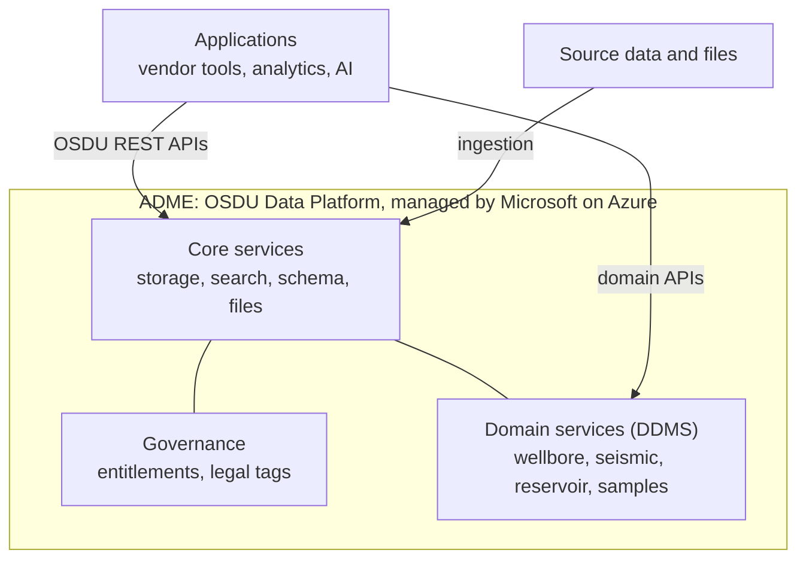

# ADME and OSDU: Learning Docs

A short, opinionated path to understanding **Azure Data Manager for Energy (ADME)**
and the **OSDU Data Platform** it runs. It's written for data, AI and software
engineers, architects and consultants who know Azure but have **no oil and gas
background**.

> **Independent learning notes.** These docs aren't official Microsoft
> documentation and aren't supported by Microsoft. Facts are as of October 2026
> (ADME on OSDU milestone M26) and change over time. Always confirm against
> [Microsoft Learn](https://learn.microsoft.com/azure/energy-data-services/) and
> the [OSDU community documentation](https://community.opengroup.org/osdu).

## The idea in one picture

- **OSDU** is the industry standard: a shared data model, APIs and an open-source
  platform.
- **ADME** is Microsoft's managed service that runs that platform on Azure.
- Every piece of data is a **JSON record** with a type (`kind`), an access list
  and a legal tag. Large files are attached to records as datasets.

## Sections and order

Read the sections in this order. Each builds on the one before it.

| Step | Section | What it's for |
|---|---|---|
| 1 | [Fundamentals](#reading-path-fundamentals) | Understand what ADME and OSDU are, what's inside, and how data goes in and comes out |
| 2 | [Data governance](#reading-path-data-governance) | Decide how the platform is organised before the first load: partitions, access, legal tags, schemas, identities, data quality |

More sections will follow.

Each doc starts with a TL;DR and ends with links to official sources for going
deeper.

## Reading path: fundamentals

Read the docs in order.

| # | Doc | You will understand |
|---|---|---|
| 01 | [Why OSDU and ADME](fundamentals/01-why-osdu-and-adme.md) | The problem, OSDU vs ADME, what you gain, who owns what |
| 02 | [Energy domain primer](fundamentals/02-energy-domain-primer.md) | Just enough oil and gas vocabulary to read OSDU schemas |
| 03 | [Data model](fundamentals/03-data-model.md) | The record structure, entity categories, schemas, reference data |
| 04 | [Entities and files](fundamentals/04-entities-and-files.md) | The main entities, their key fields, and how files are represented |
| 05 | [Platform services](fundamentals/05-platform-services.md) | Which services exist, which are OSDU and which are ADME-specific |
| 06 | [DDMS and extensions](fundamentals/06-ddms-and-extensions.md) | What's mandatory, what's optional, and what's not in ADME |
| 07 | [What goes in, what comes out](fundamentals/07-what-goes-in-what-comes-out.md) | What ADME needs before it accepts data, and what you get back |
| 08 | [Analytics and AI](fundamentals/08-analytics-and-ai.md) | Moving data to Fabric, Databricks and alternatives; ML and generative AI on ADME data |
| 09 | [Use cases and applications](fundamentals/09-use-cases-and-applications.md) | What operators do with ADME, who uses it, the vendor application ecosystem |
| 10 | [From zero to data](fundamentals/10-from-zero-to-data.md) | The end-to-end path: what to do in Azure, inside ADME and in your tooling, in order |
| — | [Glossary](fundamentals/glossary.md) | One-line definitions of the terms used in these docs |

## Reading path: data governance

For data managers, data architects and platform owners who design and run an
ADME data platform. Read the fundamentals first.

This section is about **how ADME implements governance**: the boundaries,
access rules, legal tags, data standards, identities and quality checks you
set up inside ADME. It doesn't cover data governance in general (policies,
organisation, enterprise catalogues).

| # | Doc | You will understand |
|---|---|---|
| DG-01 | [Partitions and environments](data-governance/01-partitions-and-environments.md) | When to use an ACL scope, a partition or a separate instance; dev/test/prod; naming |
| DG-02 | [Access design: groups and ACLs](data-governance/02-access-design.md) | Designing data scopes, team groups and delegation; ACLs on every record; groups as code |
| DG-03 | [Legal tags](data-governance/03-legal-tags.md) | Designing and naming tags, restricted countries, expiry, derived data |
| DG-04 | [Schemas and reference data](data-governance/04-schemas-and-reference-data.md) | Schema versions, extensions and side-cars, custom kinds, upgrades, managing reference values |
| DG-05 | [Identity, naming and versioning](data-governance/05-identity-naming-and-versioning.md) | Stable IDs, source identifiers, re-runs, versions, duplicates, deletions |
| DG-06 | [Data quality and stewardship](data-governance/06-data-quality-and-stewardship.md) | Quality gates, recording quality on records, reconciliation, KPIs, roles |

## Conventions

- Facts that change over time are stamped with a date or OSDU milestone. ADME
  was on **M26** in October 2026.
- **Go deeper** links point to official or primary sources: Microsoft (Learn,
  product pages, customer stories), The Open Group and the OSDU community,
  standards bodies (IOGP/EPSG), and companies' own publications.
- **Check:** marks a statement that public sources don't fully confirm. Verify
  it on your own instance before relying on it.
- When a doc and the live service disagree, trust the service and your instance's
  API definition, and fix the doc.

## Trademarks

OSDU® is a trademark of The Open Group. Microsoft, Azure, Microsoft Fabric and
Azure Data Manager for Energy are trademarks of the Microsoft group of
companies. Other names may be trademarks of their respective owners. Customer
examples are summarised from the public sources linked in the docs.
