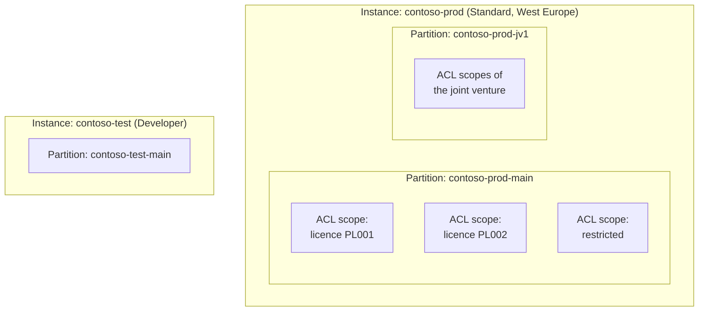
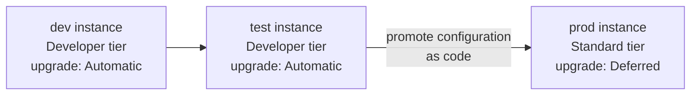

# DG-01 · Partitions and Environments

> **Facts as of:** October 2026 (ADME on OSDU milestone M26). This doc helps you
> decide **how to split** your data and environments, before any group, legal
> tag or record exists.

## TL;DR

- You have **three levels of separation**:
  - **instance**: a separate ADME resource;
  - **data partition**: inside an instance;
  - **ACL scope**: data groups inside a partition.

  Use the **lightest level that meets the requirement**.
- **Default:** one production instance with **one partition**. Separate
  confidentiality, licences and teams with **ACL scopes**.
- Use a **separate partition** only when data or its administrators must be
  **fully isolated**. Partitions are **permanent**: they can't be renamed or
  deleted, there are at most 5 (Developer) or 10 (Standard), and each one after
  the first costs extra.
- Use a **separate instance** for **production vs non-production** (dev and
  test may share one non-production instance), and for different **regions**
  (data residency), tiers, network or encryption requirements.
- Treat everything you configure inside a partition as **code**, so you can
  repeat it per partition and promote it from test to production.

## 1. Three levels of separation



| Level | Isolates | Cost and effort | Typical reason |
|---|---|---|---|
| **ACL scope** (data groups) | Who can see and change which **records** | None; change at any time | Confidentiality, licences, teams, partners within the same governance |
| **Data partition** | **Everything**: records, groups, admins, legal tags, reference values, custom schemas | Extra fee; permanent; repeated setup | A separate legal entity or joint venture, or a separate admin team that must never overlap |
| **Instance** | Also region, network, encryption keys, tier, upgrade timing | Full instance fee; separate operations | Environments, data residency, network or key isolation |

**Why a partition isolates more than ACLs:**
- Entitlement groups exist **per partition**, including the admin groups and
  `users.data.root`.
- An admin of one partition has **no** rights in another.
- Inside a partition, `users.data.root` can see all data whatever the ACLs say,
  and the partition's admins control the group memberships the ACLs rely on.

## 2. What is set per instance, and what per partition

| Set once per **instance** (shared by all its partitions) | Set per **partition** |
|---|---|
| Region and geography (data residency); disaster recovery pairing | Entitlement groups and memberships, including admins |
| Tier: SLA, availability zones, throughput | Legal tags (names are prefixed with the partition ID) |
| The app ID that owns all groups | Reference values: FIXED/OPEN sync, your LOCAL values and extensions |
| Networking (public / Private Link), CORS | Custom schemas (INTERNAL scope); OSDU well-known schemas are shared |
| Encryption (Microsoft- or customer-managed keys), Lockbox | Records, files, DDMS data; Seismic tenant registration |
| Upgrade policy and OSDU milestone | ACZ exports (up to 3 per partition) |
| Base fee | Extra fee for each partition after the first |

Every API call names **one** partition in the `data-partition-id` header,
using its **partition ID**. Microsoft Learn says ADME prefixes the name you
choose with the instance name (`<instance>-<partition>`, for example
`medstest-dp1`). Don't build the ID yourself. Use exactly the ID the instance
lists: the portal's **Data Partitions** page, or `properties.dataPartitionNames`
on the resource. Search, Storage and ingestion checks therefore work within one
partition at a time. An application that spans partitions must query
each one and combine the results itself, and you shouldn't rely on references
between records in different partitions.

## 3. Deciding: ACL scope, partition or instance?

Go through the questions in order and stop at the first "yes":

| # | Question | If yes |
|---|---|---|
| 1 | Is it **production vs non-production**? | **Separate instance** for production. Dev and test may share one non-production instance as partitions (§4). |
| 2 | Must the data stay in a **different geography**, or need different **network or encryption-key** isolation? | **Separate instance** |
| 3 | Must the data be invisible even to **this partition's administrators**, for example a separate legal entity or a joint venture that requires its own admins? | **Separate partition** |
| 4 | Does it need its **own reference-value lists** or **own custom schemas** that would conflict? | **Separate partition** |
| 5 | Is the difference confidentiality, licence, team, project or partner access? | **ACL scope** in the existing partition ([DG-02](02-access-design.md)) |

**Don't use partitions** for things that change over time, such as projects,
teams, studies or temporary partners. You'd run into the limit of 10, and you
can't delete them.

## 4. Environments



Dev and test can also be two partitions of one non-production instance; see
below.

- **Tiers:** use the Developer tier for dev and test; Microsoft positions it for
  testing, proofs of concept and training. Use the Standard tier for production
  (SLA, availability zones, disaster recovery).
- **Upgrades:** set non-production instances to **Automatic** and production to
  **Deferred**. You then get up to 30 days to test each new milestone before it
  reaches production.
- **Promote configuration, not data.** Keep these in source control and apply
  them to each environment with scripts:
  - entitlement groups (members differ per environment);
  - legal tags;
  - custom schemas;
  - LOCAL reference values and extensions;
  - ACZ and pipeline settings.
- **Data per environment:**
  - production data is loaded by the production pipelines;
  - non-production uses synthetic data or approved subsets. Copying real data
    into dev or test is subject to the same legal and confidentiality rules.
- **Subscription and resource group:** choose them carefully. An instance can't
  be moved; you'd have to re-create it and reload the data.

**Can environments be partitions of one instance?** Technically yes, but
**production should always have its own instance.** These are shared by all
partitions of an instance:
- **milestone upgrades:** every partition upgrades at once, so you can't test
  first;
- **capacity:** a load test in dev slows down prod;
- **the instance app**, which owns every group in every partition;
- **network, keys and Azure-side access.**

On top of that, a test partition can't be deleted and recreated. A common
compromise:

```text
contoso-prod     (Standard)    → partition: main         production only
contoso-nonprod  (Developer)   → partitions: dev, test   shared non-production
```

Dev and test then upgrade together, which is usually acceptable.

## 5. Naming

- **Partition names:**
  - 1–10 characters;
  - lowercase letters, digits and hyphens;
  - must start with a letter or digit, with no consecutive hyphens;
  - **permanent**.

  Prefer stable, neutral names (`main`, `jv1`), not project or team names.
- **Keep partition names the same across environments**, for example `main`
  in every instance. The full IDs then differ only by the instance prefix
  (`contoso-dev-main`, `contoso-prod-main`). If dev and test share one
  instance, their partitions need different names (`contoso-nonprod-dev`,
  `contoso-nonprod-test`); keep production's name stable.
- **Parametrise the partition ID** in all configuration. It appears in:
  - the `data-partition-id` header;
  - group emails (`data.wells.viewers@contoso-prod-main.dataservices.energy`);
  - legal tag names (`contoso-prod-main-…`);
  - record IDs (`contoso-prod-main:master-data--Well:…`).

## 6. Setting up a new partition: checklist

A new partition starts empty. Before loading data:

1. Add the first admins with the instance app's token.
2. Create the groups and memberships ([DG-02](02-access-design.md)).
3. Create the legal tags ([DG-03](03-legal-tags.md)).
4. Register any custom schemas, and load LOCAL reference values and extensions
   ([DG-04](04-schemas-and-reference-data.md)).
5. Register the partition as a **Seismic tenant** if you'll use seismic data.
6. Configure ACZ exports and monitoring if needed.

## Common mistakes

- **One partition per team or project.** You hit the limit, can't clean up, and
  lose search across the data. Use ACL scopes.
- **Using partitions for confidentiality tiers.** ACL scopes do this more
  cheaply and flexibly.
- **Casual partition names.** They're permanent and appear in every ID, group
  and legal tag.
- **Hard-coding the partition ID** in pipelines and scripts. It blocks
  promotion between environments.
- **Testing a new milestone in production.** Defer production upgrades and test
  on a non-production instance first.

## Go deeper

- [Manage data partitions](https://learn.microsoft.com/azure/energy-data-services/how-to-add-more-data-partitions) (Microsoft Learn)
- [ADME tiers](https://learn.microsoft.com/azure/energy-data-services/concepts-tier-details) and [reliability and disaster recovery](https://learn.microsoft.com/azure/energy-data-services/reliability-energy-data-services) (Microsoft Learn)
- [Manage upgrade settings](https://learn.microsoft.com/azure/energy-data-services/how-to-manage-upgrade-settings) (Microsoft Learn)
- [FAQ: data residency, pricing, moving resources](https://learn.microsoft.com/azure/energy-data-services/faq-energy-data-services) (Microsoft Learn)
- [Create an instance (quickstart)](https://learn.microsoft.com/azure/energy-data-services/quickstart-create-microsoft-energy-data-services-instance) (Microsoft Learn)
