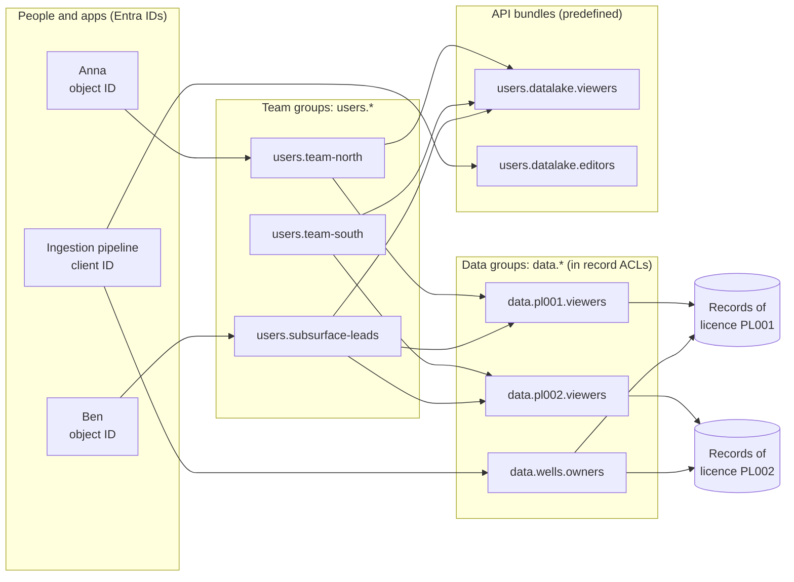

# DG-02 · Access Design: Groups and ACLs

> **Facts as of:** October 2026 (ADME on OSDU milestone M26). Builds on
> [fundamentals 05 §4](../fundamentals/05-platform-services.md#who-may-do-what-the-three-kinds-of-groups)
> (the kinds of groups, predefined groups, how membership works). This doc is about
> **designing** access and running it over time.

## TL;DR

- You work with **three kinds of groups**:
  - **API bundles** (predefined `users.datalake.*`): *what* you can do;
  - **team groups** (your `users.*`): *who* you are;
  - **data groups** (your `data.*`, written into record ACLs): *which records*.

  People and apps join team groups, and team groups are **nested** into
  bundles and data groups.
- Data groups describe **data scopes**; team groups describe **people**.
- Name data groups after a **stable business reason** (licence, joint venture,
  confidentiality), never after individual wells, projects or people.
- Every record carries its **own** `acl`, and **nothing is inherited**. Your
  ingestion rules must give a well's wellbores, logs, files and documents the
  same scope as the well.
- Changing **who** has access is a membership change: quick, no record changes.
  Changing **which records** a scope covers means a batch `acl` update. So get
  the scopes right first.
- Keep groups and memberships in **source control** and apply them with scripts
  to each partition and environment.

## 1. The three-layer pattern



- **Data groups** change rarely. They follow the structure of the business,
  which is why it's safe to write them into thousands of records.
- **Team groups** change often (joiners, movers, leavers). Membership changes
  never touch records.
- **Nesting:** a team group can be a member of a data group **and** of an API
  bundle. Adding Anna to `users.team-north` then gives her the team's API
  permissions and everything the team can see, in one step. She still needs her
  own `users@<partition>` membership.

What each kind of group is, and the full list of predefined groups, is in
[fundamentals 05 §4](../fundamentals/05-platform-services.md#who-may-do-what-the-three-kinds-of-groups).
This doc covers how to **design** them.

### People: individual identities or Entra ID groups

- **Classic model** (documented on Microsoft Learn): you add **individual
  identities**, a person's Entra **object ID** or an app's **client ID**. Team
  structure lives inside ADME as nested OSDU groups, often kept in sync with
  Entra groups by your own automation.
- **Newer option: Entra ID groups authorization.** Microsoft is enabling Entra ID
  groups to be used directly in ADME entitlements, so you manage membership in
  **one place**, Entra ID. It needs a one-time **migration** in your tenant: run
  Microsoft's scripts, which switch to a replacement Microsoft application, then
  update your client app registrations. **Check:**
  - the exact way to add a group and its limits (nesting, delay);
  - its general-availability status.

  Confirm with Microsoft and test on a non-production instance before you base
  your design on it.
- Either way, the **data groups** stay in ADME. What changes is only where the
  **people** in them are managed.

## 2. Designing data scopes

| Principle | Why |
|---|---|
| **One scope per business reason** (licence, joint venture, country, confidentiality level) | Access rules usually come from contracts and policy, which are stable |
| **Owners few, viewers many**: separate `…owners` and `…viewers` groups per scope (or one shared owners group) | Owners can update and delete; most users only read |
| **Tiers as separate scopes**, for example `data.wells.viewers` and `data.wells.restricted.viewers` | Confidentiality is just another scope |
| **Avoid one group per well, project or person** | Group explosion, huge ACLs, and a limit of 5,000 group memberships per identity |
| **Don't use `data.default.*`** for anything confidential | Every user in the partition is a member of these |
| **Separate groups for your own reference values** (for example `data.referencedata-contoso.*`) | Keeps them apart from the synced OSDU values (`data.referencedata.*`) |

**Naming convention:** OSDU's guideline is `data.{resource}.{permission}`, for
example `data.pl001.viewers`, `data.pl001.owners` and `data.wells.restricted.viewers`.
Team groups follow `users.{name}`, for example `users.team-north`. The full
email adds the partition ID: `data.pl001.viewers@<partition-id>.dataservices.energy`.

## 3. Worked example: 10 wells, two scopes

Wells 1–8 are in licence PL001 and wells 9–10 in licence PL002. Most users
should see one licence; a few leads should see both.

| Group | In the `acl` of | Members |
|---|---|---|
| `data.pl001.viewers` | `viewers` of all records of wells 1–8 | `users.team-north`, `users.subsurface-leads` |
| `data.pl002.viewers` | `viewers` of all records of wells 9–10 | `users.team-south`, `users.subsurface-leads` |
| `data.wells.owners` | `owners` of all 10 wells' records | Data managers, the ingestion pipeline |

```text
Records of wells 1–8:   acl.viewers = [data.pl001.viewers]   acl.owners = [data.wells.owners]
Records of wells 9–10:  acl.viewers = [data.pl002.viewers]   acl.owners = [data.wells.owners]
```

Access adds up: being in **any** group of a record's `viewers` or `owners` is
enough, so the leads see all 10. When well 11 arrives in PL001, it simply gets
`data.pl001.viewers`, and no group or membership changes.

## 4. ACLs on every record: the propagation rule

ACLs are **per record**. A Well's ACL does **not** protect its Wellbores,
WellLogs or files. Define one rule in your pipelines: **every record belonging
to a scope gets that scope's groups.**

| Record | Takes its scope from |
|---|---|
| Well, Wellbore | The licence or confidentiality of the well |
| WellLog, WellboreTrajectory, WellboreMarkerSet | Their wellbore |
| **Dataset (file) records** | The WPC that lists them. Forget this, and files can be readable by people who can't see the log. |
| Documents | The well or area they describe, or stricter if the document itself is sensitive |
| Derived results (ML, interpretations) | **At least as strict** as their inputs |
| Seismic | Seismic DDMS subprojects carry their own ACLs (admins, viewers). Point them at the **same data groups** where possible. |

## 5. Who manages what

| Role | Membership | Can |
|---|---|---|
| **Platform admins** | `users.datalake.admins` | Create groups (they become the group's OWNER) and manage the groups they own |
| **Platform operations** | `users.datalake.ops` | Manage the membership of **any** group |
| **Data owners**, for example a licence manager | `users.datalake.viewers` + **OWNER role** on their data group | Add and remove members of **their** group: delegated access management |
| **Ingestion pipelines** | `users.datalake.editors` + `data.*.owners` of their scopes | Write records with the right ACLs. Creating a record doesn't require being in its ACL, but **updating** existing records (re-runs) and changing their ACLs does. |
| **Readers** | `users.datalake.viewers` + team groups | Search and read their scopes |
| **`users.data.root`** | Break-glass accounts only | Sees **every** record. It's automatically in every data group and can't be removed. |
| **The instance app** | OWNER of all groups | Bootstrapping only. Keep its secret locked away. |

A group's members can be managed by its OWNERs and by `users.datalake.ops`.
Making a business person OWNER of a data group lets you **delegate** that scope
to whoever is accountable for it.

## 6. Running it over time

- **Onboarding:**
  1. add the person (object ID) or app (client ID) to `users@<partition>`;
  2. add them to an API bundle, for example `users.datalake.viewers`;
  3. add them to their **team group**.
- **Moving teams:** change the team-group membership only.
- **Offboarding:** remove the identity from the partition in one call, which
  removes it from all groups. Removing it from `users@` alone fails while other
  memberships exist.
- **Changing a record's scope:** batch-update the ACLs (up to 500 records per
  call) with the Storage metadata-update API:
  - it **doesn't create a new record version**;
  - you must be a member of the groups you set;
  - an ACL can't be left empty.
- **Reviews:** list each identity's groups regularly, and check that
  `users.data.root` and the admin groups contain only who they should.

```http
PATCH /api/storage/v2/records
data-partition-id: contoso-prod-main

{ "query": { "ids": ["contoso-prod-main:master-data--Well:NO-1234"] },
  "ops": [ { "op": "replace", "path": "/acl/viewers",
             "value": ["data.pl001.viewers@contoso-prod-main.dataservices.energy"] } ] }
```

## 7. Entitlements as code

Keep a declarative file per environment in source control and apply it with a
script that calls the Entitlements API. Make the script idempotent: create what's
missing, report drift.

```yaml
# access.yaml (illustrative)
partition: contoso-prod-main
data_groups:
  - name: data.pl001.viewers
    members: [users.team-north, users.subsurface-leads]
  - name: data.pl002.viewers
    members: [users.team-south, users.subsurface-leads]
  - name: data.wells.owners
    members: [<pipeline-client-id>, users.data-managers]
team_groups:
  - name: users.team-north
    members: [<object-id-anna>, …]
```

The two calls it needs:

```http
POST /api/entitlements/v2/groups
{ "name": "data.pl001.viewers", "description": "Viewers of licence PL001 data" }

POST /api/entitlements/v2/groups/data.pl001.viewers@contoso-prod-main.dataservices.energy/members
{ "email": "users.team-north@contoso-prod-main.dataservices.energy", "role": "MEMBER" }
```

The `email` field holds a group email, a person's object ID, or an app's client
ID. Only the partition prefix and member IDs differ between environments
([DG-01 §5](01-partitions-and-environments.md#5-naming)).

## Common mistakes

- **Protecting only the Well record.** Child records and file datasets stay open,
  or stay invisible to the right people.
- **Groups per well or per person.** They don't scale, and every change means
  rewriting ACLs.
- **Putting people directly into data groups everywhere.** Team groups make
  joiners, movers and leavers one-line changes.
- **Using `data.default.viewers` for real data.** Everyone in the partition can
  read it.
- **Using `users.data.root` for daily work.** It bypasses every scope.
- **Clicking groups together by hand in each environment.** It drifts; keep
  groups as code.

## Go deeper

- [Entitlement concepts](https://learn.microsoft.com/azure/energy-data-services/concepts-entitlements), [manage users](https://learn.microsoft.com/azure/energy-data-services/how-to-manage-users) and [manage ACLs](https://learn.microsoft.com/azure/energy-data-services/how-to-manage-acls) (Microsoft Learn)
- [OSDU Entitlements API and group naming guidelines](https://community.opengroup.org/osdu/platform/security-and-compliance/entitlements/-/blob/master/docs/docs/api.md) (OSDU community)
- [OSDU bootstrap groups: what each predefined group contains](https://community.opengroup.org/osdu/platform/security-and-compliance/entitlements/-/blob/master/docs/docs/bootstrap-groups-structure.md) (OSDU community)
- [Enable Entra ID groups authorization in ADME](https://github.com/microsoft/adme-samples/blob/main/entra-id-groups-authorization/how-to-enable-entra-id-groups-authorization.md) (Microsoft, adme-samples)
- [Storage metadata-update API (changing ACLs in batch)](https://community.opengroup.org/osdu/platform/system/storage/-/blob/master/docs/docs/api.md) (OSDU community)
