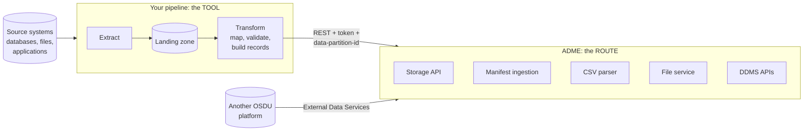
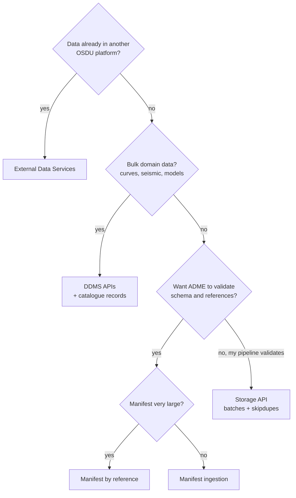

# DI-01 · Choosing a Route and a Tool

> **Facts as of:** October 2026 (ADME on OSDU milestone M26). The first decision
> for any load: **which way into ADME** (the route) and **what runs your
> pipeline** (the tool).

## TL;DR

- Every load makes **two separate choices**:
  - the **route**: the built-in way data enters ADME (Storage API, manifest
    ingestion, CSV parser, External Data Services, DDMS APIs);
  - the **tool**: what extracts, transforms and calls that route (ADF, Fabric,
    Databricks, Functions, scripts, partner products).
- **ADF and Fabric have no native ADME connector.** Your pipeline calls ADME's
  REST APIs (with an Entra token and the `data-partition-id` header), or you use
  a partner product that has its own ADME integration.
- **Route rule of thumb:**
  - curated packages → **manifest ingestion** (it validates for you);
  - high volume or frequent updates → **Storage API** (you validate);
  - bulk logs, seismic and models → **DDMS APIs**;
  - another OSDU platform → **External Data Services**.
- **Tool rule of thumb:** use what the team already runs. Spark (Fabric or
  Databricks) for heavy transformation, ADF or Fabric pipelines for scheduling
  and copying, Functions for small event-driven updates.
- Whatever you choose, every pipeline needs the same basics: a landing zone,
  a mapping specification, an ID mapping table, retries, quarantine and
  reconciliation.

## 1. Route vs tool

The tool lives **outside** ADME and is your responsibility. The route is
OSDU's, and ADME runs it.

## 2. The routes

| Route | You send | ADME checks | Good for | Watch out |
|---|---|---|---|---|
| **Storage API** | Records in batches (`PUT /api/storage/v2/records`) | Envelope only: permissions, ID and kind format, ACL format (not that groups exist), legal tags | High volume, frequent updates, pipelines that validate themselves | No schema or reference validation; use `skipdupes=true` for re-runs |
| **Manifest ingestion** (`Osdu_ingest`) | A manifest: reference data, master data, datasets, WPCs | **Schema, references, dataset existence**; bad records are skipped, listed only in the Airflow logs, and the run still reports `finished` | Curated packages; first loads; data from partners | Asynchronous (poll run status); split large loads into several manifests |
| **Manifest by reference** | A large manifest uploaded as a file, then referenced | Same as manifest ingestion | Very large manifests | Same as above |
| **CSV parser** (`csv-parser` workflow) | A CSV file through the File service, plus a file record naming the **target kind** | Converts values to the types in the target kind's schema (well-known or custom; it must already be registered) | Tabular extracts with one row per record | One kind per file; column names must match schema fields (nested as `A.B`, arrays as `A.[0].B`); asynchronous |
| **File service** | File bytes (signed URL) + a dataset record | Upload and registration | Single files: LAS, DLIS, PDF, CSV, images… | Bytes and records are separate steps. Seismic (SEG-Y) goes to the Seismic DDMS instead |
| **DDMS APIs** | Domain bulk data: curves, seismic, RESQML | The DDMS's own rules plus access and legal checks | Bulk well logs (Wellbore), seismic volumes (Seismic, `sdutil`), models (Reservoir, ETP) | Each DDMS has its own API |
| **External Data Services (EDS)** | Registration of another OSDU platform | Pulls **metadata** on a schedule; files stay at the source | Federating with partners or another OSDU instance | Metadata only. **Check:** how deletions at the source are handled |

## 3. Choosing a route

- **Files** always go through the File service (or a DDMS), whatever route the
  records take.
- **Mixing routes is normal.** For example, a first load uses manifests, and the
  daily updates afterwards use the Storage API. Bulk curves go to the Wellbore
  DDMS while their WellLog records go through a manifest.
- **The CSV parser** runs inside ADME as an Airflow workflow; you trigger it
  through the Workflow API. It suits tables that are already shaped as one row
  per record with schema field names. Anything that needs real transformation
  (joins, unit or code lookups) belongs in your pipeline first.

## 4. The tools

| Tool | Strengths | Limits | Typical role |
|---|---|---|---|
| **Azure Data Factory / Fabric Data Factory pipelines** | Scheduling, copying from hundreds of sources, monitoring, low code; Web activity calls REST with a managed identity | Weak at complex transformation and record building; no OSDU connector | Orchestration: extract to a landing zone, call notebooks or Functions, call ADME APIs |
| **Fabric notebooks (Spark)** | Transformation at scale, Python, close to OneLake and Power BI | Spark start-up overhead for small jobs | Map and build records, batch-call the APIs, reconcile |
| **Azure Databricks** | The same, with Unity Catalog and mature job tooling | Separate platform to run and pay for | As Fabric notebooks, if Databricks is the customer's standard |
| **Azure Functions / Container Apps** | Event-driven, cheap for small workloads, any language | Time and memory limits; you build orchestration | Small, frequent updates triggered by source events; API wrappers |
| **Scripts with the OSDU Python SDK** (`osdu-api`) | Community SDK for the core services; fast to start | You run, schedule and monitor it yourself | Development, tests, one-off loads, admin tasks |
| **Microsoft's TNO data loader** (`Azure/osdu-data-load-tno`) | A complete reference for loading OSDU's open test data into ADME with manifests | Built for that dataset, not a general product | Learning and reference implementation |
| **Partner products and domain applications** | Ready-made loaders, data management and quality tools; applications such as Petrel (through Petrel Data Services) read and write directly | Licences; less control | When the customer already uses them |

**Authentication from these tools:**
- use a **user-assigned managed identity** (ADME doesn't support system-assigned
  ones) or a **service principal**;
- request the caller's own token with the **ADME instance's application ID**
  as its audience (scope `<app ID>/.default`);
- add the identity to `users@<partition>` and the right groups inside ADME.

[DI-02](02-authentication.md) covers the details.

## 5. Common combinations

| Scenario | Route | Tools |
|---|---|---|
| **One-off migration** of a legacy well database and its files | File service + manifests (or Storage API with your own validation) | ADF or Fabric pipeline to extract into a landing zone; Spark notebooks to map and build records; reconciliation notebook |
| **Ongoing daily feed** from a source system | Storage API with `skipdupes=true` | Scheduled ADF/Fabric pipeline → notebook → Storage API |
| **Event-driven updates** (a well status changes) | Storage API | Function triggered by the source's event or message |
| **Log and seismic libraries** | Wellbore DDMS, Seismic DDMS (`sdutil`), conversion workflows | Scripts or notebooks; vendor tools |
| **Partner's OSDU platform** | External Data Services | ADME configuration only |

## 6. What every pipeline needs, whatever the tool

- **Landing zone:** an immutable copy of each extract, so you can replay a load
  without going back to the source.
- **Mapping specification:** source field → kind, field, unit, CRS, reference
  value; under version control.
- **ID mapping table:** source key → OSDU ID, for re-runs and reconciliation.
- **Batching, retries and backoff:** handle HTTP 429 and 5xx, and refresh tokens
  during long runs.
- **Quarantine:** records that fail a check are set aside with a reason, never
  loaded with guessed values.
- **Run log and reconciliation:** what was sent, accepted, skipped, indexed and
  searchable.

[DI-03](03-source-analysis-and-mapping.md) to [DI-06](06-validation-reconciliation-and-monitoring.md) cover these in detail.

## Common mistakes

- **Looking for a native ADME connector in ADF or Fabric.** There isn't one;
  plan for REST calls (or a partner product's own integration).
- **Choosing the tool first and the route by accident.** Decide the route
  (validation, volume, data type) first.
- **One giant manifest.** Split it, or use manifest by reference.
- **Direct Storage writes without your own validation.** Bad data goes in
  silently.
- **A system-assigned managed identity.** ADME doesn't accept it; use a
  user-assigned one.
- **No landing zone.** Every re-run has to hit the source again.

## Go deeper

- [Manifest-based ingestion](https://learn.microsoft.com/azure/energy-data-services/concepts-manifest-ingestion) and [CSV parser ingestion](https://learn.microsoft.com/azure/energy-data-services/tutorial-csv-ingestion) (Microsoft Learn)
- [Use managed identities with ADME](https://learn.microsoft.com/azure/energy-data-services/how-to-use-managed-identity) (Microsoft Learn)
- [External Data Services](https://learn.microsoft.com/azure/energy-data-services/how-to-enable-external-data-services) (Microsoft Learn)
- [ADF Web activity (REST calls with managed identity)](https://learn.microsoft.com/azure/data-factory/control-flow-web-activity) and [ADF REST connector](https://learn.microsoft.com/azure/data-factory/connector-rest) (Microsoft Learn)
- [OSDU common Python SDK](https://community.opengroup.org/osdu/platform/system/sdks/common-python-sdk) (OSDU community)
- [Microsoft's TNO open-test-data loader for ADME](https://github.com/Azure/osdu-data-load-tno) (Microsoft)
