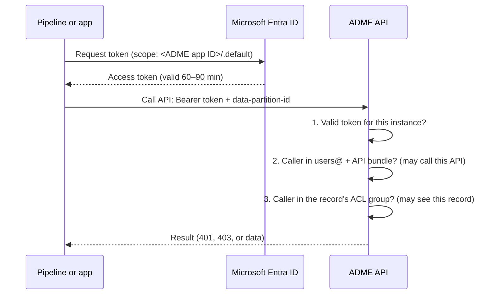

# DI-02 · Authentication for Pipelines and Apps

> **Facts as of:** October 2026 (ADME on OSDU milestone M26). How a pipeline,
> script or application proves who it is to ADME, and how it gets permission
> to do anything.

## TL;DR

- Every ADME API call needs **three things**:
  - an **Entra ID access token of the caller** (a user, managed identity or
    service principal), requested **for ADME**: its target (audience) is the
    ADME instance's application (client) ID, unless the instance has moved to
    the shared audience (§6);
  - the **`data-partition-id`** header;
  - an identity that is a **member of the right OSDU groups** in that partition.
- **Don't run pipelines with the instance's own app ID and secret.** That app is
  OWNER of every OSDU group, so its token is a master key. Use it only to add
  the first admins.
- **Give each pipeline its own identity:**
  - Azure-hosted compute (Functions, Container Apps, ADF): a **user-assigned
    managed identity**. ADME doesn't support system-assigned ones.
  - Where managed identities don't fit (Fabric notebooks, Databricks, on-premises):
    a **service principal**, with its secret or certificate in Key Vault.
- **Register the identity in ADME:** add its **application ID** (not its object
  ID) to `users@<partition>`, an API bundle and the data groups it needs.
- **Apps that act for a signed-in user** call ADME with the **user's** identity
  (on-behalf-of flow), so that the user's own ACLs apply.

## 1. What happens on every call

A token answers two questions, and they have different answers:

| Question | Token claim | When calling ADME |
|---|---|---|
| **Who is calling?** | `oid` (users) / `appid` or `azp` (apps) | **The caller itself**: you, a managed identity or a service principal |
| **Which service is the token for?** | `aud` (audience) | **The ADME instance's app ID** (or the shared audience, §6) |

You never send "the ADME app's token". You send **your own** token, made out
to ADME. ADME accepts it because the audience matches, then looks up the
caller in its groups.



- **401** means the token is wrong (expired, or the wrong audience).
- **403** means the token is fine but the identity lacks the group for that
  API, or the `data-partition-id` is wrong.
- In search results, records you aren't allowed to see **simply don't appear**,
  with no error. Fetching such a record by ID returns 403 or 404.

The headers are the same for every service:

```http
POST https://<instance>.energy.azure.com/api/search/v2/query
Authorization: Bearer <token>
data-partition-id: <partition>
Content-Type: application/json
```

## 2. The instance app ID: a master key

When you create an ADME instance, you give it an **app registration** (one per
instance).

- Users request their tokens for this app ID, so it's the **audience** of every
  token.
- The app itself is **OWNER of all OSDU groups** in every partition. A token from
  its client ID and secret, where the ADME app is **both caller and audience**,
  can do everything in the data plane.
- Microsoft's own guide uses this token **once**, to add the first admins to
  `users@` and `users.datalake.ops`. From then on, admins use their own tokens.

Treat its secret like a root password: Key Vault, a few named people, rotation,
and **never** in pipeline configuration.

## 3. Which identity for which caller

| Caller | Identity | How it gets a token |
|---|---|---|
| Azure Functions, Container Apps, App Service, VMs | **User-assigned managed identity** | `ManagedIdentityCredential(client_id=…)` from `azure-identity` |
| AKS workloads | User-assigned managed identity via **workload identity** | `WorkloadIdentityCredential` (or `DefaultAzureCredential`) from `azure-identity` |
| Azure Data Factory / Synapse pipelines | **User-assigned managed identity** (an ADF credential) | Web activity: authentication *User-assigned managed identity*, resource = ADME app ID |
| Fabric notebooks | **Service principal** (secret from Key Vault) | `ClientSecretCredential`; Fabric's own `getToken()` only covers a fixed list of audiences, and ADME isn't one of them |
| Azure Databricks | **Service principal** (secret in a Key Vault-backed secret scope) | `ClientSecretCredential` or `CertificateCredential` |
| GitHub Actions, Azure DevOps | Service principal with **federated credentials** (no secret) | The pipeline's Azure login task, then request the token |
| A person running scripts, Postman, notebooks | **Their own user account** | Interactive sign-in (authorisation-code flow) |
| Web app or AI agent acting for a user | **The signed-in user**, through the app | On-behalf-of flow (§5) |

**Prerequisite for the Azure CLI:** getting ADME tokens with
`az account get-access-token --resource <ADME app ID>` only works if the ADME
app registration exposes a delegated scope and pre-authorises, or has consented
to, the Azure CLI. If it fails, ask the owner of the app registration.

**Rules that apply to all of them:**
- **One identity per pipeline or app,** not one shared "integration" account.
  Audit logs then tell you who wrote what, and you can revoke one without
  breaking the others.
- **Separate identities per environment** (dev, test, prod). A dev pipeline
  then can't write to production by mistake.

## 4. Getting a token and giving access

**A managed identity in Python** (Functions, Container Apps, VMs):

```python
from azure.identity import ManagedIdentityCredential
import requests

ADME = "https://<instance>.energy.azure.com"
ADME_APP_ID = "<ADME instance application (client) ID>"

cred = ManagedIdentityCredential(client_id="<client ID of the user-assigned identity>")
token = cred.get_token(f"{ADME_APP_ID}/.default").token  # cached; call before each batch

r = requests.post(f"{ADME}/api/search/v2/query",
    headers={"Authorization": f"Bearer {token}", "data-partition-id": "<partition>"},
    json={"kind": "osdu:wks:master-data--Well:*", "limit": 10}, timeout=60)
r.raise_for_status()
```

For a service principal, swap the first line for `ClientSecretCredential(tenant_id,
client_id, client_secret)` or `CertificateCredential`. The scope stays the same.

**Giving the identity access:** an admin adds it to groups through the
Entitlements API. An admin here means an OWNER of the group, or a member of
`users.datalake.ops`.

```http
POST /api/entitlements/v2/groups/users@<partition>.dataservices.energy/members
{ "email": "<application ID of the identity>", "role": "MEMBER" }
```

Repeat the call for each group:

| Group | Why |
|---|---|
| `users@<partition>` | Always first: "member of this partition" |
| `users.datalake.editors` (write) or `users.datalake.viewers` (read) | The API bundle: which APIs it may call |
| The `data.*` groups it reads or writes | Which records it may see or own |

- **Which ID to add:** ADME compares the ID **in the caller's token** with
  its group members. Apps and managed identities have two GUIDs, and only one
  of them is in the token. Email addresses don't work.

  | Who | Add by | Where to find it | In the token as |
  |---|---|---|---|
  | User | **Object ID** | Entra ID → Users → Object ID | `oid` |
  | Managed identity | **Client ID** (not the object/principal ID) | Managed identity → Overview → Client ID | `appid` (v1) / `azp` (v2) |
  | Service principal | **Application (client) ID** | App registrations → Application (client) ID | `appid` (v1) / `azp` (v2) |
- **Writing records:** the identity must be in the groups it puts in the
  records' ACLs. Otherwise it may be able to create records it can't read or
  update afterwards.

## 5. Apps that act for a user

Portals, Power BI back ends and AI agents should not read ADME with **their
own** identity. If they did, every user would see whatever the app can see.
Instead:

1. The user signs in to the app.
2. The app's back end swaps the user's token for an ADME token for **the same
   user**, using the Entra **on-behalf-of (OBO)** flow.
3. ADME applies **that user's** groups and ACLs.

**Prerequisite for OBO:** the ADME app registration must expose a delegated
scope, and your app must have consent for it. Agree the setup with whoever owns
the ADME app registration.

**Browser-only apps** (single-page apps) call ADME directly from the browser, so
the instance's **CORS** allowed origins must include the app's domain. If no
CORS settings are made, ADME allows all origins (`*`); restrict this in
production.

## 6. The alternative mode: shared audience and Entra ID groups

**Entra ID groups authorization** is a second authentication mode: OSDU
entitlement groups can then contain Entra ID security groups, not just
individual identities. An instance uses one mode or the other, so find out
which one yours uses before you write token code.

- It uses a **shared Microsoft audience**, `https://energy.azure.com`, instead
  of the per-instance app ID.
- Client apps then need the **`ADME.ApplicationAccess`** app role (app-only
  calls) or the **`access_as_user`** delegated scope (user calls), with admin
  consent.
- Microsoft publishes a migration guide and scripts in `microsoft/adme-samples`.
  It requires an Entra Application Administrator or a higher role.

**Check:** availability and GA status for your instance before you design around
it. Until your tenant migrates, use the per-instance app ID as described above.

## 7. Secrets and token hygiene

- **Secrets:** prefer managed identities, then federated credentials, then
  certificates, and client secrets last. Keep secrets and certificates in Key
  Vault, and track their expiry dates.
- **Tokens:** they expire after 60–90 minutes. Request a token from the
  credential before each batch (it's cached) rather than once at the start of
  a five-hour load.
- **Never** log tokens, paste them into tickets, or commit them.
- **Never** turn off TLS checks (`verify=False`), even though some samples do.
- **Least privilege:** use the viewers bundle for read-only consumers, and
  editors only for pipelines that write. Keep `users.datalake.ops` and
  `users.data.root` for named admins.

## Common mistakes

- **Using the instance app's secret in a pipeline.** It works, which is exactly
  the problem: the pipeline becomes all-powerful and untraceable.
- **A system-assigned managed identity.** ADME doesn't support it; use a
  user-assigned one.
- **Adding a managed identity or app by its object ID.** The portal shows two
  GUIDs for it: *Client ID* and *Object (principal) ID*. Its token carries the
  client ID, so add that one. With the object ID, the add call succeeds but
  every API call fails.
- **Requesting the token for the wrong audience.** For example
  `https://management.azure.com` gives you a 401.
- **Forgetting `users@<partition>`.** Without it, every other group membership
  is useless.
- **One shared service account for every integration.** You lose the audit trail,
  and a single leak exposes everything.
- **AI agents that query with their own identity.** Use on-behalf-of so that
  users only see what they're entitled to.

## Go deeper

- [Authentication concepts](https://learn.microsoft.com/azure/energy-data-services/concepts-authentication) and [Generate an auth token](https://learn.microsoft.com/azure/energy-data-services/how-to-generate-auth-token) (Microsoft Learn)
- [Use managed identities with ADME](https://learn.microsoft.com/azure/energy-data-services/how-to-use-managed-identity) (Microsoft Learn)
- [Manage users](https://learn.microsoft.com/azure/energy-data-services/how-to-manage-users) (Microsoft Learn)
- [Enable Entra ID groups authorization](https://github.com/microsoft/adme-samples/blob/main/entra-id-groups-authorization/how-to-enable-entra-id-groups-authorization.md) (Microsoft adme-samples)
- [On-behalf-of flow](https://learn.microsoft.com/entra/identity-platform/v2-oauth2-on-behalf-of-flow) and [access token lifetime](https://learn.microsoft.com/entra/identity-platform/access-tokens) (Microsoft identity platform)
- [Azure Identity library for Python](https://learn.microsoft.com/python/api/overview/azure/identity-readme) (Microsoft Learn)
