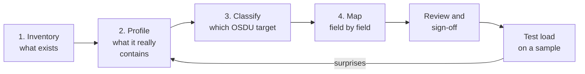

# DI-03 · Source Analysis and Mapping

> **Facts as of:** October 2026 (ADME on OSDU milestone M26). What to find out
> about a source before loading anything, and how to write the mapping that
> your pipeline will implement.

## TL;DR

- **Analyse before you build.** Most failed loads trace back to a source that
  nobody profiled, not to a bug in the pipeline.
- **Four steps:**
  1. inventory the sources;
  2. profile them: structure, meaning, relationships;
  3. classify every item into an OSDU target;
  4. write a **mapping specification**: one row per source field, with the
     transformation, the target path, the check and what happens on failure.
- **The mapping spec is code's twin.** Keep it under version control, version
  it with the pipeline code, and have the data owner sign it off.
- **Unknown beats wrong.** Never invent a value to satisfy a schema: no default
  CRS, no guessed unit, no "Active" for an unknown status code. Leave the value
  out, or quarantine the record.
- Watch for these, which are hard to spot:
  - coordinates without a CRS;
  - depths without a unit or reference point;
  - ambiguous date formats;
  - status codes without a dictionary;
  - access rules that live in someone's head.

## 1. The process

Expect to loop: the first test load almost always reveals something the
profile missed.

## 2. Inventory: what to capture per source

| Area | Questions |
|---|---|
| **Ownership** | Who owns the system? Who can explain what the data means? Who signs off? |
| **Technology and access** | Database, API, file share or export? How do we read it, and how often? |
| **Scope and volume** | Which tables and files? How many rows? How many gigabytes or terabytes of files? |
| **Change pattern** | Static archive, periodic updates, or continuously changing? Can we detect changes? |
| **Identity** | What is the primary key? Is it stable, unique and never reused? Which other systems' IDs are stored? |
| **Relationships** | Well → wellbore → log: are links stored as keys, by name, or not at all? |
| **Meaning** | Units, CRS, depth references, code lists, date formats, time zones |
| **Governance** | Confidentiality, partner and licence restrictions, country of origin, personal data |
| **Known problems** | What do users already work around? |

The last row is often the most valuable. Ask the people who use the data
daily.

## 3. Profile at three levels

| Level | Question | Typical findings in E&P data |
|---|---|---|
| **Structural** | Is it shaped as documented? | Numbers stored as text, mixed date formats, empty mandatory columns, duplicate keys, files listed but missing |
| **Semantic** | Does it mean what the label says? | Latitude and longitude swapped; a mix of feet and metres in one column; depths relative to different reference points (kelly bushing vs sea level); "0" meaning unknown; undocumented status codes |
| **Relational** | Do the links hold? | Wellbores without a well; logs pointing to deleted wellbores; one well under two names; LAS file headers disagreeing with the database |

A value can be **structurally valid and semantically wrong**: a well at
latitude 4.5, longitude 60.1 passes every type check but sits in the
wrong ocean.

**Profile the whole source, not a sample.** The problem cases are the rare
ones.

## 4. Classify: which OSDU target?

Sort every source item before thinking about JSON:

| Source item | OSDU target | Example |
|---|---|---|
| Rows describing real-world objects | **Master data** | `WELLS` table → `master-data--Well` |
| Code lists and dictionaries | **Reference data**: map to existing values, or add your own | Status codes → `WellStatusSummary` |
| Rows describing data products | **Work-product-components** | A logs table → `WellLog` |
| Files | **Datasets** (+ the WPC that describes them) | `.las` → `dataset--File.Generic` + `WellLog` |
| Bulk measurements | A **DDMS** where one exists | Log curves → Wellbore DDMS |
| Access and legal information | **ACL groups and legal tags** on every record | An `ACCESS` table → `data.*` groups |
| Problems found by profiling | **Quality rules**: fix, quarantine or accept | Duplicate `WELL_ID`, missing CRS |

For each target, pick the **kind and schema version**. Prefer the well-known
OSDU kinds. A custom kind is a last resort;
[DG-04](../data-governance/04-schemas-and-reference-data.md) explains how to
decide.

**Load order follows dependencies:**
1. reference data;
2. parent master data (field, well);
3. child master data (wellbore);
4. files and datasets;
5. the work-product-components that point to them.

## 5. The mapping specification

One row per source field, precise enough that two developers would implement
it the same way. A worked example: one row from a legacy wells table, mapped
to `osdu:wks:master-data--Well:1.4.0` (the version in M26; confirm what your
instance's Schema service has registered).

**Source row** (`LEGACYDB.WELLS`):

| Field | Value | Notes from profiling |
|---|---|---|
| `WELL_ID` | `W-100` | Unique, never reused |
| `NAME` | ` North Star ` | Leading and trailing spaces |
| `STATUS_CODE` | `P` | Dictionary: `P` = producing oil |
| `KB_ELEV` / `ELEV_UNIT` | `82` / `ft` | Text column; kelly-bushing elevation. Owner confirms it's above mean sea level |
| `LAT` / `LON` | `58.441` / `1.887` | **CRS column empty** |
| `SPUD_DATE` | `03/04/2015` | **Day/month order unknown** |

**Mapping:**

| Source | Treatment | Target path | Check | On failure |
|---|---|---|---|---|
| `WELL_ID` | Prefix with source; keep the original as an alias | `id` = `…:master-data--Well:LEGACYDB-W-100`; `data.NameAliases[]` with `AliasName` `W-100` and alias type `LegacyDBId` | Unique in source | Quarantine duplicates |
| `NAME` | Trim | `data.FacilityName` | Not empty after trimming | Quarantine |
| `STATUS_CODE` | **Lookup table** `P` → `OilProducing` | `data.StatusSummaryID` = `…:reference-data--WellStatusSummary:OilProducing:` | Code is in the lookup table | Quarantine, and send the code to the reference-data steward |
| `KB_ELEV`, `ELEV_UNIT` | Parse the number; map the unit; **no conversion**; state the datum | `data.VerticalMeasurements[]`: value `82`, type `…VerticalMeasurementType:KellyBushing:`, unit `…UnitOfMeasure:ft:`, `VerticalCRSID` = the confirmed datum (here mean sea level) | Numeric; the unit and the datum are known | Leave out the measurement and flag it |
| `LAT`, `LON` | **Hold** until the CRS is confirmed; then `AsIngestedCoordinates` (original CRS) + `Wgs84Coordinates` (converted) | `data.SpatialLocation` | CRS known; within the field's bounding box | Load the well **without** location, flagged; never assume WGS 84 |
| `SPUD_DATE` | Parse with the format **confirmed by the source owner**, as ISO 8601 UTC | `data.FacilityEvents[]`: type `…FacilityEventType:Spud:`, `EffectiveDateTime` | Valid date in plausible range | Leave out the event and flag it |
| — | Constant | `data.Source` = `LegacyDB` | — | — |
| `ACCESS.CLASS` | Lookup table class → groups and legal tag | `acl.viewers/owners`, `legal.legaltags` | Class is in the table | **Quarantine**; never a permissive default |

**Notes on the example:**
- `WellStatusSummary` is a **LOCAL** list: OSDU ships examples, but each
  operator defines its own values. `FacilityEventType`, `VerticalMeasurementType`
  and `UnitOfMeasure` are **OPEN** lists, so you map to OSDU's values and only
  add values when something is missing.
- Storing `82 ft` with its unit is correct. OSDU doesn't require SI units; it
  requires that **every number states its unit**. Consumers convert with
  ADME's Unit service when they need another unit.
- Fields with no home in the schema go into `ExtensionProperties`. They're
  stored, but not searchable, so map to real schema fields wherever one fits.

## 6. Treatment rules

| Topic | Rule |
|---|---|
| **Identity** | Deterministic IDs from a stable source key; original key kept in `NameAliases`; source key → OSDU ID kept in the pipeline's mapping table |
| **Text** | Trim, normalise whitespace and encoding (UTF-8); keep the original spelling of names, don't "beautify" them |
| **Codes** | Map through a **lookup table** owned by a steward, never with `if/else` in code. Unknown codes are quarantined and reported |
| **Units** | Keep the source unit and declare it. Convert only when a consumer or rule needs it, and then keep the original too. ADME's **Unit service** has the official unit catalogue and conversions |
| **Coordinates** | Always with a CRS. Keep `AsIngestedCoordinates` as received. Map and spatial search use **WGS 84 only**. If you supply only `AsIngestedCoordinates`, the indexer tries to convert them itself; if that fails, the location isn't searchable. Safer: compute `Wgs84Coordinates` in your pipeline, for example with ADME's **CRS Converter** service, and check the result |
| **Depths and elevations** | Value + unit + **reference point** (kelly bushing, ground level, sea level). A depth without a reference is not usable |
| **Dates** | ISO 8601 with a time zone (UTC preferred); confirm ambiguous formats with the source owner |
| **Missing values** | Leave the property out. Never use `0`, `-999`, `"N/A"` or today's date |
| **Governance** | ACL and legal tags come from a lookup on the source's classification. No permissive default, and a missing class means quarantine |

## 7. What "done" looks like

Deliverables before building the pipeline:
- the **source inventory** (§2) and the **profiling report**, with counts per
  issue;
- the **classification** and **load order** (§4);
- the **mapping specification** (§5), in version control and signed off by the
  data owner;
- **lookup tables** for codes, units, CRS and access classes, each with an
  owner;
- the **quality rules**, each stating its check, severity, owner and treatment
  (fix, quarantine, accept or exclude);
- a **test sample** that includes the ugly cases, not only clean rows.

## Common mistakes

- **Building the pipeline first and profiling later,** by reading the error log.
- **Profiling a clean sample** and missing the 2% of rows that break
  everything.
- **Defaulting the CRS to WGS 84,** which silently moves wells by up to
  hundreds of metres.
- **Converting units without keeping the original value,** which loses
  lineage, and sometimes precision.
- **Code mappings hidden in code.** Stewards can't review them, and new codes
  disappear silently.
- **Mapping display names as IDs.** Names change; the next load then creates
  duplicates.
- **Treating access classification as an afterthought.** The data then lands
  either too open or unusable.

## Go deeper

- [OSDU data definitions](https://community.opengroup.org/osdu/data/data-definitions): schemas, reference value lists, examples (OSDU community)
- [Well 1.4.0 schema documentation](https://community.opengroup.org/osdu/data/data-definitions/-/blob/v0.29.0/E-R/master-data/Well.1.4.0.md) (OSDU community, M26 tag)
- [ADME REST API reference](https://microsoft.github.io/adme-samples/rest-apis/index.html): including the CRS Converter and Unit services (Microsoft adme-samples)
