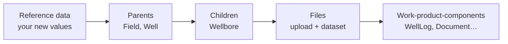

# DI-04 · Building and Loading Records

> **Facts as of:** October 2026 (ADME on OSDU milestone M26). How to build
> records and manifests, load them in the right order, know what actually
> landed, and re-run safely.

## TL;DR

- **Build valid records first.** Every record needs a correctly formed `kind`,
  `acl`, `legal` and `data`. Storage can generate the `id`, but a repeatable
  pipeline should set it itself, from a stable source key. Parent references
  end with `:` to point to the latest version; lineage (`ancestry.parents`) is
  the exception and always names a version.
- **Load in dependency order:** reference data → parents → children → files →
  the records that describe the files.
- **Storage API:**
  - up to **500 records per call**, and no ID twice in the same call;
  - **one bad record rejects the whole batch**;
  - it **doesn't** check the schema, or whether the ACL groups exist.
- **Manifest ingestion:**
  - checks schemas and references, and **skips** bad records together with
    everything that depends on them;
  - the run still ends as **`finished`**, so read the skipped-records report
    and reconcile.
- **Safe re-runs need deterministic IDs.** With the Storage API, use
  `skipdupes=true`, and don't change `tags` on unchanged records: any change,
  tags included, makes a record "new" again. Surrogate keys and generated IDs
  create duplicates on every run.
- **What to retry:** retry 429, 5xx and timeouts with backoff. Never retry
  400 or 403 without fixing something first.

## 1. The record you send

```jsonc
{
  "id":   "contoso-prod-main:master-data--Wellbore:LEGACYDB-WB-101",
  "kind": "osdu:wks:master-data--Wellbore:1.5.1",
  "acl": {
    "owners":  ["data.wells.owners@contoso-prod-main.dataservices.energy"],
    "viewers": ["data.wells.viewers@contoso-prod-main.dataservices.energy"]
  },
  "legal": {
    "legaltags": ["contoso-prod-main-wells-internal"],
    "otherRelevantDataCountries": ["NO"]
  },
  "data": {
    "FacilityName": "North Star A-1",
    "WellID": "contoso-prod-main:master-data--Well:LEGACYDB-W-100:",
    "NameAliases": [ /* source IDs */ ],
    "Source": "LegacyDB"
  }
}
```

**Checklist:**
- **`id`** is `<partition>:<group>--<Entity>:<key>`, and its middle part must
  match the kind (`master-data--Wellbore`). The Storage API rejects a mismatch.
  It's optional for Storage, but set it yourself so re-runs update instead of
  duplicating (§5).
- **References** to other records end with **`:`** (no version), which means
  "the latest version". Add a version number only when you need a fixed snapshot.
- **Lineage is the exception.** `ancestry.parents` lists the records this one
  was derived from, **always with their version**, for example
  `contoso-prod-main:work-product-component--WellLog:LEGACYDB-WL-7:1712345678901234`.
  Storage checks that those parents exist and derives legal tags from them.
- **ACL groups** end with `@<partition>.dataservices.energy`. Use owners and
  viewers that **exist**: Storage doesn't check this (§3).
- **Legal tags** must exist and be valid. **`otherRelevantDataCountries`**
  holds the country the data was ingested from. List it even if it's the same
  as the tag's country of origin.
- **`data`** follows the schema of `kind` exactly: names are case-sensitive,
  units and CRS are declared, and empty values are left out.

## 2. Load order



- **Within one manifest,** ADME orders the work for you: reference data, then
  master data, then datasets, then work-product-components, then the work
  product. Inside each array, put **parents before children** (a Well before its
  Wellbores).
- **Across loads,** wait until the previous load is **indexed** before loading
  records that point to it. Manifest ingestion checks references through
  **Search**, so a parent that is stored but not yet indexed counts as missing.

## 3. Route A: Storage API

```http
PUT /api/storage/v2/records?skipdupes=true
data-partition-id: contoso-prod-main
[ { record 1 }, { record 2 }, … up to 500 ]
```

The response lists `recordIds` (created, or new version written),
`skippedRecordIds` (identical, skipped thanks to `skipdupes`) and
`recordIdVersions`.

**What the Storage API checks, and what it doesn't** (from the OSDU code):

| Checked ✔ | Not checked ✘ |
|---|---|
| `kind` format (`authority:source:entity:version`) | That a schema exists for the kind, or that `data` matches it |
| `id` format, and that it matches the kind; **no ID twice in one call** | References in `data` (a WellID pointing to nothing) |
| ACL groups end with this partition's domain | That the ACL groups **exist**: a typo creates records only `users.data.root` can see |
| Legal tags valid; `otherRelevantDataCountries` valid | Units, CRS or reference values |
| Lineage: every `ancestry.parents` record and version exists | — |
| Updates: caller is in an **owners** group of the existing record | — |

The ACL row reflects the OSDU code for M26, which compares only the domain.
Test a deliberate typo on a non-production instance before you rely on it either
way.

**Consequences:**
- **Validate in your pipeline** before calling: schema, references, reference
  values, and the existence of ACL groups and legal tags.
- **One invalid record fails the whole call** with 400. Validate first, and
  remove duplicate IDs within each batch. If a batch still fails, split it in
  halves to find the bad record, and quarantine only that one.
- **Records with an unregistered kind** are stored, but indexed with
  `index.statusCode` 404: only the envelope is searchable, not their `data`
  fields. Register the schema first. If you're too late, register it and then
  reindex the kind.

## 4. Route B: manifest ingestion

**The manifest** (kind `osdu:wks:Manifest:1.0.0`):

```jsonc
{
  "kind": "osdu:wks:Manifest:1.0.0",
  "ReferenceData": [ … ],
  "MasterData":    [ { Well }, { Wellbore } ],          // parents first
  "Data": {
    "Datasets":               [ { "id": "surrogate-key:file-1", … } ],
    "WorkProductComponents":  [ { …, "data": { "Datasets": ["surrogate-key:file-1"] } } ],
    "WorkProduct":            { … }
  }
}
```

**Surrogate keys:**
- A record that doesn't have its ID yet gets `"id": "surrogate-key:<name>"`.
- Other records in the same manifest refer to it by the same string.
- ADME replaces the surrogate key with the real, generated ID.

They're convenient, but **every run generates new IDs**. Use them only for
one-off loads, or keep a mapping table (§5).

**Starting and checking a run:**

```http
POST /api/workflow/v1/workflow/Osdu_ingest/workflowRun
{ "executionContext": {
    "Payload": { "AppKey": "<your-pipeline-name>", "data-partition-id": "contoso-prod-main" },
    "manifest": { …the manifest… } } }

GET  /api/workflow/v1/workflow/Osdu_ingest/workflowRun/<runId>   → poll until finished / failed
```

**What happens inside the run:**

1. **Schema validation** of every record against its kind's schema.
2. **Reference checks.** References inside the manifest and to existing,
   indexed records are resolved. A record whose reference fails is skipped,
   **together with every record that depends on it** (a skipped Well takes its
   Wellbores and logs with it).
3. **Writing** the valid records through the Storage API.

**"Finished" doesn't mean "all loaded".**
- Invalid records are **skipped** and the run still ends as `finished`. Only
  payload or system errors give `failed`.
- After each run, read the **SKIPPED ENTITIES REPORT** in the Airflow task logs.
  To get them, integrate Airflow logs with Azure Monitor, then query the
  `OEPAirFlowTask` table by run ID.
- Then **reconcile**: compare the IDs you sent with the IDs search returns.

**Sizing:**
- No official per-manifest record limit is documented. Keep manifests to a
  size you can debug, and run them sequentially or with low parallelism.
- **Several manifests in one request:** pass a list in `manifest` (batch
  upload).
- **Very large manifests:** upload the manifest as a file and use **manifest
  ingestion by reference** (GA since July 2026).

**Check:** the community DAG has a run timeout of 180 minutes. Confirm
ADME's value with Microsoft if your runs are long.

## 5. Safe re-runs

| Situation | What happens on re-run | Make it safe by |
|---|---|---|
| Storage API, deterministic IDs, `skipdupes=true` | Unchanged records skipped, changed ones get a new version | ✔ This is the target pattern |
| Storage API, `skipdupes=true`, but a new batch tag on every record | **A new version of every record**: `skipdupes` compares `data`, `meta`, ACL, legal, `tags` and `ancestry`, so a changed tag counts as a change | Tag only records that are new or really changed; keep the full per-run list in the run log |
| Storage API without `skipdupes` | **A new version of every record**, even unchanged ones | Always set `skipdupes=true` |
| Manifest with deterministic IDs | New versions of all records (the OSDU manifest code doesn't use `skipdupes`) | Send only new and changed records |
| Manifest with surrogate keys | **Duplicates**: every record gets a new ID | Deterministic IDs, or don't re-run; clean up with deletes |
| Storage API without IDs (generated) | **Duplicates** | Deterministic IDs, or look up the ID mapping table first |

**Keep these in your pipeline's store:**
- **ID mapping:** source key → OSDU ID → last version → content hash.
- **Run log:** batch ID, input file and checksum, mapping version, then per
  record: sent, written (with the new version **and the previous one**),
  skipped, failed (with reason). This, not a tag in ADME, is the complete
  record of what a run did, and what a rollback starts from.
- **Resume point:** a crashed run restarts from the last completed batch, not
  from zero.

## 6. Errors and retries

| Response | Meaning | Action |
|---|---|---|
| **401** | Token expired, or the wrong audience | Get a new token, retry once |
| **403** | The identity lacks the API bundle or owner rights on the record, or the `data-partition-id` is wrong | **Don't retry.** Fix group membership or the header |
| **400** | Invalid record(s) in the batch | **Don't retry as is.** Find the bad record, quarantine it, resend the rest |
| **404** on write | In the OSDU code: a lineage parent in `ancestry.parents`, or its version, doesn't exist. The M26 API definition also lists 404 for an invalid ACL group. Ordinary references in `data` never cause it | **Don't retry as is.** Read the error message; fix the lineage reference or the ACL |
| **429** | Throttled | Retry with backoff; reduce parallelism |
| **5xx**, timeouts | Transient platform or network issue | Retry with exponential backoff and jitter, with a limit (for example 5 attempts) |

- **Bounded retries:** after the limit, park the batch and alert. Don't loop
  forever.
- **Parallelism:** start low (a few concurrent calls) and increase while
  watching 429s and latency.
- **Search during loads:** wildcard-kind queries (`*:*:*:*`) are expensive and
  can be throttled. Always query a specific kind.

## Common mistakes

- **Trusting `finished`.** Skipped records are only visible in the logs and in
  reconciliation.
- **Typos in ACL group names.** Storage accepts them, and the data becomes
  invisible.
- **Sending 500 unvalidated records** and losing the batch to one bad row.
- **Loading children immediately after parents** through a manifest, before the
  parents are indexed.
- **Surrogate keys in a repeatable pipeline,** which create duplicates on every
  run.
- **Re-sending everything every night without `skipdupes`,** which multiplies
  versions and indexing load.
- **Retrying 400 and 403 errors,** which only adds load and noise.
- **Stamping every record with the current batch tag,** which defeats
  `skipdupes` and creates a new version of everything.

## Go deeper

- [Manifest-based ingestion concepts](https://learn.microsoft.com/azure/energy-data-services/concepts-manifest-ingestion) and [tutorial](https://learn.microsoft.com/azure/energy-data-services/tutorial-manifest-ingestion) (Microsoft Learn)
- [Troubleshoot manifest ingestion](https://learn.microsoft.com/azure/energy-data-services/troubleshoot-manifest-ingestion), including the skipped-records report (Microsoft Learn)
- [Integrate Airflow logs with Azure Monitor](https://learn.microsoft.com/azure/energy-data-services/how-to-integrate-airflow-logs-with-azure-monitor) (Microsoft Learn)
- [Storage service API](https://community.opengroup.org/osdu/platform/system/storage/-/blob/master/docs/docs/api.md): `skipdupes`, patch, delete (OSDU community)
- [Manifest examples](https://community.opengroup.org/osdu/data/data-definitions/-/tree/master/Examples/manifest) (OSDU community)
