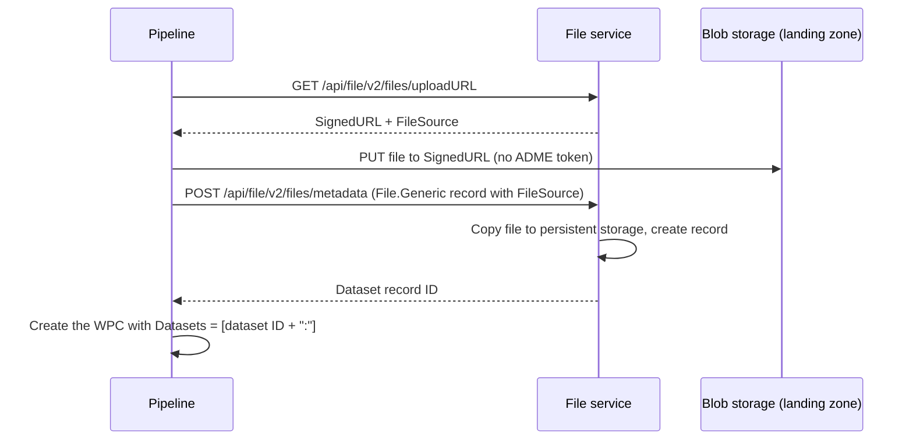

# DI-05 · Files and Domain Bulk Data

> **Facts as of:** October 2026 (ADME on OSDU milestone M26). How to get the
> actual bytes into ADME: files through the File service, well curves through
> the Wellbore DDMS, seismic through the Seismic DDMS, and where the other
> domain services fit.

## TL;DR

- **Bytes and records are separate steps.**
  1. Upload the file.
  2. Register a **dataset** record that points to it.
  3. Create the **WPC** (WellLog, Document…) that describes what it contains.
- **Single files** go through the **File service**:
  - get a signed upload URL (**valid for 1 hour** in ADME);
  - upload the file (**AzCopy for files of 5 GB or more**);
  - create the metadata record.
- **Uploading a file doesn't parse it.** A LAS file stays an opaque file until
  **you** (or a parser workflow) read it and write its curves to the
  **Wellbore DDMS**, which can then serve curves by name and depth range.
- **Seismic** lives in the **Seismic DDMS**:
  - each partition is registered as a seismic tenant, with subprojects inside;
  - upload with `sdutil` or the API;
  - optionally convert SEG-Y to **OpenVDS** or **ZGY** with built-in workflows.
- **Reservoir models** go to the **Reservoir DDMS** (RESQML over ETP), and
  **lab samples** to **RAFS**. Domain applications usually load these.
- **Keep the original file** as a dataset even when a DDMS holds an optimised
  copy. Record a **checksum**, and verify it on download.

## 1. Where bulk data lives

| Data | Where the bytes go | Record that points to it | Load with |
|---|---|---|---|
| Any single file (PDF, LAS, DLIS, CSV, image) | File service storage | `dataset--File.Generic` (+ a WPC such as Document or WellLog) | File service API |
| A set of files that belong together | Dataset service storage | `dataset--FileCollection.*` (+ a WPC) | Dataset service API |
| Well log curves, trajectory stations | **Wellbore DDMS** (columnar Parquet) | `WellLog` / `WellboreTrajectory` with `DDMSDatasets` | Wellbore DDMS API |
| Seismic volumes and lines (SEG-Y, OpenVDS, ZGY) | **Seismic DDMS** (`sd://tenant/subproject/…`) | `dataset--FileCollection.SEGY` + `SeismicTraceData` | `sdutil` or the Seismic DDMS API |
| Reservoir models (RESQML) | **Reservoir DDMS** dataspaces | Managed by the DDMS | ETP (WebSocket) or REST |
| Rock and fluid sample analyses | **RAFS DDMS** | Sample and analysis records | RAFS REST API |

### Behind the APIs: ADME's internal stores

ADME keeps each partition's data in three kinds of Azure store:
- **Blob storage:** the bytes;
- **Cosmos DB:** record metadata;
- **Elasticsearch:** the search index.

These stores are **managed by Microsoft and invisible to you**: they're not in
your subscription, and there are no storage keys or direct access.

| Store | What goes there |
|---|---|
| **Blob storage** | Files from the File and Dataset services (landing zone, then permanent storage), Wellbore DDMS curves (Parquet), Seismic Store objects (the Hot/Cool/Cold tiers are blob tiers) |
| **Cosmos DB** + blob storage | Records from the Storage service: metadata such as ID, kind, ACL, legal and versions in Cosmos DB, record content in blobs. This follows the OSDU Azure implementation; ADME doesn't publish its internals |
| **Elasticsearch** | The search index built from records. It's a derived copy: if it's lost, it's rebuilt by reindexing |

**What this means for pipelines:**
- **Access:** you reach the bytes only through the APIs, or through the
  short-lived signed URLs and credentials they return.
- **Network:** uploads and downloads go directly to those blob endpoints, not
  to the ADME API host.
- **Resilience and cost:** the stores are zone-redundant (in regions with
  availability zones) and encrypted at rest (with customer-managed keys if
  enabled). Most regions also replicate to a
  paired region for disaster recovery, but a few don't, so check yours. ADME
  charges for stored data from 1 August 2026; see the ADME pricing page.
- **The exception:** the Analytics Consumption Zone writes copies into a Data
  Lake Storage account in **your own** subscription.

## 2. Single files: the File service



**Step by step:**
1. **Upload URL:** `GET /api/file/v2/files/uploadURL`. Keep `SignedURL` in
   memory, because it's a secret, and keep `FileSource`, the file's relative
   path.
2. **Upload:**
   - **Under 5 GB:** a single blob PUT with the header
     `x-ms-blob-type: BlockBlob`.
   - **5 GB or more:** `azcopy copy <file> "<SignedURL>"`, because one PUT
     can't exceed 5 GB.
   - **Expiry:** the URL expires after **1 hour**, so request it just before
     uploading.
   - **Never send your ADME token** to the signed URL.
3. **Register:** `POST /api/file/v2/files/metadata` with a `File.Generic`
   record:

   ```jsonc
   {
     "kind": "osdu:wks:dataset--File.Generic:1.1.0",
     "acl": { … }, "legal": { … },
     "data": {
       "Name": "WB-101_GR.las",
       "DatasetProperties": { "FileSourceInfo": {
         "FileSource": "<from step 1>",
         "Checksum": "<SHA-256 of the file, hex>",
         "ChecksumAlgorithm": "SHA-256" } },
       "Checksum": "<MD5 of the file, 32 hex characters>"
     }
   }
   ```

   - The service copies the file from the landing zone to permanent storage.
     It fails if the file isn't there.
   - The top-level `Checksum` is defined as **MD5**. For another algorithm, use
     `FileSourceInfo.Checksum` together with `ChecksumAlgorithm`, as above. One
     of the two is enough.
   - **Save the returned ID** and use it from then on.
4. **Describe:** create the WPC (WellLog, Document…), with `Datasets` set to
   that ID plus a trailing `:`.
5. **Download:** `GET /api/file/v2/files/{id}/downloadURL` returns a
   time-limited signed URL. Only callers who can read the dataset record get
   one.

**Rules for pipelines:**
- **The File service doesn't validate content.** A corrupt LAS file uploads
  fine, so check files before upload: format, readable headers, expected
  well.
- **Compute a checksum** before upload, store it in the record, and compare it
  after a test download.
- **Re-runs:** keep a table that maps file checksum → dataset ID. An unchanged
  file isn't uploaded and registered again.
- **Deleting** with `DELETE /api/file/v2/files/{id}/metadata` removes both the
  record and the file.

## 3. Many files at once: the Dataset service

For content that is **several files that only make sense together**, use the
Dataset service with a `FileCollection` kind. Examples: a DLIS set, a shapefile
with its sidecar files, a multi-file export.

1. `POST /api/dataset/v1/storageInstructions`: a signed location for the
   collection.
2. Upload all files there.
3. `PUT /api/dataset/v1/registerDataset`: create the `FileCollection` record.
4. `POST /api/dataset/v1/retrievalInstructions`: get download URLs later.

Signed URLs from the Dataset service also expire after 1 hour. **Manifest
ingestion by reference** uses the same service to upload a large manifest.

## 4. Well logs and trajectories: the Wellbore DDMS

A LAS or DLIS file in the File service can only be downloaded whole. Load the
curves into the **Wellbore DDMS** when applications or analytics need to
"give me GR between 1,000 and 1,500 m".

**What ADME doesn't do for you:**
- **It doesn't parse LAS or DLIS** in the Wellbore DDMS path. Your pipeline
  reads the file, for example with `lasio` or `dlisio` in Python, and writes
  the curves.
- **Check:** whether a parser workflow is enabled on your instance. Petrel Data
  Services can extract logs from Petrel projects ("data liberation").

**Steps:**
1. **Create the WellLog record:** `POST /api/os-wellbore-ddms/ddms/v3/welllogs`,
   with `WellboreID`, `Curves[]` (mnemonics and units), and `Datasets` pointing
   to the original file. The record is stored like any other record and is
   searchable.
2. **Write the curves:** `POST …/welllogs/{id}/data` with a JSON or **Parquet**
   body.
   - Each write sends the **whole** bulk data and creates a **new version**.
   - Older versions stay readable.
3. **Large logs** (more than about 10 million values or 3,000 columns) use a
   **session**:
   - create it with `POST …/welllogs/{id}/sessions`;
   - send chunks, possibly in parallel, with `POST …/sessions/{sid}/data`;
   - commit with `PATCH …/sessions/{sid}`.

   Keep all values of one curve in the same chunk. The session ends with
   **one** new version; it expires if not committed, after at most 24 hours.
4. **Read back:** `GET …/welllogs/{id}/data` with:
   - `curves=` to pick curves;
   - `filter=` for a depth range, for example `DEPT:gte:1000`;
   - `offset` / `limit` to page;
   - `Accept: application/x-parquet` for analytics.

   `…/data/statistics` gives per-curve statistics.

**Trajectories** use the same pattern: `…/wellboretrajectories/{id}/data`.
**Updating an existing WellLog:** start from the stored record, so you keep the
fields the DDMS manages for its bulk data. Rebuilding the record from scratch can
make the update fail.

## 5. Seismic: the Seismic DDMS

**Structure:**

```text
sd://<tenant>/<subproject>/<path>/<dataset>
      │          │
      │          └─ working unit: owns ACLs, a legal tag, admins; created by a tenant admin
      └─ the data partition, registered once as a seismic tenant
```

**Steps:**
1. **Once per partition:** register the partition as a seismic **tenant**.
2. **Per project or delivery:** create a **subproject**, with an admin, a legal
   tag and access groups.
3. **Upload:**
   - **`sdutil`** (a Python command-line tool):
     `sdutil cp survey.segy sd://<tenant>/<subproject>/raw/survey.segy`;
   - **or the API:** `/seistore-svc/api/v3/utility/upload-connection-string`
     returns a short-lived storage credential for the dataset.

   Seismic Store manages objects of any size by splitting them across blobs.
4. **Catalogue it** with Storage records, so that it can be found through search:
   - a `dataset--FileCollection.SEGY` with the `sd://` path;
   - a `work-product-component--SeismicTraceData` that references it;
   - links to the survey and processing project.
5. **Optional: convert** with built-in workflows:
   - SEG-Y → **OpenVDS** (`segy-to-vds-conversion`);
   - SEG-Y → **ZGY**, used by Petrel.

   Each is triggered through the Workflow API, with the records and a
   header-mapping record prepared first. The outputs land in a Seismic Store
   subproject.

**ADME-specific operations (preview):**
- **Storage tiers:** Hot / Cool / Cold per dataset or path, to cut cost for old
  surveys. Available by default on the Developer tier.
- **Restore** of a single dataset to a point in time within **30 days**.
  Standard tier, on request.

**Watch out:**
- **Only Seismic Store uploads count.** Copying SEG-Y files to a storage account
  with AzCopy isn't ingestion: the files are neither in Seismic Store nor
  catalogued.
- **Don't download OpenVDS with `sdutil cp`.** A VDS is many objects; use the
  OpenVDS tools instead.

## 6. Reservoir models and lab samples

- **Reservoir DDMS:**
  - stores **RESQML** objects (grids, properties, interpretations) in
    **dataspaces** such as `project/scenario`;
  - modelling applications read and write through **ETP**, a streaming
    WebSocket protocol, and REST covers simpler reads and admin;
  - in practice, the **applications** load it, not generic pipelines.
- **RAFS DDMS:**
  1. create the master hierarchy first (Organisation → Field → Well →
     Wellbore) through Storage;
  2. then the sample master data (sites, acquisition jobs, containers, samples);
  3. then **analysis reports** through `/api/rafs-ddms/v2/…`.

## 7. Pipeline checklist for bulk data

- **Order:**
  - **Files:** upload the bytes → register the dataset → create or update the
    WPC that lists it → verify.
  - **Wellbore DDMS:** register the original file as a dataset → create the
    WellLog record (it needs to exist first) → write its bulk data → verify.
- **Keep the original** as a dataset. The DDMS copy is an additional,
  optimised form, not a replacement.
- **Checksums:**
  - record one on every file;
  - verify a sample by downloading after the load;
  - compare row counts and depth ranges for DDMS curves.
- **Parallelism:** uploads scale well, so run several in parallel and keep API
  calls within throttling limits.
- **Re-runs:** keep the checksum → dataset ID and source log → WellLog ID
  mappings, so unchanged files aren't uploaded twice.
- **Network:** uploads go straight to Azure Storage endpoints, not to the ADME
  API. With private networking, those endpoints must be reachable too.

## Common mistakes

- **Expecting ADME to read the file.** Uploading a LAS file doesn't create
  curves, and uploading a PDF doesn't extract text.
- **Requesting the upload URL at the start of a long batch.** It expires after
  1 hour.
- **Sending big files with a single PUT.** Anything of 5 GB or more needs AzCopy.
- **Losing the returned dataset ID,** and then uploading the same file again on
  every run.
- **Rewriting a WellLog record from scratch** after its curves are loaded, which
  makes the update fail.
- **Skipping the catalogue records for seismic.** The data sits in Seismic Store,
  but nobody can find it.
- **Deleting the original after conversion to OpenVDS or ZGY.** You lose the
  source of truth.

## Go deeper

- [Reliability in ADME: underlying data stores](https://learn.microsoft.com/azure/energy-data-services/reliability-energy-data-services), [data residency and pricing FAQ](https://learn.microsoft.com/azure/energy-data-services/faq-energy-data-services) (Microsoft Learn)
- [Upload large files with the File service](https://learn.microsoft.com/azure/energy-data-services/how-to-upload-large-files-using-file-service) (Microsoft Learn)
- [File service API](https://community.opengroup.org/osdu/platform/system/file/-/blob/master/docs/docs/File-Service.md) (OSDU community)
- [Wellbore DDMS tutorial](https://learn.microsoft.com/azure/energy-data-services/tutorial-wellbore-ddms) and the [ADME REST API reference](https://microsoft.github.io/adme-samples/rest-apis/index.html) (Microsoft)
- [Seismic DDMS APIs](https://learn.microsoft.com/azure/energy-data-services/tutorial-seismic-ddms) and [sdutil](https://learn.microsoft.com/azure/energy-data-services/tutorial-seismic-ddms-sdutil) (Microsoft Learn)
- [Convert SEG-Y to OpenVDS](https://learn.microsoft.com/azure/energy-data-services/how-to-convert-segy-to-ovds) and [to ZGY](https://learn.microsoft.com/azure/energy-data-services/how-to-convert-segy-to-zgy) (Microsoft Learn)
- [Seismic storage tiers](https://learn.microsoft.com/azure/energy-data-services/tutorial-seismic-change-tier) and [dataset restore](https://learn.microsoft.com/azure/energy-data-services/tutorial-seismic-restore-dataset) (Microsoft Learn)
- [Reservoir DDMS APIs](https://learn.microsoft.com/azure/energy-data-services/tutorial-reservoir-ddms-apis) and [RAFS DDMS APIs](https://learn.microsoft.com/azure/energy-data-services/tutorial-rock-and-fluid-samples-ddms) (Microsoft Learn)
