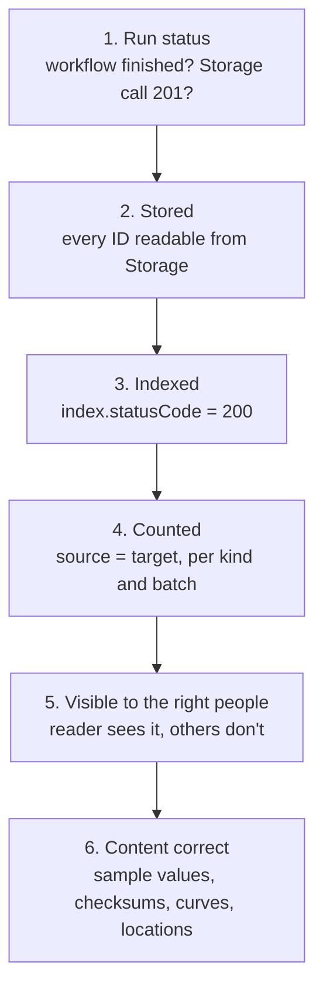

# DI-06 · Validation, Reconciliation and Monitoring

> **Facts as of:** October 2026 (ADME on OSDU milestone M26). How to prove that
> a load really worked, find what went wrong, and watch pipelines over time.

## TL;DR

- **A successful API call proves almost nothing.** Records can be skipped by a
  manifest run that still reports `finished`. They can be stored but not
  indexed, indexed without their fields, or visible to the wrong people.
- **Verify in steps:**
  1. run status;
  2. stored;
  3. indexed;
  4. counted;
  5. visible to the right identities;
  6. content correct.
- **Indexing status lives on every indexed record.** Search with
  `"returnedFields": ["index"]` and look for `index.statusCode` 400 (fields not
  mapped) or 404 (schema missing).
- **Counting:** `totalCount` stops at **10,000** unless you set
  `"trackTotalCount": true`. Tag records with the **batch** that created or
  changed them, and keep the full per-run list of IDs in your run log.
- **Fix index problems by reindexing,** not by loading again.
- **Monitoring:**
  - **Diagnostic settings** send service, Airflow and audit logs to Log
    Analytics;
  - **platform metrics** (preview) show requests by service and response code;
  - a **correlation ID** on every call ties your logs to ADME's logs.

## 1. The verification ladder



Each step catches problems the one above misses. Automate steps 1–5 in the
pipeline. Step 6 combines automated samples with a human check by the data
owner.

## 2. Checking each step

### Run status

- **Manifest runs:** poll `GET /api/workflow/v1/workflow/Osdu_ingest/workflowRun/{runId}`
  until the status is `finished` or `failed`. `finished` **only** means the
  run ended. Records with schema or reference errors were skipped, and appear
  only in the **skipped-entities report** in the Airflow logs (§4).
- **Storage API:** a 201 lists `recordIds` and `skippedRecordIds`. Compare
  both with what you sent.

### Stored

`POST /api/storage/v2/query/records` with up to **100 IDs** per call returns:
- `records` (found);
- `invalidRecords` (not found, or deleted);
- `retryRecords` (try again).

Records that exist but that the caller **may not read** appear in **none** of
these lists: they're silently left out. So compare the number of IDs sent with
the number returned, not only the `invalidRecords` list.

Run it with the pipeline identity for the full list of IDs from your ID
mapping table.

### Indexed

Indexing is **asynchronous**: Storage publishes a change event, and the
indexer reads the schema and writes to Elasticsearch. So:
- **Allow time.** Poll with a deadline instead of searching immediately after
  loading.
- **Check the index status** that the indexer stores on each record:

```http
POST /api/search/v2/query
{ "kind": "osdu:wks:master-data--Wellbore:1.5.1",
  "query": "tags.load_batch:\"2026-10-09-01\" AND NOT index.statusCode:200",
  "returnedFields": ["id", "index"], "limit": 1000 }
```

| `index.statusCode` | Meaning | Typical fix |
|---|---|---|
| **200** | Indexed correctly | — |
| **400** | Some fields didn't match the schema's types. `index.trace` says which, for example "datetime parsing error" | Fix the data and reload the record, or fix the schema and reindex |
| **404** | No schema for the kind: only the envelope is indexed, so the `data` fields can't be searched | Register the schema, then **reindex** the kind |

Query a **specific kind**. Wildcard-kind queries (`*:*:*:*`) are expensive and
can be throttled.

A record with status 400 or 404 is still **found** by search (its envelope is
indexed), so "searchable" and "indexed correctly" are two different counts.

### Counted

- **Tag the records a run creates or changes**, for example
  `"tags": { "load_batch": "2026-10-09-01" }`. Tags are searchable as
  `tags.load_batch`. Don't re-tag unchanged records: with `skipdupes`, a new
  tag makes every record a new version ([DI-04](04-building-and-loading-records.md)).
  The run log, not the tag, lists every ID a run touched, including skipped
  ones.
- **Count per kind and batch** with `"trackTotalCount": true`. Without it,
  `totalCount` stops at 10,000.
- Use **`aggregateBy`** (for example on `kind`) to get several counts in one
  call.
- **Compare the numbers:** rows in the source extract, IDs in your mapping
  table, records found by search, and records with `index.statusCode` 200.
  Every difference has a reason in the run log, or it's a defect.

### Visible to the right people

Run a few searches and reads with a **test reader identity** that should see
the data, and one that shouldn't:
- The reader finds the expected count.
- Restricted records are absent from search, and a direct read is denied
  (403 or 404).

This catches typos in ACL groups, which Storage accepts silently.

### Content correct

- **Sample records:** compare 10–20 records field by field with the source,
  and include edge cases.
- **Files:** download a sample and compare checksums.
- **Wellbore DDMS curves:** compare row counts, depth range and curve list with
  the source, using `…/data?describe=true` or the statistics endpoint.
- **Locations:** run a bounding-box search. Every well should fall inside the
  expected area.
- **The data owner signs off** a short reconciliation report per run.

## 3. Reindexing

Reindex when the **records are fine but the index isn't**:
- after registering a schema that was missing (status 404);
- after changing indexing hints;
- after an index inconsistency.

| Call | Scope | Who may call it |
|---|---|---|
| `POST /api/indexer/v2/reindex` `{ "kind": "…" }` | One kind. Add `force_clean=true` to drop and rebuild that kind's index | `users.datalake.admins` or `users.datalake.ops` |
| `POST /api/indexer/v2/reindex/records` `{ "recordIds": [ … ] }` | Specific records | `users.datalake.admins` or `users.datalake.ops` |
| `PATCH /api/indexer/v2/reindex` | The whole partition | `users.datalake.ops` only |

- Reindexing is **asynchronous**: the call returns quickly, and then you
  re-check status and counts.
- **Large kinds take time,** and with `force_clean` the kind's records are
  missing from search until the rebuild finishes. Plan it outside working hours.
- **Don't load data again just to fix the index.** That creates new versions and
  more load for nothing.

## 4. Monitoring

**Logs.** These are off by default. Turn them on with a **diagnostic setting**
on the ADME resource, sending to Log Analytics and/or a storage account:

| Log category | Log Analytics table | Use it for |
|---|---|---|
| OSDU service logs (per service) | `OEPDataplaneLogs` | Errors per service and call, matched by correlation ID |
| Airflow task logs | `OEPAirFlowTask` | Manifest and CSV runs, including the **skipped-entities report** |
| Elasticsearch logs | Elasticsearch tables | Index-level problems (rarely needed) |
| Audit events | `OEPAuditLogs` | Who did what: group changes, record writes and deletes |

Example: the skipped records of one manifest run.

```kusto
OEPAirFlowTask
| where RunID has "<runId>"
| where Content has "SKIPPED ENTITIES REPORT"
```

**Metrics (preview).** These are available on the resource, with 93 days of
retention:
- **Total HTTP Requests,** split by data partition, service, method and
  response code;
- **Data Volume,** split by partition and storage tier.

**What to alert on:**
- a rising rate of **5xx** or **429** responses per service;
- **failed** workflow runs;
- **skipped entities** above zero;
- records with **`index.statusCode` other than 200** after a load;
- **source vs target count gaps** from the run report;
- unexpected **entitlement changes**, from the audit logs.

**Correlation IDs.**
- Send a `correlation-id` header (a GUID) on every call, and log it with the
  record IDs and the result.
- Use it to find the matching entries in `OEPDataplaneLogs`.
- Also log failures **on the client side**. Some failures, such as token
  problems, may never reach the service logs.

## 5. The run report

One short report per run, kept with the run log:

| Item | Example |
|---|---|
| Batch ID, source extract and checksum, mapping version | `2026-10-09-01`, `wells_20261009.csv` (sha256…), mapping v1.4 |
| Sent / written / skipped / failed, per kind | Well 1,204 / 1,200 / 0 / 4 |
| Stored check | 1,200 of 1,200 readable |
| Index check | 1,198 × 200, 2 × 400 (date format) |
| Counts: source / mapping table / found by search / indexed correctly | 1,204 / 1,200 / 1,200 / 1,198 |
| Access spot-check | Reader: OK; restricted: hidden |
| Content sample | 20 of 20 match; checksums 15 of 15 |
| Open issues | 4 quarantined (missing CRS), 2 to reload (date) |

## Common mistakes

- **Declaring success on `finished`** without reading the skipped-entities
  report.
- **Searching right after loading,** seeing zero results and loading again.
  Indexing is asynchronous.
- **Trusting `totalCount`** above 10,000 without `trackTotalCount`.
- **Never checking `index.statusCode`.** Records with status 400 or 404 look
  loaded, but their fields can't be found.
- **Loading again to fix an index problem** instead of reindexing.
- **Verifying only as the pipeline identity,** which sees everything it wrote,
  so ACL mistakes stay hidden.
- **Turning on diagnostic settings after the first incident,** when the logs you
  needed were never collected.

## Go deeper

- [Indexing and search concepts](https://learn.microsoft.com/azure/energy-data-services/concepts-index-and-search) (Microsoft Learn)
- [Indexer API: reindex and indexing status](https://community.opengroup.org/osdu/platform/system/indexer-service/-/blob/master/docs/docs/api.md) and [Search API: query syntax, `trackTotalCount`](https://community.opengroup.org/osdu/platform/system/search-service/-/blob/master/docs/docs/api.md) (OSDU community)
- [Monitor ADME (metrics)](https://learn.microsoft.com/azure/energy-data-services/how-to-monitor-data-manager-energy) and [monitoring data reference](https://learn.microsoft.com/azure/energy-data-services/concepts-monitor-data-reference) (Microsoft Learn)
- [OSDU service logs](https://learn.microsoft.com/azure/energy-data-services/how-to-integrate-osdu-service-logs-with-azure-monitor), [Airflow logs](https://learn.microsoft.com/azure/energy-data-services/how-to-integrate-airflow-logs-with-azure-monitor) and [audit logs](https://learn.microsoft.com/azure/energy-data-services/how-to-manage-audit-logs) (Microsoft Learn)
- [Troubleshoot manifest ingestion](https://learn.microsoft.com/azure/energy-data-services/troubleshoot-manifest-ingestion) (Microsoft Learn)
