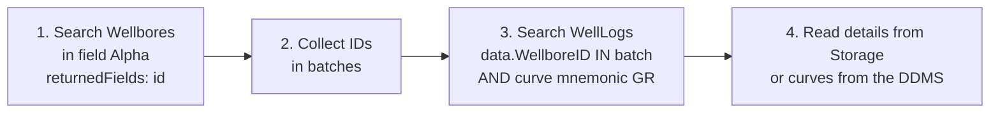

# DI-07 · Reading Data: APIs and Change Feeds

> **Facts as of:** October 2026 (ADME on OSDU milestone M26). How applications
> and pipelines find and read data in ADME, and how they learn that something
> changed.

## TL;DR

- **Search finds, Storage reads.**
  - **Search** is for questions ("which wellbores in field X?"). Results are
    filtered by the caller's ACLs.
  - **Storage** returns the authoritative record by ID, any version.
  - **Files and DDMS** serve the bytes.
- **Search has no joins.** Answer relationship questions in two steps: find
  the parents, then search the children by their parent IDs.
- **Know the limits:**

  | Limit | Value |
  |---|---|
  | Results per page | ≤ 1,000 |
  | `offset` + `limit` | ≤ 10,000 |
  | `totalCount` | Exact only with `trackTotalCount` |
  | Response size | ≤ 100 MB |
  | Cursor | Expires 1 minute after the last page fetched |

- **Spatial search** works on WGS 84 fields: bounding box, distance, polygon
  and intersection. To search across kinds, use
  `data.VirtualProperties.DefaultLocation`.
- **Change feeds:** subscribe to `recordstopic` through the **Register**
  service, and ADME pushes record changes to your HTTPS endpoint.
  - The messages hold **IDs only**, so read the records with your own token.
  - There is no filtering: you receive changes for every kind.

## 1. Which API for which question

| Question | API | Notes |
|---|---|---|
| "Which records match these criteria?" | **Search** `POST /api/search/v2/query` | Index copy, ACL-filtered, near-real-time |
| "Give me everything that matches" (more than 10,000) | **Search** `POST /api/search/v2/query_with_cursor` | A snapshot; for batch jobs, not for user interfaces |
| "Give me this record (or version)" | **Storage** `GET /api/storage/v2/records/{id}[/{version}]` | Authoritative, includes everything you wrote |
| "Give me these 100 records" | **Storage** `POST /api/storage/v2/query/records` | Up to 100 IDs per call |
| "Give me these records with units in SI and CRS in WGS 84" | **Storage** `POST /api/storage/v2/query/records:batch` + header `frame-of-reference` | Up to 20 IDs; converts on the fly, but only what the record declares: units and CRS in `meta[]`, or `AsIngestedCoordinates` with a CRS |
| "All versions of a record" | **Storage** `GET /api/storage/v2/records/versions/{id}` | Then read any version by number |
| "All records of a kind, changed since a date" | **Storage** `GET /api/storage/v2/records?kind=…&modifiedAfterDate=…` | **Don't rely on it yet.** It's in the M26 API definition, but OSDU's Azure code doesn't implement it, and it doesn't check each record's ACL. If it works on your instance, note that `kind` needs an exact version and the date is a whole day. Use notifications or Search + Storage instead (§5, [DI-08](08-export-to-analytics-and-ai.md)) |
| "The file" | **File** `GET /api/file/v2/files/{id}/downloadURL` | A signed URL; see [DI-05](05-files-and-bulk-data.md) |
| "Curves between 1,000 and 1,500 m" | **Wellbore DDMS** `GET …/welllogs/{id}/data?curves=…&filter=…` | JSON or Parquet; see [DI-05](05-files-and-bulk-data.md) |
| "Tell me when something changes" | **Register** subscription to `recordstopic` | Push to your HTTPS endpoint (§5) |

**Search vs Storage:**
- **Search** returns the **indexed copy**: what was indexed, shaped for
  searching. It's seconds to minutes behind Storage, and geometry isn't valid
  GeoJSON there.
- **Storage** returns **exactly what you wrote**.

Use Search to find IDs, then read from Storage when you need the full record.

## 2. Search essentials

```json
{
  "kind": "osdu:wks:master-data--Wellbore:*",
  "query": "data.WellID:\"contoso-prod-main:master-data--Well:LEGACYDB-W-100:\" AND data.StatusSummaryID:\"contoso-prod-main:reference-data--WellStatusSummary:OilProducing:\"",
  "returnedFields": ["id", "data.FacilityName", "data.WellID"],
  "sort": { "field": ["data.FacilityName"], "order": ["ASC"] },
  "limit": 100
}
```

**`kind`:**
- It's required. Use wildcards per part, for example
  `osdu:wks:master-data--Wellbore:*` for all versions.
- **Avoid `*:*:*:*`:** it's slow and can be throttled.

**`query`** uses **Lucene syntax**, with at most 1,024 clauses:
- **Combinations and ranges:** `AND`, `OR`, `NOT`, and ranges such as
  `data.TopMeasuredDepth:[1000 TO 2000]`.
- **Wildcards** (`*`, `?`) work on single words **outside quotes**, for example
  `data.FacilityName:north*`. Inside a quoted phrase they're plain
  characters. Leading wildcards (`*star`) aren't allowed, and wildcards are
  heavy, so use them sparingly.
- **Text fields are analysed:** split into words and lowercased. For an exact,
  case-sensitive match, query the **`.keyword`** subfield, for example
  `data.FacilityName.keyword:"NO 1234/5-A"`.
- **Arrays of objects** marked as nested (`NameAliases`, `Markers`,
  `VerticalMeasurements`…) need the `nested()` syntax:
  `nested(data.NameAliases, (AliasName:"WB-101"))`.
- **Tags and kind parts** are searchable too: `tags.load_batch:"…"`,
  `type:"master-data--Wellbore"`.

**Other request fields:**
- **`returnedFields` / `excludedFields`:** return only what you need. It keeps
  responses small, and they must stay under 100 MB.
- **`sort`:** sorts on text (via `.keyword`), numbers, dates and nested fields,
  but not on geometry.
- **`aggregateBy`:** distinct values with counts (up to 1,000), for example per
  `kind` or status. That's quick facets for dashboards.
- **`queryAsOwner: true`:** only records the caller **owns**, not just those it
  can view.

**Paging:**

| Need | Use |
|---|---|
| Up to 10,000 results | `offset` + `limit` (≤ 1,000 per page) |
| More, or "all of a kind" | `query_with_cursor`: send the returned `cursor` until it's empty |

- **Cursor rules:** it expires 1 minute after the last page fetched, and at most
  500 cursors can be open per partition.
- **Snapshot:** the results reflect the index when the cursor started.

## 3. Spatial search

Exactly **one** spatial filter per request, combined with `query` by AND:

```json
{
  "kind": "osdu:wks:master-data--Well:*",
  "spatialFilter": {
    "field": "data.SpatialLocation.Wgs84Coordinates",
    "byBoundingBox": {
      "topLeft":     { "latitude": 61.0, "longitude": 1.5 },
      "bottomRight": { "latitude": 60.0, "longitude": 3.0 }
    }
  }
}
```

**Filter types:**
- **`byBoundingBox`:** a rectangle.
- **`byDistance`:** a point plus a radius.
- **`byGeoPolygon`** or **`byWithinPolygon`:** inside a polygon.
- **`byIntersection`:** a shape intersecting a polygon, for example seismic
  outlines.

**How locations get indexed:**
- Only **WGS 84** fields are searchable.
- If a record has only `AsIngestedCoordinates`, the indexer tries to convert
  them. If that fails, the location isn't indexed, and `index.trace` records
  the reason.
- **Across kinds:** search `data.VirtualProperties.DefaultLocation.Wgs84Coordinates`,
  a common location field defined by OSDU for most kinds. Use
  `data.VirtualProperties.DefaultName` for names.

## 4. Relationship questions: two steps, no joins

**Example: "all gamma-ray logs in field Alpha".**



- **Reference values have a trailing colon.** References are stored with it,
  so query them that way: `data.WellboreID:("…:WB-101:" OR "…:WB-102:")`. Keep
  batches well under the 1,024-clause limit.
- **Reverse lookups only work this way.** A wellbore doesn't list its logs; the
  log points to the wellbore. So "logs of wellbore X" is always a search on the
  log kind.
- **Many-hop questions belong elsewhere.** If you ask the same multi-step
  question often, run it on an analytics copy instead ([DI-08](08-export-to-analytics-and-ai.md)).

## 5. Change feeds: notifications

**How it works:**
1. **Pick the topic.** For record changes it's **`recordstopic`**, which
   covers creates, updates and deletes (soft and hard). There are also
   schema-change and status-change topics. Listing them
   (`GET /api/register/v1/topics`) needs `users.datalake.ops`, so an admin may
   have to do it once for you.
2. **Build an HTTPS endpoint** that accepts:
   - **GET** for the challenge: ADME sends `crc` and `hmac`, and you answer
     with a hash of your secret plus `crc`;
   - **POST** for the messages.
3. **Subscribe:** `POST /api/register/v1/subscription` (editors bundle or
   above), with the topic, your endpoint and an **HMAC secret** (letters and
   digits only, with an even number of characters). ADME checks the endpoint
   with the challenge.
4. **Handle messages:**
   - **Verify the `hmac` signature first.**
   - Each POST holds up to **50** changes, like
     `{"id": "…", "kind": "…", "op": "create", "recordUpdated": "true"}` or
     `{"id": "…", "kind": "…", "op": "delete", "deletionType": "soft"}`.
   - **Updates** arrive as `create` with `recordUpdated: "true"`. **Check:**
     on your instance, because one OSDU example shows `op: "update"`. Handle
     both.
   - **Reply 2xx within 30 seconds.** Otherwise ADME retries, at a slowing
     rate, for up to **5 days**.

**Design rules:**
- **Messages hold IDs, not data.** Read the records from Storage **with your
  own identity**, so its ACLs apply.
- **No filtering:** you get changes for **all kinds** in the partition, and
  filter on `kind` yourself.
- **Make processing idempotent,** because the same change can arrive more than
  once. Queue the message, for example in Azure Service Bus, acknowledge
  quickly, and process asynchronously.
- **Keep a safety net,** in case your endpoint was down for longer than the
  retry window: a periodic reconciliation that lists the IDs per kind with
  `query_with_cursor`, compares them with your copy, and re-reads differences
  from Storage. It also catches deletions.
- **Rotate the secret** with `PUT /api/register/v1/subscription/{id}/secret`.
  Update your endpoint first, because the challenge runs again.

## 6. Patterns for consumers

| Consumer | Pattern |
|---|---|
| **Interactive app** (portal, map) | Search with `returnedFields` and `aggregateBy` for facets → Storage for details → File or DDMS for data. Call ADME **as the signed-in user** |
| **Batch extraction** (analytics copy) | `query_with_cursor` per kind for the IDs → Storage `query/records` for the full records → write to the lake. Then incremental: notifications plus periodic reconciliation ([DI-08](08-export-to-analytics-and-ai.md)) |
| **Synchronising another system** | Subscription to `recordstopic` → queue → read changed records → upsert. Nightly reconciliation by counts |
| **AI agent / RAG** | Search as a tool, with the user's identity (on-behalf-of). Never index ADME content into a store without carrying its access rules ([DI-08](08-export-to-analytics-and-ai.md)) |

## Common mistakes

- **Using Search as the source of truth.** It's an index: slightly behind, and
  shaped for search. Read records from Storage.
- **Paging past 10,000 with `offset`.** It fails; use the cursor API.
- **Slow cursor consumers.** More than 1 minute between pages, and the cursor
  is gone.
- **Querying a text field without `.keyword`** and getting partial or
  case-insensitive matches.
- **Querying nested arrays without `nested()`,** which finds nothing.
- **Forgetting the trailing `:`** when matching reference IDs.
- **Expecting notifications filtered by kind, or containing data.** They're
  neither.
- **Reading change notifications with a super-user identity** and copying data
  to people who shouldn't see it.

## Go deeper

- [Search API: query syntax, nested, spatial, cursor, limits](https://community.opengroup.org/osdu/platform/system/search-service/-/blob/master/docs/docs/api.md) (OSDU community)
- [Storage API: records, versions, batch and frame of reference](https://community.opengroup.org/osdu/platform/system/storage/-/blob/master/docs/docs/api.md) (OSDU community)
- [Data notifications: topics, subscriptions, handlers](https://community.opengroup.org/osdu/platform/system/notification/-/blob/master/docs/docs/DataNotification.md) (OSDU community)
- [Virtual properties report](https://community.opengroup.org/osdu/data/data-definitions/-/blob/master/E-R/VirtualPropertiesReport.md) (OSDU community)
- [Indexing and search concepts](https://learn.microsoft.com/azure/energy-data-services/concepts-index-and-search) and the [ADME REST API reference](https://microsoft.github.io/adme-samples/rest-apis/index.html) (Microsoft)
