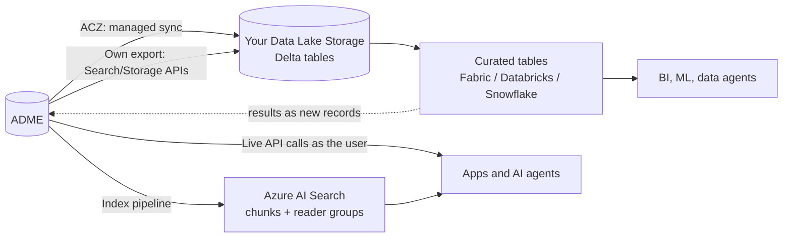

# DI-08 · Export to Analytics and AI Integration

> **Facts as of:** October 2026 (ADME on OSDU milestone M26). How to get ADME
> data into a lakehouse, keep access rules intact outside ADME, and connect AI
> agents and search indexes safely.

## TL;DR

- **Three ways to use ADME data outside ADME:**
  1. **ACZ:** a managed export of chosen kinds to Delta tables in **your**
     Data Lake Storage. It's a **preview**, on the **Developer tier only**,
     with an allow list.
  2. **Your own export pipeline:** Search/Storage → Delta tables. It's always
     available.
  3. **Live API calls** from apps and agents, **as the user**.
- **Access rules don't travel.** Neither ACZ nor your own export carries ACLs
  or legal-tag enforcement into the copy. You decide what may be published and
  re-apply access with workspaces, roles or row filters.
- **ACZ tables are raw:** one `osducatalog` table for all catalogue kinds, with
  `data`, `acl` and `legal` as JSON strings. Build curated, flattened tables on
  top, and never write into the ACZ folders.
- **AI:**
  - **Agents** call ADME with the **user's token** (on-behalf-of).
  - **Search indexes** (Azure AI Search) store each chunk's **OSDU reader
    groups** (owners and viewers) and filter every query by the user's groups.
    Before showing a chunk, confirm with ADME that the user can still read it.
  - **Document text is untrusted input.**

## 1. Three patterns



| Pattern | Use when | Freshness | Access control |
|---|---|---|---|
| **ACZ** | Developer-tier instance on the allow list; Wellbore DDMS curves also needed | Near-real-time | **None in the copy.** Rows keep `acl` and `legal` as columns |
| **Own export** | Production (Standard tier), or you need custom shaping or filtering | Your schedule, or event-driven ([DI-07](07-reading-data-apis-and-change-feeds.md)) | **None in the copy.** But you control what is exported |
| **Live API** | Apps and agents that need current data, scoped to the user | Real time | **Enforced by ADME** for each user |

## 2. ACZ setup

**One-time enablement** (Developer tier, preview):
1. **Storage:** create a Data Lake Storage Gen2 account with **hierarchical
   namespace** enabled, in an allowed geography. You choose it, so residency is
   your call.
2. **Identity:** create a **dedicated user-assigned managed identity** for ACZ.
3. **Attach it** to the ADME resource with an Azure Resource Manager `PUT`.
   **Careful:** the `PUT` replaces the whole resource configuration. GET it
   first and send back **all** properties (CORS, encryption, network, tags,
   identities), or they're removed.
4. **Grant** the identity **Storage Blob Data Contributor** on the container.
5. **Send** the identity and instance details to Microsoft for the allow list.

**Create an ACZ** (the caller needs `users@` and `users.datalake.ops`):

```http
POST /api/acz/v1/aczs
{ "name": "wells-to-lake",
  "aczType": "LATEST_VERSION",
  "targetFormat": "DELTA_PARQUET",
  "allCatalogSync": false,
  "sink": { "storageType": "microsoft.storage/storageaccounts",
            "storageId": "<storage account resource ID>", "basePath": "adme" },
  "configuration": {
    "catalogKinds": ["osdu:wks:master-data--Well:*", "osdu:wks:master-data--Wellbore:*"],
    "wellboreDDMSKinds": ["osdu:wks:work-product-component--WellLog:*"] } }
```

- **Poll** `GET /api/acz/v1/aczs/{id}` until `status` is `ACTIVE` and
  `historicalSnapshotStatus` is `COMPLETED`.
  - `ACCESS_DENIED` means ACZ can't write to the storage account.
- **Limits:**
  - **3 ACZs per partition.**
  - The API offers create, list, get and delete only. To change the kinds,
    create a new ACZ.
  - Deleting an ACZ stops the sync but **keeps** the exported data.
- **Kind choices:**
  - `allCatalogSync: true` exports every catalogue kind.
  - `ALL_VERSIONS` keeps the full history, but makes the table bigger.
- **Check:** network requirements if the storage account isn't publicly
  reachable. They aren't documented for the preview.

**Connect a platform:**
- **Fabric:** a OneLake **shortcut** to `<aczId>/osducatalog/`. In a
  schema-enabled lakehouse, create the shortcut at schema level.
- **Databricks:** an access connector → a Unity Catalog storage credential →
  an external location → external tables.
- **Snowflake:** an external volume → a Delta catalog integration → a
  read-only Iceberg table.

## 3. Working with ACZ tables

**The `osducatalog` table:**
- **One row per record version**, across all exported catalogue kinds.
- **Partitioned by `kind`.**
- **Columns:** `id`, `version`, `kind`, `data`, `meta`, `acl`, `legal` and
  `tags`. All of them except `id`, `version` and `kind` are JSON strings.
- **System columns:** `createUser`, `createTime`, `ingestTime`, `isActive`.

| Change in ADME | Effect in the table |
|---|---|
| Create, or update `data` | New row (a new version) |
| Change only ACL, legal or tags | The existing row is updated in place |
| Soft delete | `isActive = false` |
| Purge | The row is removed |

**Wellbore DDMS kinds** get their own folders, with the bulk Parquet files per
record and file-tracking columns (`fileDownloadState`…).

**Build curated tables on top.** Example in Spark SQL:

```sql
CREATE OR REPLACE TABLE curated.wells AS
SELECT well_id, source_version, well_name, status_ref, acl, legal, extracted_at
FROM (
  SELECT id                                         AS well_id,
         CAST(version AS BIGINT)                    AS source_version,
         get_json_object(data, '$.FacilityName')    AS well_name,
         get_json_object(data, '$.StatusSummaryID') AS status_ref,
         acl, legal, isActive, ingestTime           AS extracted_at,
         ROW_NUMBER() OVER (PARTITION BY id
                            ORDER BY CAST(version AS BIGINT) DESC) AS rn
  FROM   acz.osducatalog
  WHERE  kind LIKE 'osdu:wks:master-data--Well:%'
) latest
WHERE rn = 1 AND isActive;
```

**Rules:**
- **Keep only the highest `version` per `id`, then filter on `isActive`.** Do
  this in both modes: every data update writes a new row, so don't assume
  `LATEST_VERSION` leaves exactly one row per record.
- **Joins: separate the ID from the version.** References in `data` end with
  `:` (latest version) or `:<version>` (a pinned version), but `id` doesn't.
  - For "current state" joins, strip the suffix:
    `regexp_replace(get_json_object(data, '$.WellID'), ':[0-9]*$', '') = id`.
  - For a pinned reference, keep the version and join on both `id` and
    `version` (this needs `ALL_VERSIONS`). Stripping it silently swaps the
    referenced snapshot for the latest one.

  Better still, split references into ID and version once, when building
  curated tables.
- **Resolve reference values** by joining the reference-data kinds (exported
  the same way) to get readable names.
- **Treat ACZ folders as read-only.** ACZ manages the Delta log, compaction and
  vacuum, and manual writes corrupt the sync.
- **Mixed schema versions:** several versions of a kind (`Well:1.0.0` and
  `1.4.0`) land in the same table, so the field paths may differ.

## 4. Your own export (when ACZ isn't available)

A Fabric notebook, Databricks job or Function that runs on a schedule:
1. **Initial load per kind:** list the IDs with `query_with_cursor`
   (`returnedFields: ["id"]`), then read the full records from Storage with
   `POST /api/storage/v2/query/records`, 100 IDs per call. Search alone returns
   the indexed copy, not the complete record ([DI-07](07-reading-data-apis-and-change-feeds.md)).
2. **Incremental load:** subscribe to `recordstopic` notifications, queue the
   changed IDs, and re-read those records from Storage.
3. **Write** with a Delta **MERGE on `id`**, and only when the incoming
   `version` is newer than the stored one, so a late or replayed message can't
   overwrite newer data. Keep `version`, `kind`, `acl`, `legal`, `tags` and an
   `extracted_at` column.
4. **Checkpoint:** record progress durably, and advance it only after the
   write has succeeded. Because the MERGE is idempotent, replaying an overlap
   after a failure is safe.
5. **Deletes and lost access:**
   - **from notifications:** use `deletionType` soft or hard;
   - **by periodic reconciliation:** compare the IDs in the lake with the IDs
     search returns for the exporter. IDs that are gone were deleted, purged,
     or are no longer visible to the exporter: remove them from the copy.
6. **ACL and legal changes** don't create a new version. Refresh `acl` and
   `legal` for all exported records during reconciliation, unless you've
   confirmed that your instance sends notifications for them.

**Storage's "list a kind" endpoint**
(`GET /api/storage/v2/records?kind=…&modifiedAfterDate=…`) looks made for this,
but don't build on it yet. It's in Microsoft's M26 API definition, but OSDU's
Azure code doesn't implement it, and the code doesn't check each record's ACL.
Test it on your instance first, and never use it to decide what may be
published.

**Use the exporter's identity as a publication rule.** Search and Storage reads
by ID only return what the exporter's identity may see. Give it membership of
**only the data groups that may be published**, and never `users.data.root`.
Then restricted data can't leak into the lake through the export itself.

## 5. Re-applying access in the copy

ADME's ACLs and legal tags stop working at the export boundary. Combine these
controls:

| Control | How |
|---|---|
| **Publication rule** | Publish only records whose `acl.viewers` include an approved audience group and whose legal tags are approved and valid. Apply it when building curated tables |
| **Separate workspaces** per audience | The simplest strong boundary: a "general" workspace and a "restricted" workspace, each with its own curated tables |
| **Row filters** | Map OSDU groups to Entra ID groups in a mapping table you maintain. Then filter rows by the user's groups, counting both `acl.owners` and `acl.viewers` (both grant read): Unity Catalog row filters in Databricks, OneLake security in Fabric |
| **Refresh** | Legal tag status and ACL changes reach the copy only on the next sync. With ACZ, an ACL change updates the row. Rebuild curated tables often enough for your risk level |

- **Remove old copies.** Overwriting a Delta table doesn't erase older files
  until vacuum runs, so plan retention for data that must disappear.
- **Residency:** ADME's legal tags limit where data may be used. A lake in
  another geography can break them.

## 6. AI integration

### Agents and apps calling ADME live

- **Identity:**
  1. The user signs in to the app.
  2. The back end exchanges the user's token for an ADME token for **that
     user** (on-behalf-of, see [DI-02](02-authentication.md)).
  3. ADME enforces the user's ACLs on every tool call.
- **Tools:** a small, **read-only, allow-listed** set with typed parameters,
  for example:
  - `search_wells(field, status)`;
  - `get_record(id)`;
  - `get_well_logs(wellbore_id)`;
  - `get_document_text(id)`.

  Never let the model build arbitrary API calls.
- **Answers:** cite **record IDs and versions**, so users can check the source.
- **Check the authorization in code,** not in the prompt. For data from a
  lakehouse or an index, first confirm with ADME that the user can read the
  record.

### Search indexes (RAG over documents)

**Indexing pipeline:**
1. Find Document WPCs, using a search or notifications.
2. Download the files.
3. Extract the text, for example with Azure AI Document Intelligence for
   scanned reports.
4. Split the text into chunks and create embeddings.
5. Index into **Azure AI Search** with these fields:

| Field | Purpose |
|---|---|
| `content`, `vector` | Chunk text and embedding |
| `record_id`, `version`, `kind`, `dataset_ids` | Citation, refresh and the access re-check |
| `reader_groups` (`Collection(Edm.String)`, filterable, not retrievable) | The record's `acl.owners` **and** `acl.viewers`: both grant read access |
| `legal_tags`, `well_ids` | Extra filters and context |

The text comes from the **file**, whose dataset record has its own ACL. Give
the chunk the groups that may read **both** the Document and its dataset;
normally your pipeline gives them the same groups anyway.

**At query time:**
1. Get the user's groups with `GET /api/entitlements/v2/groups`, called with the
   user's token. It returns a **flat list including inherited groups**, so a
   `users.data.root` member gets every data group. Cache it for a few minutes.
2. Add a security filter to every query:
   `reader_groups/any(g: search.in(g, 'data.wells.viewers@…,data.docs.viewers@…', ','))`.
3. **Re-check the hits with ADME** before the text reaches the model: read the
   candidate `record_id`s and their `dataset_ids` with
   `POST /api/storage/v2/query/records` using the user's token, and drop any
   hit whose records don't all come back. That catches ACL changes, expired
   legal tags and deletions that the index hasn't picked up yet.

Without step 3, the index is only an eventually consistent copy of ADME's
access rules, not the same enforcement.

**Notes:**
- **AI Search's built-in document-level access control** works with Entra ID
  identities, so it doesn't apply to OSDU groups directly. Use the security
  filter pattern.
- **Keep the index in sync:**
  - re-index changed records;
  - **remove** chunks of deleted records;
  - refresh `reader_groups` when ACLs change.

  **Check:** whether ACL-only changes, which create no new version, trigger a
  notification on your instance. If they don't, schedule a periodic ACL refresh.
- **Prompt injection:** retrieved document text is **data, not instructions**.
  Say so in the system prompt, and keep the tools read-only.

### Writing results back

**Results go back as new records, with lineage:**
- **Store AI and ML outputs as new records,** for example extracted metadata,
  classified documents or predicted curves.
- **Set `ancestry.parents`** to their inputs, **with the exact version used**
  (`<id>:<version>`). That gives traceability, and legal tags are inherited.
- **Mark them** with `ExistenceKind` or technical assurance values, so users
  can tell predicted data from measured data.
- **Never overwrite measured data.**

## 7. Maps: the Geospatial Consumption Zone

The **Geospatial Consumption Zone (GCZ)** is an OSDU service that turns ADME
location data into ready-to-use **map layers** for GIS applications.
- You deploy it **yourself** on AKS, from Helm charts.
- It uses an app registration to read ADME and keeps a cache of the
  geospatial data.

Consider it when users need ADME wells and surveys in a GIS tool, rather than
building your own map export.

## Common mistakes

- **Assuming ACZ or Fabric enforces ADME's ACLs.** They're columns, not
  controls.
- **Exporting with an all-seeing identity** and then filtering "later".
- **Letting users query `osducatalog` directly.** Expose curated tables
  instead.
- **Joining on reference IDs without removing the trailing colon,** and getting
  zero matches.
- **Attaching the ACZ managed identity with a partial `PUT`,** which wipes CORS,
  network or encryption settings.
- **AI agents running with a service principal,** so every user sees everything
  the agent can see.
- **Indexing documents without their reader groups,** or never removing deleted
  ones from the index.

## Go deeper

- [ACZ concepts](https://learn.microsoft.com/azure/energy-data-services/concepts-analytics-consumption-zone), [enablement](https://learn.microsoft.com/azure/energy-data-services/how-to-enable-analytics-consumption-zone) and [APIs](https://learn.microsoft.com/azure/energy-data-services/tutorial-analytics-consumption-zone-apis) (Microsoft Learn)
- Connect ACZ to [Fabric](https://learn.microsoft.com/azure/energy-data-services/how-to-connect-analytics-consumption-zone-to-fabric), [Databricks](https://learn.microsoft.com/azure/energy-data-services/how-to-connect-analytics-consumption-zone-to-databricks) and [Snowflake](https://learn.microsoft.com/azure/energy-data-services/how-to-connect-analytics-consumption-zone-to-snowflake) (Microsoft Learn)
- [Security filters for trimming results in Azure AI Search](https://learn.microsoft.com/azure/search/search-security-trimming-for-azure-search) (Microsoft Learn)
- [Entitlements API: groups of the caller](https://community.opengroup.org/osdu/platform/security-and-compliance/entitlements/-/blob/master/docs/docs/api.md) (OSDU community)
- [Deploy the Geospatial Consumption Zone](https://learn.microsoft.com/azure/energy-data-services/how-to-deploy-gcz) (Microsoft Learn)
