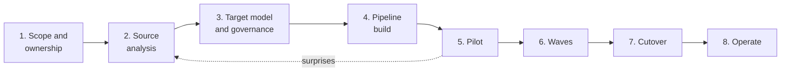

# DI-09 · Migration Playbook

> **Facts as of:** October 2026 (ADME on OSDU milestone M26). The end-to-end
> plan for moving a legacy data store into ADME: phases, waves, cutover and
> rollback. It ties [DI-01](01-choosing-a-route-and-a-tool.md) to [DI-08](08-export-to-analytics-and-ai.md) together.

## TL;DR

- **A migration is a project with gates,** not a pipeline. Each phase ends
  with an **exit gate** that the business signs off, not only IT.
- **Decide governance and identity before loading anything:**
  - partitions, groups and legal tags;
  - the ID rules;
  - the mapping specification.
- **Pilot on ugly data:** a small, representative slice with the worst cases,
  verified by domain experts.
- **Migrate in waves of complete business units,** for example a field with all
  its wells, wellbores, logs and documents. Never split parents from their
  children across waves.
- **Choose a strategy for source changes during the migration:** freeze, delta
  extraction, repeated snapshot comparison, or a parallel run.
- **Plan rollback before cutover.** In ADME there's no "restore a backup":
  you delete the records a bad run created, and write the previous versions
  back for the records it updated.

## 1. The phases at a glance

| Phase | Main outputs | Exit gate | Detail in |
|---|---|---|---|
| **1. Scope and ownership** | Systems and data in or out of scope; data owner and steward per domain; success measures; consumers to switch | Signed scope; named owners | — |
| **2. Source analysis** | Inventory, profiling report, classification into OSDU targets, quality rules | Every source item has a target treatment, or an explicit exclusion | [DI-03](03-source-analysis-and-mapping.md) |
| **3. Target model and governance** | Kinds and versions; ID rules; reference-value mappings; partitions, data groups and legal tags; mapping specification | Mapping specification and governance signed off **before** any load | [DI-03](03-source-analysis-and-mapping.md), [DI-04](04-building-and-loading-records.md) |
| **4. Pipeline build** | Route and tool choice; identities; landing zone; build, load and verify stages; run log; dashboards | A dry run on test data passes the verification ladder | [DI-01](01-choosing-a-route-and-a-tool.md), [DI-02](02-authentication.md), [DI-04](04-building-and-loading-records.md) to [DI-06](06-validation-reconciliation-and-monitoring.md) |
| **5. Pilot** | A load of a representative slice; reconciliation report; expert review | Agreed thresholds met, every difference explained, experts approve the **data** | [DI-06](06-validation-reconciliation-and-monitoring.md) |
| **6. Waves** | Wave plan; per-wave runs and reports; quarantine burn-down | Each wave reconciled and signed off | §2 |
| **7. Cutover** | Final delta; consumers switched; source made read-only or retired | Cutover checklist complete (§4) | §4 |
| **8. Operate** | Ongoing feeds, monitoring, stewardship, change management | Handover to operations owners | [DI-06](06-validation-reconciliation-and-monitoring.md), [DI-07](07-reading-data-apis-and-change-feeds.md) |

## 2. Waves

**Group data by complete business units** that you can measure on their own:
- a **field or asset**, with all its wells, wellbores, logs, trajectories and
  documents;
- a **source system and domain**, for example "WellDB wells", then "log
  archive";
- a **security or legal classification**, for example partner data under one
  contract.

**Order within and across waves:**
- **Shared data first:** reference values, organisations and fields are
  wave 0.
- Within a wave, follow the load order: parents → children → files → WPCs.
- **Don't split a well from its wellbores and logs** across waves. If you must,
  for example when logs come from a different source later, record the deferred
  references and check them when the second wave lands.

**Size the waves:**
- **Throughput is limited** by API throttling, indexing time and file upload
  bandwidth. Measure it in the pilot, then plan wave sizes from the measured
  rate, not from guesses.
- **Run waves in the test environment first** when they bring new data types
  or new mappings.

## 3. Changes in the source during migration

The source keeps changing while you migrate. Pick one strategy per source:

| Strategy | Use when | ADME side |
|---|---|---|
| **Freeze** | The migration is short and the source can be read-only for a while | Simplest: one final load |
| **Delta extraction** | The source has reliable change timestamps or change data capture | Re-run the pipeline on changes. Deterministic IDs + `skipdupes=true` make it safe |
| **Repeated snapshot comparison** | The source has no trustworthy change tracking | Compare snapshot checksums per record; load only the differences |
| **Parallel run** | The business needs proof that both systems agree | Keep both systems live; compare reports or query results for an agreed period |

**Deletions in the source** need a rule too:
- soft delete in ADME;
- or mark the record with `ResourceLifecycleStatus`;
- or ignore them.

Decide which, and log every case.

## 4. Cutover

**Checklist:**
- All waves reconciled; critical quarantine items fixed or formally accepted.
- Final delta loaded and reconciled.
- Consumers tested against ADME with **their own identities**: applications,
  reports, data science users.
- Access spot-checks passed ([DI-06](06-validation-reconciliation-and-monitoring.md)), including restricted data.
- Monitoring and alerts live; support owners named.
- Source status agreed: read-only, retired, or still syncing (as an ongoing
  feed).
- Rollback criteria and procedure confirmed (§5).
- **Timing:** not during an ADME milestone upgrade. Check the instance's
  upgrade setting and window.
- Business and technical owners sign off.

## 5. Rollback in ADME

Rollback is rarely "delete everything". A bad run usually **creates** some
records and **updates** others, and those need opposite treatment. Start from
the run log ([DI-04](04-building-and-loading-records.md)), which lists both.

| Situation | Action in ADME |
|---|---|
| **Records a bad run created** | Soft delete them with `POST /api/storage/v2/records/delete` (up to 500 per call). This is reversible: writing a record with the same ID again restores it |
| **Existing records a bad run updated** | **Don't delete them**: that would hide the good record too. Read the previous version (Storage keeps it, and the run log holds its number) and write it back. That becomes a new version with the old content, ACL, legal tags and relationships |
| **Wrong values in good records** | Fix the mapping and load again. That creates a **new version**, and the old version stays readable for audit |
| **Files and bulk data** | Each service has its own way back. Files a run added: delete them through the File service. Wellbore DDMS: write the previous bulk version again (older versions stay readable). Seismic: delete, or use single-dataset restore (preview, 30 days) |
| **Data that must not exist** (wrong legal basis, personal data) | **Purge**: `DELETE /api/storage/v2/records/{id}` permanently removes the record and all its versions. Only the record's owner with `service.storage.admin` may do it. Delete the files too |
| **Consumers can't work with the new data** | Point consumers back to the source system, which stays read-only (not deleted) until the rollback window ends |
| **Changes made in the source after cutover** | Keep capturing them (delta extraction) until the rollback window closes, so nothing is lost either way |
| **Changes made in ADME after cutover** | Users and applications may already write to ADME. Before switching back, export those changes (from notifications or the run logs of your own feeds) and agree how they get back into the source. Otherwise, switching back loses them |

**Prerequisites:**
- **The run log lists every record each run created or updated,** with the
  previous version number of each update. A batch tag on new and changed
  records helps you find them in search, but the run log is the complete list.
- **The ID mapping table is complete.**
- **The source stays available** until the rollback window ends.
- **The rollback has been rehearsed** on a test environment, at least once.

## 6. Roles

| Role | Responsibilities |
|---|---|
| **Data owner** (business) | Scope, mapping and pilot sign-off, acceptance of exceptions, cutover decision |
| **Data steward** | Code and reference-value mappings, quarantine resolution, quality rules |
| **Domain experts** (geoscience, drilling) | Meaning of the data; pilot and wave review |
| **Integration engineers** | Pipelines, identities, verification, run reports |
| **ADME platform team** | Partitions, groups, legal tags, schemas, monitoring, upgrades |
| **Security and legal** | Access design, legal tags, residency, export rules |
| **Consumer owners** (apps, BI, data science) | Testing against ADME; switching at cutover |

## 7. Deliverables checklist

1. Scope and ownership statement
2. Source inventory and profiling report
3. Target model: kinds, versions, ID rules
4. Governance design: partitions, groups, legal tags, publication rules
5. Mapping specification and lookup tables, version-controlled
6. Architecture and technology decision record
7. Pipeline with run log, ID mapping table and quarantine
8. Verification and reconciliation procedures, and the run-report template
9. Pilot report with expert sign-off
10. Wave plan, source-change strategy, cutover and rollback plan
11. Operations runbook: monitoring, alerts, owners, change process

## Common mistakes

- **Starting with the pipeline** before scope, governance and the mapping are
  agreed.
- **A pilot on the cleanest data,** which then fails in wave 3.
- **Waves that split wells from their children,** leaving orphaned references
  for weeks.
- **No plan for source changes,** which leaves gaps or duplicates at cutover.
- **Deleting the source at cutover,** which removes the rollback option.
- **Treating sign-off as "the pipeline ran green"** instead of the data owner
  accepting the data.
- **Cutover during an ADME milestone upgrade,** with two changes at once and
  unclear blame.

## Go deeper

- [Manifest-based ingestion](https://learn.microsoft.com/azure/energy-data-services/concepts-manifest-ingestion) and [troubleshooting](https://learn.microsoft.com/azure/energy-data-services/troubleshoot-manifest-ingestion) (Microsoft Learn)
- [Manage upgrade settings](https://learn.microsoft.com/azure/energy-data-services/how-to-manage-upgrade-settings) (Microsoft Learn)
- [Storage API: delete and purge](https://community.opengroup.org/osdu/platform/system/storage/-/blob/master/docs/docs/api.md) (OSDU community)
- [Microsoft's TNO open-test-data loader for ADME](https://github.com/Azure/osdu-data-load-tno): an end-to-end example of a bulk load (Microsoft)
