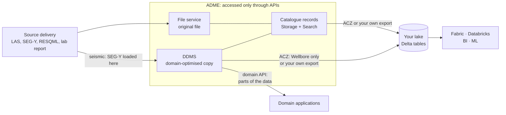
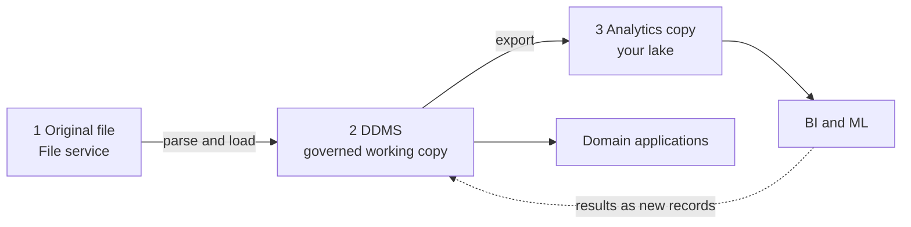

# DDMS-01 · Choosing: File Service, DDMS or Lakehouse

> **Facts as of:** October 2026 (ADME on OSDU milestone M26). Where domain data
> should live, and which copy serves which purpose: the original file, the
> DDMS, or an analytics copy in your own lake.

## TL;DR

- Domain data in and around ADME can exist in **three forms**, each for a
  different job:
  1. **The original file**, the untouched delivery, always downloaded whole.
     It's kept in the File service, except seismic: the original SEG-Y stays
     in the Seismic DDMS's own store.
  2. **The DDMS copy:** domain-optimised storage that **applications** query in
     parts, for example two curves over 500 m, or one slice of a seismic cube.
  3. **The analytics copy:** Delta tables in **your own** lake for Fabric,
     Databricks, BI and ML across many wells.
- **Fabric and Databricks can't read ADME's internal storage.** Data leaves ADME
  only through its APIs, or through an export that writes into your storage.
- **ACZ exports catalogue records and Wellbore DDMS data** (the Wellbore part in
  preview), plus, in preview, entitlement memberships. Seismic, reservoir models
  and lab sample analyses need their DDMS, or your own export.
- **DDMS for applications, lakehouse for analytics.** Most mature setups keep
  **all three** copies, with the DDMS as the governed source and the lake as a
  derived copy.

## 1. Where data can live, and where it can't

| Where | What it holds | Who reads it | How |
|---|---|---|---|
| **File service** | The original file, exactly as delivered (for seismic, the original SEG-Y stays in the Seismic DDMS instead) | Anyone who needs the original, and pipelines that parse it | A signed URL to the **whole file**. ADME doesn't look inside it. |
| **DDMS** | The same content, restructured for fast partial access: curves, seismic bricks, model graphs, analysis tables | Domain applications, and code that needs a part of the data | The DDMS's **domain API**: "these curves, this depth range", "this inline", "this property of this grid" |
| **Your lake** (ADLS Gen2, OneLake) | A copy as Delta Parquet tables | Fabric, Databricks, Power BI, Azure ML | SQL and Spark, across many records at once |

**ADME's own storage isn't one of the options.** Behind the APIs, ADME keeps
blobs, Cosmos DB and an Elasticsearch index, but they're managed by Microsoft
and invisible to you ([DI-05 §1](../data-integration/05-files-and-bulk-data.md#behind-the-apis-admes-internal-stores)).
Even where a DDMS stores Parquet internally, as the Wellbore DDMS and RAFS do,
you can't point Fabric or Databricks at it. You either call the API, or export
a copy into storage you own.

## 2. What each option gives you

| | **File service** | **DDMS** | **Lakehouse copy** |
|---|---|---|---|
| **Unit of access** | The whole file | A part: chosen curves, a depth range, a slice, one array | Rows and columns across many records |
| **Understands the content?** | No. A LAS file is just bytes | Yes: curves, traces, grids, analyses | Yes, once you've modelled the tables |
| **Typical reader** | Archive, re-processing, audit | Domain applications (Petrel and others), services, notebooks needing a slice | Analysts, data scientists, BI |
| **Access control** | Enforced by ADME on the dataset record | Enforced by ADME on every call (record, subproject or dataspace) | **Not carried over.** You re-apply it ([DI-08 §5](../data-integration/08-export-to-analytics-and-ai.md#5-re-applying-access-in-the-copy)) |
| **Freshness** | Current | Current | ACZ: near-real-time. Your own export: your schedule |
| **Interoperability** | Every reader needs its own parser for the format | One standard API per domain, shared by the applications that support it | Open Delta format, but your own table design |
| **Versions and lineage** | New file, new dataset record | Varies: Wellbore and RAFS version the bulk data with the record, Reservoir versions its objects, Seismic Store has no versions (new datasets instead) | Whatever your pipeline keeps |
| **Best at** | Keeping the evidence | Interactive, partial, governed access | Scanning, aggregating and joining at scale |
| **Weak at** | Reading parts, or reading often | Analytics across thousands of objects | Being the source of truth; enforcing ADME's access rules |

## 3. Choosing by need

| The need | Use | Why |
|---|---|---|
| Keep the delivered file as evidence, or re-process it later | **File service** | Exact original, checksum, no transformation |
| An application shows or edits domain data | **DDMS** | Partial reads at interactive speed, standard API, access enforced per user |
| A user needs a small part of a large object | **DDMS** | Downloading and parsing a whole file for one curve or one slice doesn't scale |
| Several vendors' applications work on the same data | **DDMS** | One shared copy instead of one per application |
| Dashboards, statistics, data-quality KPIs | **Lakehouse** | SQL across all wells; Power BI on top |
| ML on curves or tabular features across many wells | **Lakehouse** | Spark scans and joins efficiently; training needs bulk access |
| ML on seismic volumes | **DDMS**, read with OpenVDS, or array copies in your lake | A volume is 3D, not a table, so a Delta copy makes little sense. Training often reads array copies in the lake ([DDMS-03 §6](03-seismic.md#6-alternatives-and-when-each-wins)) |
| Combine domain data with sensor streams, operations or finance data | **Lakehouse** | That data usually lives in the lake or a time-series store, not in ADME. Reported production volumes can come from ADME's `ProductionValues` records |
| An AI agent answers a user's question | **ADME APIs, as the user** | Access is enforced for that user ([DI-08 §6](../data-integration/08-export-to-analytics-and-ai.md#6-ai-integration)) |

**Rule of thumb:** if the question is about **one object, in detail, now**, use
the DDMS. If it's about **many objects, in aggregate**, use the lake.

## 4. The usual pattern: original, DDMS and analytics copy

| Copy | Its role | Owned by |
|---|---|---|
| **1. Original file** | Evidence and source for re-processing. Never deleted after loading into a DDMS. Kept in the File service; for seismic, the SEG-Y stays in the Seismic DDMS | Data management |
| **2. DDMS copy** | The **governed working copy**: what applications use, and what access rules protect | Data management, through the ingestion pipelines |
| **3. Analytics copy** | A **derived** copy for analytics. Rebuildable from ADME at any time. | The analytics or data platform team |

- **One direction of truth:** changes go into ADME, then flow out to the lake.
  Results computed in the lake, such as a cleaned log or a prediction, come back
  as **new records** with lineage, not as edits to the copy
  ([08 §6](../fundamentals/08-analytics-and-ai.md#6-closing-the-loop-writing-results-back-to-adme)).
- **Not every dataset needs all three.** A PDF report needs only the File
  service, plus perhaps a search index. Catalogue records such as wells need
  ADME and, for analytics, a lake copy. The three copies matter most for bulk
  domain data.

## 5. By data type, at a glance

| Data | Original | DDMS | In ACZ? | Lakehouse copy makes sense for… | Chapter |
|---|---|---|---|---|---|
| **Well logs, trajectories, pressure data** | LAS, DLIS, CSV in the File service | **Wellbore DDMS** | **Yes:** the records; bulk data for WellLog and WellboreTrajectory (preview) | Statistics and ML across many wells | [DDMS-02](02-wellbore.md) |
| **Seismic** | SEG-Y, kept in the Seismic DDMS | **Seismic DDMS**: SEG-Y, OpenVDS, ZGY | No | Survey metadata and inventories as tables; training patches as array files, not Delta. Volumes stay in the DDMS | [DDMS-03](03-seismic.md) |
| **Reservoir models** | RESQML packages (EPC + HDF5) | **Reservoir DDMS** | No | Selected properties or summaries, exported with your own pipeline | [DDMS-04](04-reservoir.md) |
| **Rock and fluid sample analyses** | Lab reports (PDF, spreadsheets) | **RAFS DDMS** | No | Analysis results across samples, exported with your own pipeline | [DDMS-05](05-rock-and-fluid-samples.md) |
| **Petrel projects** | Petrel project files | **Petrel Data Services** (SLB, not OSDU) | — | Not directly. Its data is liberated into the OSDU DDMS first | [DDMS-06](06-petrel-data-services.md) |
| **Documents** (reports, scans) | PDF, images | None | Records only | Text and metadata for search and RAG ([DI-08 §6](../data-integration/08-export-to-analytics-and-ai.md#6-ai-integration)) | — |
| **Catalogue records** (wells, wellbores, fields…) | — | Storage + Search | **Yes** | Almost always: they're the dimensions for every analysis | — |

**Note:** since November 2026, ACZ is generally available on the Developer and
Standard tiers, enabled in the Azure portal and billed as an add-on. Its
Wellbore DDMS export is still a preview. Without ACZ, or for data it doesn't
cover, the lakehouse copy comes from **your own export**
([DI-08 §4](../data-integration/08-export-to-analytics-and-ai.md#4-your-own-export-when-acz-isnt-available)).

## 6. Other options in ADME

- **External Data Services (EDS):** when the data already lives in **another
  OSDU platform**, EDS pulls its **metadata** into ADME on a schedule, and the
  files stay at the source until you "naturalise" them by copying them in. It
  answers "make it findable here" without moving the bulk data
  ([06 §4](../fundamentals/06-ddms-and-extensions.md#4-other-extensions-and-adme-specific-additions)).
- **Petrel Data Services:** SLB's service on ADME stores **Petrel projects** and
  can **liberate** their content, for example well logs, into the OSDU DDMS, so
  that other applications can use it. It matters wherever Petrel is the main
  application ([DDMS-06](06-petrel-data-services.md)).

## 7. From needs to options

**Typical needs, and what they point to:**

| The need | Points to |
|---|---|
| Logs are LAS files on a shared drive, and every tool re-imports them | Wellbore DDMS, with the originals in the File service |
| Interpreters wait for large surveys to load | Seismic DDMS, with volumes converted to OpenVDS or ZGY |
| Old surveys are rarely used but expensive to keep | Seismic DDMS storage tiers: Cool or Cold for rarely used surveys (preview; check availability on your tier) |
| Every modelling tool keeps its own copy of the model | Reservoir DDMS |
| Lab results are locked in PDF reports | RAFS DDMS, after parsing the reports |
| Dashboards and ML across all wells | A lakehouse copy, fed by ACZ or your own export |
| Geoscientists work mainly in Petrel | Petrel Data Services, with liberation into the DDMS |

**Questions that decide the choice:**
1. **Who reads the data:** applications, people, or analytics jobs?
2. **How much at once:** one object in detail, or many objects in aggregate?
3. **Which applications** must work on it, and do they support the OSDU DDMS?
4. **How big** is it, and how often is it read?
5. **Where must access rules hold:** only in ADME, or also in the lake?
6. **ACZ or your own export:** is the data covered by ACZ, and is ACZ, a billed
   add-on, enabled on the instance?

## Common misconceptions

- *"Databricks can read the Parquet files ADME stores."* ADME's internal storage
  isn't accessible. Use the APIs, or export a copy into your own storage.
- *"Once data is in the lake, we don't need the DDMS."* The lake is a derived
  copy, without ADME's access enforcement, and domain applications don't read
  it.
- *"Loading into a DDMS replaces the original file."* Keep the original: in the
  File service, or for seismic the SEG-Y in the Seismic DDMS. The DDMS copy is
  restructured for reading.
- *"ACZ exports everything."* Only catalogue records, Wellbore DDMS data
  (preview) and, in preview, entitlement memberships.
- *"The File service is enough, because applications can parse the files."* It
  works for small volumes and few readers. It breaks down when files are large,
  read often, or read in parts.
- *"Seismic belongs in Delta tables like everything else."* A seismic volume is
  a 3D array, often hundreds of gigabytes or more. Applications and ML read it
  in blocks through OpenVDS or ZGY.

## Go deeper

- [DDMS overview](https://learn.microsoft.com/azure/energy-data-services/overview-ddms) and [DDMS concepts](https://learn.microsoft.com/azure/energy-data-services/concepts-ddms) (Microsoft Learn)
- [Analytics Consumption Zone concepts](https://learn.microsoft.com/azure/energy-data-services/concepts-analytics-consumption-zone) (Microsoft Learn)
- [OSDU services available (and unavailable) on ADME](https://learn.microsoft.com/azure/energy-data-services/osdu-services-on-adme) (Microsoft Learn)
- In this guide: loading each DDMS in [DI-05](../data-integration/05-files-and-bulk-data.md), exporting and re-applying access in [DI-08](../data-integration/08-export-to-analytics-and-ai.md), and choosing the analytics platform in [fundamentals 08](../fundamentals/08-analytics-and-ai.md)
