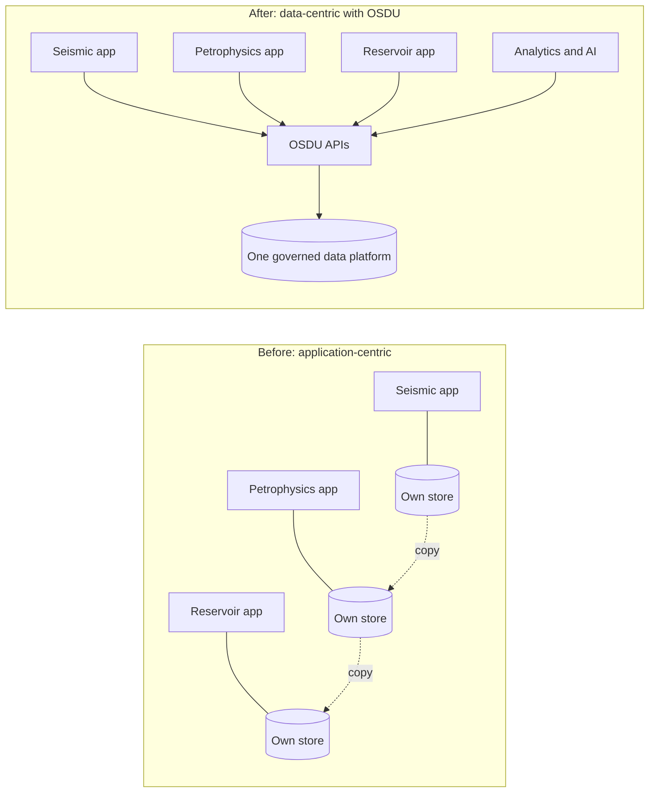
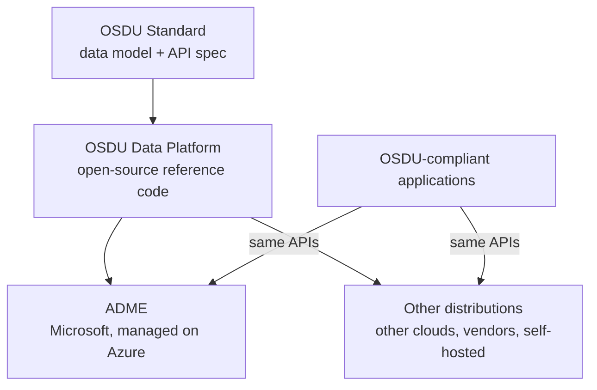

# 01 · Why OSDU and ADME

> **Facts as of:** October 2026 (ADME on OSDU milestone M26)

## TL;DR

- Energy companies keep subsurface data in **application-specific silos and
  proprietary formats**. Finding, trusting and reusing it is slow, and every new
  application needs another integration.
- **OSDU** is an open industry **standard** (a shared data model plus APIs) together
  with an **open-source reference platform** that implements it. Its core idea is
  to **separate data from applications**.
- **ADME (Azure Data Manager for Energy)** is Microsoft's **fully managed Azure
  service that runs the OSDU Data Platform**. OSDU is to ADME what Kubernetes is
  to AKS.
- What you gain: one governed system of record that OSDU-compatible applications
  can use (check each application's milestone and DDMS support), one search
  across all data, access and legal rules carried by every
  record, and a clean foundation for analytics and AI.
- Microsoft runs the platform. **You still own** the data, its mapping to OSDU,
  governance design, ingestion and consumption.
- ADME **complements** Fabric and Databricks; it does not replace them.

## 1. The problem OSDU solves

Oil and gas assets live for decades. Norway's Ekofisk field was discovered in 1969
and is expected to produce for decades more, so data recorded on paper in the
1960s is still in use. Over that time, data has piled up in an
**application-centric** way:

- Each specialist application (seismic interpretation, petrophysics, reservoir
  modelling…) keeps its **own project database and formats**.
- Data is **copied** between applications, so copies drift apart and nobody knows
  which version is the master.
- Moving data between vendors' tools needs **custom, point-to-point
  integrations**, which locks customers into vendors.
- Finding the right dataset is slow. Well logs, for example, exist in huge
  numbers, and picking the best one takes real effort.
- Data comes with **legal strings attached** (licences, partner contracts, country
  export rules), and those rules rarely travel with the copies.

## 2. What OSDU is

The **OSDU Forum** is an industry consortium run by **The Open Group**, a
vendor-neutral standards body.

- **Origins:** founded in **September 2018**, starting from Shell's donated
  *Subsurface Data Universe* (SDU) code. SLB donated its DELFI data services in
  July 2019.
- **Members:** about **190 organisations**, including major oil operators,
  software vendors and the **four major clouds** (Microsoft, AWS, Google, IBM/Red
  Hat).
- **Name:** OSDU originally stood for *Open Subsurface Data Universe*. It is now
  just a trademark, because the scope has widened beyond subsurface data (for
  example to carbon storage).

The Forum delivers three things:

| Deliverable | What it is |
|---|---|
| **OSDU Standard** | The data model (schemas, reference values) and API specification. **Version 1.0** was announced on 9 June 2026 (the document is dated 29 April 2026). It's a stable, certifiable subset that deliberately lags behind the code. |
| **OSDU Data Platform** | The open-source **reference implementation**: a set of microservices for storage, search, schemas, access control, ingestion and domain data. |
| **OSDU Test Suite** | Tests used to certify that a platform conforms to the standard. |

**Releases:** the platform ships as **milestones** (M1, M2, … under the "R3 /
Mercury" release line from 2021). **M26** was released in May 2026.

### What OSDU standardises

| Area | Examples (detail in later docs) |
|---|---|
| **Data definitions** | Schemas for Well, Wellbore, WellLog, SeismicTraceData…; reference lists such as units and coordinate systems |
| **Record format** | Every item is a JSON record with an ID, type, access list, legal tag and payload |
| **Core services and APIs** | Storage, Search, Schema, File/Dataset, Notification… |
| **Governance** | Group-based access control (entitlements) and legal tags on every record |
| **Domain services (DDMS)** | The **pattern and requirements** for domain services, for example reusing the platform's access control, legal tags and search. The individual DDMS (wellbore, seismic, reservoir, samples…) are community-built services, **each with its own API and storage formats**. See [doc 06](06-ddms-and-extensions.md). |

**OSDU is not** a database product, a file format, an analytics engine or an
end-user application. It is a **contract**, plus an implementation of that contract,
that applications and data can rely on.

## 3. What ADME is

**Azure Data Manager for Energy** is a first-party Azure PaaS that runs the OSDU
Data Platform for you. It was built in partnership with SLB.

- **History:** previewed in 2022 as *Microsoft Energy Data Services* (Learn URLs
  still say `energy-data-services`). Generally available since **July 2023**.
- **Version:** currently compliant with **OSDU milestone M26**.
- **What Microsoft operates:** deployment, monitoring, scaling, security patches
  and upgrades to new milestones.
- **Built-in security:** sign-in through **Microsoft Entra ID**, plus
  encryption in transit and at rest.
- **Scope:** ADME offers **most, not all**, OSDU services; [doc 05](05-platform-services.md) and
  [doc 06](06-ddms-and-extensions.md) list what's included. One instance holds
  one or more **data partitions**, which are isolated data spaces.

**Analogy:** Kubernetes is open source and AKS runs it for you, and in the same way
OSDU is open and ADME runs it for you. One difference: AKS lets you
deploy your own workloads inside it, but ADME exposes **only the OSDU APIs**. You
get no access to its underlying infrastructure.

### Tiers

| | Developer | Standard |
|---|---|---|
| Purpose | Dev, test, proofs of concept, training | Production |
| Financially backed SLA | No | Yes |
| Availability zones / disaster recovery | No / No | Yes / Yes (in most regions) |
| Data partitions (included / max) | 1 / 5 | 1 / 10 |
| Throughput | Low | High |

**Pricing:**
- You pay a fixed hourly fee per instance, **even when it's idle**.
- Each data partition after the first is charged extra.
- Since 1 August 2026, storage is also billed, at standard Azure storage rates.
- Check the [pricing page](https://azure.microsoft.com/pricing/details/energy-data-services/)
  for current numbers.

## 4. Why ADME instead of running OSDU yourself

The open-source platform is free to run, but it's a large distributed system. It has
dozens of microservices plus search clusters, workflow engines (Airflow), message
queues and databases. Self-hosting means **you** deploy, secure, patch, scale and
upgrade all of it for every milestone.

| ADME gives you | ADME takes away |
|---|---|
| Managed operations and upgrades | Most control over upgrades and internal configuration: you can defer a milestone upgrade by up to 30 days, but not skip it |
| SLA, availability zones and disaster recovery (Standard tier) | Services Microsoft doesn't offer (see [doc 06](06-ddms-and-extensions.md)) |
| Azure-native security: Entra ID, Private Link, customer-managed keys | Some flexibility: for example, you can't move an instance to another subscription; you have to re-create it and re-ingest the data |
| Microsoft support and apps that are already integrated (for example SLB, Halliburton) | Being on the newest community milestone the day it's released |

### Who is responsible for what

| Microsoft | You (the customer or project team) |
|---|---|
| Running the OSDU services | Deciding which data goes in, and mapping it to OSDU schemas |
| Infrastructure, scaling, patching | Data quality, identifiers, relationships |
| Milestone upgrades | Designing access groups, legal tags and partitions |
| Platform security and encryption | Ingestion pipelines and their monitoring |
| Platform availability (SLA) | Applications, analytics and AI built on top |

## 5. What you gain

- **Business:** one trusted place for subsurface data, the freedom to swap
  vendors' applications, faster onboarding of new tools, and less time
  spent hunting for and reconciling data.
- **Data management:** shared industry schemas, version history on every record,
  and lineage between raw files and the results interpreted from them.
- **Governance:** access lists and legal tags are part of **every record**, not
  an afterthought.
- **Data and AI:** one search API (full-text, filters, geospatial) over all
  metadata, consistent entities for building features and training sets, and
  governed documents and records as a source for AI assistants. See
  [doc 08](08-analytics-and-ai.md).

## 6. Why not just a data lake, Fabric or Databricks?

| Need | Plain lake, Fabric or Databricks | ADME (OSDU) |
|---|---|---|
| Industry data model | You invent and maintain your own | Shared community schemas |
| Vendor application support | A custom integration for each vendor | Applications already speak the OSDU APIs |
| Per-record access and legal rules | You build them yourself | Built in |
| Seismic and well-log bulk data | Generic files | Domain-optimised services and formats |
| Large-scale BI, SQL and ML | **Strong** | Not designed for this |

They work together: **ADME is the governed system of record** for subsurface
data, and **Fabric or Databricks run analytics** on curated copies of it. When data
is copied out of ADME, its access lists and legal tags **don't travel with it**, so
the copy needs its own controls.

## Common misconceptions

- *"OSDU is a database or a file format."* It's a standard plus a platform made of
  many services.
- *"ADME is all of OSDU."* It's a managed **subset**, tied to a specific milestone.
- *"Managed means Microsoft migrates and maps our data."* No, data work stays
  with the customer or project team.
- *"ADME replaces our lakehouse."* It's the governed source; analytics stay on
  the lakehouse.
- *"It's only for oil."* It started in oil and gas subsurface work, and the scope
  now reaches into areas such as carbon storage.

## Go deeper

- [What is Azure Data Manager for Energy?](https://learn.microsoft.com/azure/energy-data-services/overview-microsoft-energy-data-services) (Microsoft Learn)
- [ADME tiers](https://learn.microsoft.com/azure/energy-data-services/concepts-tier-details) and [ADME FAQ](https://learn.microsoft.com/azure/energy-data-services/faq-energy-data-services) (Microsoft Learn)
- [OSDU services available on ADME](https://learn.microsoft.com/azure/energy-data-services/osdu-services-on-adme) (Microsoft Learn)
- [The OSDU Data Platform – A Primer](https://www.opengroup.org/osdu-forum/blog/mar-2023-osdu-platform-primer-1) (The Open Group)
- [OSDU Data Platform Standard](https://www.opengroup.org/osdu-forum/business-hub/osdu-data-platform-standard) (The Open Group)
