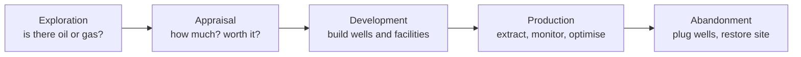

# 02 · Energy Domain Primer

> **Goal:** just enough oil and gas vocabulary to read
> OSDU schemas and talk to domain experts. Each term is mapped to its OSDU entity.

## TL;DR

- Upstream oil and gas follows a **lifecycle**: explore → appraise → develop →
  produce → abandon. Every stage produces data that OSDU stores.
- **Seismic** gives a picture of the subsurface. **Wells** test that picture and
  measure the rock directly.
- **Well ≠ wellbore.** A well is the surface installation; a wellbore is one
  drilled path, and one well can have several. Measurements belong to a
  **wellbore**.
- **Depth is ambiguous** without saying *how* (along the hole or vertical) and
  *from where* (which reference point). **Coordinates are ambiguous** without their
  **coordinate reference system (CRS)**.
- Most domain data is **big numeric arrays** (log curves, seismic traces, models)
  plus **metadata** about them. That's why OSDU separates records from files.

## 1. The lifecycle and the data it produces



| Stage | What happens | Main data produced | Typical OSDU entities |
|---|---|---|---|
| **Exploration** | Study regional geology, shoot seismic, drill a first well | Seismic surveys, regional maps, exploration well data | SeismicAcquisitionSurvey, SeismicTraceData, Basin, Play, Prospect |
| **Appraisal** | Drill more wells to measure the size and quality of a discovery | Well logs, cores, pressure tests, fluid samples | Well, Wellbore, WellLog, RockSample, WellPressureTestRawMeasurement |
| **Development** | Design and drill production wells, build facilities | Well plans, trajectories, reservoir models | WellboreTrajectory, WellPlanningWellbore, reservoir model entities |
| **Production** | Extract hydrocarbons, monitor and optimise | Production volumes, well tests, downtime, sensor streams | ProductionValues, FlowTest, DowntimeEvent |
| **Abandonment** | Seal wells permanently, decommission | Plugging records, final reports | Wellbore status, Document |

Data is reused across stages for decades. A log from the 1970s can still inform
today's drilling decisions, which is why OSDU cares about lineage, units and
reference points.

## 2. Where things are: from basin to reservoir

| Term | Meaning | OSDU |
|---|---|---|
| **Basin** | A large region where sediments accumulated over millions of years | `master-data--Basin` |
| **Play** | A geological idea about how oil or gas could be trapped in a basin | `master-data--Play` |
| **Prospect** | A specific location believed to hold oil or gas; not yet drilled | `master-data--Prospect` |
| **Field** | A proven accumulation being developed or produced | `master-data--Field` |
| **Reservoir** | The porous rock layer inside a field that actually holds the fluids | `master-data--Reservoir` |
| **Formation** | A named rock layer, for example "Brent Group" | Reference data and markers |
| **Licence, block, concession** | A government-granted area or right to explore or produce | `master-data--GeoPoliticalEntity` |

Records link to these areas through `GeoContexts[]`, for example: this wellbore is
in field X, in country Y, in basin Z.

## 3. Wells and wellbores

```text
          Well "NO 1234/5"  (surface location, rig, operator)
              │
      ┌───────┴────────┐
  Wellbore A       Wellbore B (sidetrack, kicked off from A)
  vertical          deviated → horizontal
      │                    \
   logs, trajectory,        logs, trajectory,
   formation tops           formation tops
```

| Term | Meaning | OSDU |
|---|---|---|
| **Well** | The surface installation and business asset (location, operator, status) | `master-data--Well` |
| **Wellbore** | One drilled path, starting at the surface or at a **kick-off point** in another wellbore, down to its end. **Sidetracks** and **multilateral** branches are additional wellbores of the same well. | `master-data--Wellbore` (`WellID`, `KickOffWellbore`) |
| **Vertical / deviated / horizontal** | The shape of a wellbore: straight down; deliberately drilled at an angle to reach a target that isn't directly below the rig; or turned to run roughly flat (about 90°) along the reservoir layer | `Wellbore.TrajectoryTypeID` (reference data) |
| **Trajectory** | The 3D path of a wellbore, measured at survey stations (depth, inclination, azimuth) | `work-product-component--WellboreTrajectory` |
| **Total depth (TD)** | The deepest point drilled | A wellbore `VerticalMeasurement` |
| **Spud, completion** | Start of drilling; preparing a wellbore to produce | Dates and status in `FacilityEvents` / `FacilityStates` |

## 4. Depth: always ask "along what?" and "from where?"

| Term | Meaning |
|---|---|
| **MD (measured depth)** | Distance **along the hole**. For a deviated wellbore, MD is longer than the vertical depth. |
| **TVD (true vertical depth)** | **Straight-down** distance from the reference point |
| **TVDSS** | TVD below **mean sea level (MSL)** |
| **Datum / reference point** | Where zero is: **KB** (kelly bushing), **DF** (drill floor), **RT** (rotary table), **GL** (ground level) or **MSL** |

```text
   KB ─┬─ 0 m MD/TVD (reference point on the rig)
       │  25 m air gap
   MSL ┼─ 
       │  water
       │      \
       │       \  deviated wellbore
       │        \   MD = 3,150 m along the hole
       ▼         ●  TVD = 2,400 m straight down from KB
```

Key points:
- The same rock layer has different MD values in different wellbores, but
  comparable TVDSS values. Geologists compare wells in TVDSS.
- **Converting units never turns MD into TVD.** You need the trajectory to do
  that.
- **OSDU:** wells and wellbores keep a `VerticalMeasurements[]` array of reference
  points (KB, DF, GL, TD…). Each depth-bearing record says which reference it uses.
  See *Vertical Measurements* in Go deeper.

## 5. Location: coordinates need a CRS

| Term | Meaning |
|---|---|
| **CRS** | Coordinate reference system: defines what a pair of numbers means on Earth |
| **Geographic CRS** | Latitude and longitude on a model of the Earth (a **datum**), for example WGS 84 or ED50 |
| **Projected CRS** | A flat x/y grid in metres, for example UTM zone 31N. It's derived from a geographic CRS. |
| **EPSG code** | A standard ID for a CRS, for example `EPSG:4326` = WGS 84 or `EPSG:23031` = ED50 / UTM 31N |

**Why there are several datums.** The Earth isn't a perfect sphere, so surveyors
approximate it with an ellipsoid (a slightly squashed sphere). Before
satellites, each region picked the ellipsoid and anchor point that fitted *its
own* area best. Two datums you'll see constantly:

| Datum | Scope | Where you meet it |
|---|---|---|
| **WGS 84** (World Geodetic System 1984) | Global, defined by satellites | GPS, web maps, modern data, OSDU search |
| **ED50** (European Datum 1950) | Regional, from post-war ground surveys | Much legacy European data, especially North Sea wells and seismic from the 1960s–1990s |

The same latitude/longitude means a **different physical point** in each datum.
Between ED50 and WGS 84 the gap is typically **around 100 m or more**, which is
enough to miss a drilling target. Converting between them needs a specific
published **transformation**, not just arithmetic. Think of a datum as a
*timezone for positions*: "60.5° N, 2.5° E" is as ambiguous as "14:00" until
you know which one applies.

**OSDU** keeps the original (`AsIngestedCoordinates` + its CRS) **and** a WGS 84
copy for search. CRSs and units are reference data (`CoordinateReferenceSystem`,
`UnitOfMeasure`).

## 6. Measuring along the wellbore

| Term | Meaning | OSDU |
|---|---|---|
| **Well log** | Measurements recorded along a wellbore, usually against depth. **Wireline** logs are recorded after drilling; **LWD** (logging while drilling) logs are recorded during it. | `WellLog` |
| **Curve** | One measured property in a log, identified by a **mnemonic** | `WellLog.Curves[]` |
| **Common curves** | **GR** gamma ray (rock type), **RES** resistivity (fluids), **RHOB** density and **NPHI** neutron (porosity), **DT** sonic (rock properties) | `LogCurveMainFamily` / `LogCurveFamily` reference data |
| **Formation top / marker** | The depth where a rock layer starts in a wellbore | `WellboreMarkerSet.Markers[]` |
| **Core, cuttings, fluid sample** | Physical rock and fluid taken from the well and analysed in a lab | `RockSample`, `SamplesAnalysis` (Rock & Fluid Samples DDMS) |
| **Pressure test** | A measurement of reservoir pressure, either at points or over time | `WellPressureTestRawMeasurement` |

**File formats:**
- **LAS**: a text format, usually one log per file, small (KB to MB).
- **DLIS**: a binary format that can hold many logs and arrays.

**How a log is stored in OSDU: description in the record, values elsewhere.**
The `WellLog` record describes the log and each of its curves. The measured
values themselves stay in the file, or in the Wellbore DDMS.

```jsonc
// work-product-component--WellLog (trimmed): searchable description
"data": {
  "WellboreID": "contoso-dp1:master-data--Wellbore:NO-1234-A:",
  "ReferenceCurveID": "DEPT",            // the index curve (depth)
  "SamplingInterval": 0.1524,            // one sample every 15 cm
  "NullValue": "-999.25",                // marker for "no reading"
  "Curves": [
    { "Mnemonic": "GR",                  // vendor's short name
      "CurveUnit": "contoso-dp1:reference-data--UnitOfMeasure:gAPI:",
      "LogCurveMainFamilyID": "contoso-dp1:reference-data--LogCurveMainFamily:Gamma%20Ray:",
      "LogCurveFamilyID":     "contoso-dp1:reference-data--LogCurveFamily:Gamma%20Ray:",
      "SamplingStart": 1200.0, "SamplingStop": 3150.0 },
    { "Mnemonic": "RHOB",
      "CurveUnit": "contoso-dp1:reference-data--UnitOfMeasure:g%2Fcm3:",
      "LogCurveMainFamilyID": "contoso-dp1:reference-data--LogCurveMainFamily:Density:",
      "LogCurveFamilyID":     "contoso-dp1:reference-data--LogCurveFamily:Bulk%20Density:",
      "SamplingStart": 1450.0, "SamplingStop": 3150.0 }
  ],
  "Datasets": [ "contoso-dp1:dataset--File.Generic:91ab…:" ]   // → the LAS file
}
```

```text
# the LAS file behind the dataset: thousands of rows, never in the record
DEPT      GR       RHOB
1200.00   45.2   -999.25
1200.15   47.8   -999.25
...
3150.00   62.1     2.41
```

- **Mnemonics differ by vendor** (`GR`, `SGR`, `GRC`…). The **curve families**
  are a shared classification, so "find every gamma-ray curve" works across
  vendors.
- `LogCurveTypeID` appears in older examples. It's **deprecated**; use the two
  family fields instead.

A wellbore can have hundreds of logs from different runs and vendors. Picking the
right one is a real data-management problem.

## 7. Seismic in one page

Seismic is how geoscientists **see underground without drilling**. It works like
an ultrasound scan of the Earth. Sound waves are sent into the ground, and each
boundary between rock layers reflects part of the energy back to the surface.
Recording how long the echoes take, and how strong they are, gives an image of
the layers and of the structures that might trap oil or gas.

Seismic covers large areas cheaply compared with drilling, but it's indirect and
needs heavy processing and expert interpretation. In practice:
- **seismic** tells you *where* to drill;
- **wells** tell you *what's actually there*.

The terms you'll meet:

- **How it's acquired:** a source sends sound into the ground, typically air
  guns at sea or vibrator trucks on land. Receivers record the echoes from rock
  layers.
- **Trace:** one recording, amplitude against time, for one position.
  **2D** surveys produce lines; **3D** surveys produce a cube.
- **Inline / crossline:** the two horizontal axes of a 3D grid. Their layout is
  described by a **bin grid**.
- **Domain:** raw seismic is in **time** (milliseconds of two-way travel). After
  velocity modelling it can be converted to **depth**.
- **Processing:** raw **pre-stack** data (many traces per position) is
  processed into a **post-stack** image (one trace per position). Processing takes
  months, and the same survey may be **reprocessed** years later.
- **Interpretation:** geoscientists pick **horizons** (layer boundaries) and
  **faults** on the image.
- **Size:** a single 3D volume ranges from tens of GB to several TB.

**File formats:**
- **SEG-Y**: the interchange standard.
- **OpenVDS** and **ZGY**: compressed, cloud-friendly formats for fast access.
- **SEG-D**: raw field recordings.

| Concept | OSDU |
|---|---|
| Survey campaign | `master-data--SeismicAcquisitionSurvey` |
| Processing project | `master-data--SeismicProcessingProject` |
| Processed volume or line | `work-product-component--SeismicTraceData` |
| Grid geometry | `work-product-component--SeismicBinGrid` |
| Horizons, faults | `SeismicHorizon`, `SeismicFault` (and `*Interpretation` types) |

## 8. Models and production, briefly

- **Reservoir model:** a 3D grid of the reservoir with rock and fluid properties,
  built from seismic, logs and cores. It's used to estimate volumes and to
  **simulate** future production. The industry exchange format is **RESQML**
  (Reservoir DDMS).
- **Production data:** volumes of oil, gas and water per well and period
  (measured or **allocated**), well tests and downtime. It's reported daily or
  monthly. High-frequency sensor streams are a separate case, covered in
  [doc 04](04-entities-and-files.md).
- **Units:** oil in barrels (bbl) or m³, gas in standard cubic feet (scf) or Sm³,
  pressure in bar or psi. Always record the unit, as reference data.

**Beyond oil and gas:** the same concepts apply to **carbon capture and storage**
(injection wells, storage sites, monitoring) and **geothermal** wells. OSDU's
scope already reaches carbon storage; geothermal mostly reuses the same well
concepts.

## Common misconceptions

- *"Depth is a number."* It's a number **plus** a path (MD or TVD) **plus** a
  reference point.
- *"Lat/long is universal."* Only together with its datum. ED50 and WGS 84 differ.
- *"A well log is a file."* It's a set of curves. Files (LAS, DLIS) are just one
  container, and one DLIS can hold many logs.
- *"Seismic is an image."* It's a large numeric volume, and it's interpreted, not
  just viewed.
- *"Old data is obsolete."* Fields produce for decades; legacy data is often still
  critical.

## Go deeper

- [OSDU Data Definitions: Well Basics (Well, Wellbore, Trajectory, WellLog)](https://community.opengroup.org/osdu/data/data-definitions/-/blob/master/Guides/Chapters/10-WellBasics.md) (OSDU community)
- [OSDU Data Definitions: Vertical Measurements](https://community.opengroup.org/osdu/data/data-definitions/-/blob/master/Guides/Chapters/03-VerticalMeasurements.md) (OSDU community)
- [OSDU Data Definitions: Frame of Reference (units, CRS)](https://community.opengroup.org/osdu/data/data-definitions/-/blob/master/Guides/Chapters/04-FrameOfReference.md) (OSDU community)
- [OSDU Data Definitions: Geographic Entities](https://community.opengroup.org/osdu/data/data-definitions/-/blob/master/Guides/Chapters/08-GeographicEntities.md) (OSDU community)
- [OSDU Data Definitions: Seismic Projects and Related Data](https://community.opengroup.org/osdu/data/data-definitions/-/blob/master/Guides/Chapters/09-SeismicProjectsAndRelatedData.md) (OSDU community)
- [Oil and petroleum products explained](https://www.eia.gov/energyexplained/oil-and-petroleum-products/) (U.S. Energy Information Administration)
- [EPSG Geodetic Parameter Dataset](https://epsg.org/) (IOGP)
