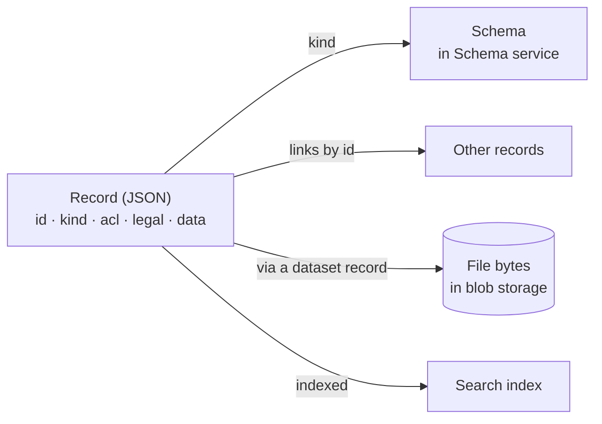
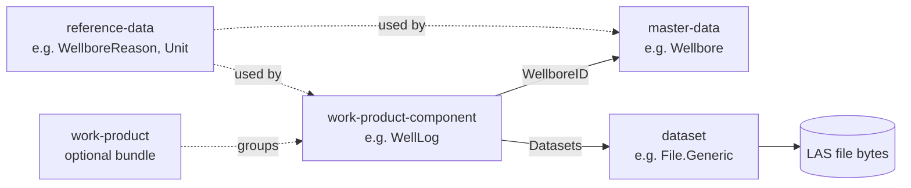

# 03 · The OSDU Data Model

> **Facts as of:** October 2026 (OSDU data definitions on
> the community `master` branch; your ADME instance may run slightly older schema
> versions)

## TL;DR

- **Everything is a record.** A record is a JSON document with a fixed **envelope**
  (`id`, `kind`, `acl`, `legal`, …) and a **`data`** payload whose shape is defined
  by a schema.
- **`kind`** names the schema, for example `osdu:wks:master-data--Wellbore:1.5.1`.
  **`id`** identifies one object, for example
  `contoso-dp1:master-data--Wellbore:NO-1234-A`.
- `data` holds **facts about the object, links to other records and small lists of
  values**. Bulk numbers (log curves, seismic traces) live in **files** that the
  record points to through dataset records.
- The **group type** is the prefix before `--` in `kind` and `id`. It works like a
  **base class**: it decides which shared fields a schema has and what role the
  record plays. There are five: **reference**, **master**,
  **work-product-component**, **dataset** and **work-product**.
- Records link **by ID**. Every change to `data` creates a **new version**, and old
  versions are kept.
- Every record carries its own **access list** (`acl`) and **legal tags**
  (`legal`). Governance is part of the data, not a layer on top.

## 1. Mental model

Think of OSDU as a **governed catalogue of JSON documents** plus **file storage**:



If you know data platforms, the closest comparison is a **document database whose
rows carry their own permissions and legal tags**, each row typed by a versioned
JSON Schema, with large files kept beside it in blob storage.

## 2. Anatomy of a record

A trimmed example of a Wellbore record:

```json
{
  "id": "contoso-dp1:master-data--Wellbore:NO-1234-A",
  "kind": "osdu:wks:master-data--Wellbore:1.5.1",
  "version": 1727712345678901,
  "acl": {
    "owners":  ["data.wells.owners@contoso-dp1.dataservices.energy"],
    "viewers": ["data.wells.viewers@contoso-dp1.dataservices.energy"]
  },
  "legal": {
    "legaltags": ["contoso-dp1-norway-licence-123"],
    "otherRelevantDataCountries": ["NO"]
  },
  "tags": { "project": "pilot" },
  "ancestry": { "parents": [] },
  "meta": [ { "kind": "Unit", "name": "m",
              "unitOfMeasureID": "contoso-dp1:reference-data--UnitOfMeasure:m:",
              "persistableReference": "…",
              "propertyNames": ["VerticalMeasurements[].VerticalMeasurement"] } ],
  "data": {
    "FacilityName": "NO 1234/5-A",
    "WellID": "contoso-dp1:master-data--Well:NO-1234:",
    "WellboreReasonID": "contoso-dp1:reference-data--WellboreReason:Appraisal:",
    "VerticalMeasurements": [ { "VerticalMeasurement": 3150.0 } ]
  }
}
```

| Field | Who sets it | Required? | Purpose |
|---|---|---|---|
| `id` | You or the system | Optional (generated if missing) | `{partition}:{group-type}--{EntityType}:{unique-key}`. Stable identity across versions. |
| `kind` | You | **Yes** | `{authority}:{source}:{group-type}--{EntityType}:{semver}`. `wks` means *well-known schema* (published by OSDU). |
| `version` | System | — | A new number on every change to `data`. All versions are kept. |
| `acl` | You | **Yes** | Owner and viewer **entitlement groups**, written as email addresses (see section 6). |
| `legal` | You | **Yes** | One or more **legal tags**, plus other relevant countries. The system adds a compliance `status`. |
| `data` | You | Per schema | The business payload (see below). |
| `ancestry.parents` | You | Optional | Lineage: the records this one was derived from. |
| `meta[]` | You | Optional | Frame of reference: which **unit**, **CRS** or date format a property uses, so the platform can convert values. |
| `tags` | You | Optional | Free-form string key/values. Indexed, so you can search on them. |
| `createTime/User`, `modifyTime/User` | System | — | Audit fields. |

### What goes into `data`

`data` holds **metadata about the object plus small sets of real values**. It
normally contains five kinds of content:

| Content | Examples | Notes |
|---|---|---|
| **Plain business values** | `FacilityName`, `TopMeasuredDepth`, `DatePublished` | Text, numbers, dates |
| **Links to other records** (fields ending in `ID`/`IDs`) | `WellID` (master), `WellboreReasonID` (reference), `Datasets[]` (dataset) | Always record IDs, **never URLs** |
| **Structured lists** | `NameAliases[]` (other names and source IDs), `VerticalMeasurements[]` (depth reference points), `Curves[]` (a log's curve list and units) | Arrays of objects; searchable |
| **Location** | `SpatialLocation` | GeoJSON; see section 7 |
| **Your extras** | `ExtensionProperties` | Anything the schema doesn't cover. Stored, but **not searchable**. |

**Small values go inside `data`; bulk values go into files.** A
`WellboreMarkerSet` stores its tens of markers (`MarkerName`,
`MarkerMeasuredDepth`) directly in `data`. A `WellboreTrajectory` only *describes*
its columns in `data`, and its thousands of survey points sit in a file. The rule
of thumb:
- if a person would read it as a fact about the object, it goes in `data`;
- if it's a series of numbers a program processes, it goes in a file, and `data`
  describes it.

**How a record reaches a file.** The chain has four steps:
1. A business record lists **dataset record IDs** in `Datasets[]`.
2. Only the dataset record holds the file location (`FileSource`), which is an
   internal platform path.
3. To read the bytes, you ask the File/Dataset service for a **short-lived signed
   URL**.
4. You download the file from that URL.

## 3. Kinds and schemas

- **A schema describes the whole record**, not just `data`.
  - The envelope (`id`, `kind`, `acl`, `legal`, …) is defined in every schema and is
    the same everywhere.
  - The schema also fixes the `id` format: a Wellbore's `id` must contain
    `master-data--Wellbore`.
  - What differs between schemas is the **`data`** part.
- **Look it up:** `GET /api/schema-service/v1/schema/{kind}`. ADME comes with the
  OSDU well-known schemas **preloaded**.
- **Almost nothing in `data` is required.** In the well-known schemas only `kind`,
  `acl` and `legal` are mandatory.
  - Well, Wellbore and WellLog have **no** required `data` fields.
  - Datasets require `FileSource`.
  - Which fields *your* organisation must fill in is a data-quality rule you
    define yourself.
- **Platform hints:** schemas carry `x-osdu-*` annotations that the platform reads.
  - `x-osdu-relationship`: "this field points to a Wellbore".
  - `x-osdu-indexing`: how Search should index an array.
  - `x-osdu-frame-of-reference`: "this number is a depth with a unit".
- **Versions:** schemas use semantic versioning, and a record states the exact
  version in its `kind`. Schema releases follow their own community schedule, not
  platform milestones. ADME brings in the versions current at each milestone
  upgrade.
- **Extending the model:**
  - **Simplest:** put extra fields in `data.ExtensionProperties`, which every
    schema has. They're stored and returned by Storage, but **not searchable**.
    If users must search by them, use a separate record of your own kind that
    links to the standard record (a "side-car"), with the fields declared in
    its schema.
  - **Own kind:** for a different shape, register a schema under your own
    authority (for example `contoso:welldb:…`) with
    `POST /api/schema-service/v1/schema`. Rules:
    - status: DEVELOPMENT (editable) → PUBLISHED (immutable). Only a
      DEVELOPMENT schema can be marked OBSOLETE;
    - scope: your own schemas are INTERNAL to one partition. The OSDU
      well-known schemas are SHARED across all partitions;
    - the service **rejects breaking changes** unless you raise the major
      version.
  - **If you don't register the schema:** the Storage API generally still accepts
    the record, but Search can't index its `data` (the record shows
    `index.statusCode: 404`), and manifest ingestion rejects it. **In practice,
    always register.**
- **Validation:**
  - The **manifest ingestion** workflow checks records against their schema and
    confirms that referenced records exist.
  - **Direct writes to the Storage API** check the envelope (ACL groups, legal
    tags) but **don't** fully validate `data`.

## 4. Group types

**Where you see it:** there's no `groupType` field. It's the prefix before `--`
in the entity-type name, inside `kind` and `id`:

```text
kind:    osdu:wks:master-data--Wellbore:1.5.1
id:   contoso-dp1:master-data--Wellbore:NO-1234-A
                  └──group──┘  └entity┘
```

**What it changes:** the group type works like a **base class**. Every schema is
assembled from reusable *abstract* fragments, and the group type decides which
base fragment it includes. That base fragment gives the schema its shared
`data` fields. The group type also decides:
- the record's role in relationships;
- which section of an ingestion manifest it goes into;
- which services act on it (the File/Dataset services only handle `dataset--*`);
- how its identity and versioning are expected to behave.



| Group type | In one line | Entity types* |
|---|---|---|
| **reference-data** | Controlled lists of values | ~430 |
| **master-data** | Real-world things and business activities | ~90 |
| **work-product-component** | What a piece of digital content means | ~100 |
| **dataset** | The file itself | ~28 |
| **work-product** | A delivery bundle | 1 |

\* Distinct entity types on the community `master` branch, October 2026, plus
~100 *abstract* fragments that are building blocks and are never stored as records.

**The key rule:** master data **never owns files**. A file always hangs off a
work-product-component, which describes what the file contains and links it to
its master object.

### 4a. Reference data: the lookup values

- **What:** the allowed values for coded fields, for example units of measure,
  wellbore reasons, log types and coordinate reference systems.
- **Each value is a record.** It has its own `id`, `kind`, `acl` and `legal`.
  Shared `data` fields (from `AbstractReferenceType`): `Code`, `Name`,
  `Description`, `InactiveIndicator`, plus type-specific ones. For example, a
  `UnitOfMeasure` carries conversion coefficients.
- **How other records use it:** a field ending in `ID` holds the value's `id`.
  The schema's pattern defines which list it must point at, and manifest
  ingestion checks that the value exists.

```jsonc
// the value
{ "id": "contoso-dp1:reference-data--WellboreReason:Appraisal",
  "kind": "osdu:wks:reference-data--WellboreReason:1.0.0",
  "data": { "Code": "Appraisal", "Name": "Appraisal" } }

// a Wellbore using it
"WellboreReasonID": "contoso-dp1:reference-data--WellboreReason:Appraisal:"
```

- **Analogy:** reference records are rows in a **lookup table**, and `…ID` fields
  are **foreign keys** to them.
- **Why records instead of enums?** They can be extended, versioned and governed;
  every OSDU platform shares the same codes; and they can carry extra content,
  such as unit conversion factors or CRS definitions.

Every reference type has a **governance level**:

| Level | Who controls the values | Can you change them? |
|---|---|---|
| **FIXED** | The OSDU Forum | No |
| **OPEN** | The OSDU Forum sets a baseline | You can **add** values, but not change existing ones |
| **LOCAL** | You (OSDU may supply an example list) | Yes, freely |

**ADME specifics:**
- FIXED and OPEN values are **synced automatically** into every data partition.
  LOCAL values are synced only if you opt in when you create the instance.
- Values are upgraded with each milestone. FIXED values are overwritten, while
  your OPEN and LOCAL changes are preserved.
- Synced values use the legal tag `{partition}-referencedata-legal` and the groups
  `data.referencedata.owners/viewers`.

### 4b. Master data: the real-world things

- **What:** physical objects and business activities that exist outside the
  computer, for example Field, Well, Wellbore, Organisation and
  SeismicAcquisitionSurvey.
- **Shared `data` fields** (from `AbstractMaster`): `NameAliases[]`,
  `GeoContexts[]` (which field, country or basin), `SpatialLocation`, plus the
  entity's own fields (`FacilityName`, `WellID`, …).
- **Identity:** usually a **natural or company key** (`…:Wellbore:NO-1234-A`).
  It's meant to be a **single version of truth**: the `id` stays the same and new
  versions are added as facts change.
- **Files:** none, ever. Master records are what other records point *to*.

### 4c. Work-product-component (WPC): what the data means

- **What:** the business description of a piece of digital content about a
  master object, such as a measurement, an interpretation or a document. Examples:
  WellLog, WellboreTrajectory, WellboreMarkerSet, SeismicTraceData, Document.
- **Shared `data` fields** (from `AbstractWorkProductComponent` and
  `AbstractWPCGroupType`):
  - `Name`, `Description`;
  - `Datasets[]` (the files), `DDMSDatasets[]` (optimised copies in a domain
    service);
  - `SpatialPoint` / `SpatialArea`, `IsDiscoverable`, `LineageAssertions`;
  - plus the entity's own fields (`WellboreID`, `Curves[]`, …).
- **Identity:** usually a **system-generated GUID**.
- **Versioning:** effectively immutable.
  - New content (for example a reprocessed log) means a **new WPC**.
  - Changed context (status, remarks) means a new **version** of the same one.
- **Points to:** its master object, its datasets and reference values. This is
  what users mostly **search**.

### 4d. Dataset: the file itself

- **What:** the technical facts about a file or file collection, with no business
  meaning. Examples: `File.Generic`, `FileCollection.SEGY`,
  `FileCollection.Bluware.OpenVDS`.
- **Shared `data` fields** (from `AbstractDataset`): `Name`, `TotalSize`,
  `EncodingFormatTypeID`, and `DatasetProperties.FileSourceInfo` with
  `FileSource` (required), `Name`, `FileSize` and `Checksum`.
- **Identity:** a GUID. Immutable: a new file means a new dataset record.
- **Handled by:** the File and Dataset services, which give you upload and
  download locations.

### 4e. Work product: the delivery bundle

A record grouping the WPCs that arrived together, like a "shipment". It's
useful for audit trails. It's optional in the manifest schema, although ADME's
manifest documentation expects one when you load WPCs.

The two names are confusingly similar, so side by side:

| | Work-product-component (WPC) | Work product (WP) |
|---|---|---|
| What it is | **One business object** made from digital content: a log, a trajectory, a report | **One delivery**: a package of WPCs that arrived together |
| Analogy | An item inside a parcel | The parcel and its delivery note |
| Points to | Its master object (`WellboreID`), its files (`Datasets[]`) | Its WPCs (`Components[]`) |
| Entity types | ~100 (WellLog, Document, SeismicTraceData…) | 1 (`WorkProduct`) |
| Why it matters | **This is what users search for and use** | Audit and provenance: what came in together, from whom and when |

**Grey zone:** the community admits the boundary between master data and WPCs
isn't always clear-cut. Some entity types have moved between the two in past
releases.

## 5. Relationships

Relationships are **ID strings inside `data`**:
- `Wellbore.data.WellID` points to a Well;
- `WellLog.data.WellboreID` points to a Wellbore;
- `…ReasonID`, `…TypeID` and similar fields point to reference values.

How they behave:
- `…:NO-1234:` with a **trailing colon** means "the latest version", and
  `…:NO-1234:1727712345678901` pins a **specific version**.
- They are **not database foreign keys**. Manifest ingestion checks that the
  targets exist; direct Storage writes don't. Load reference and parent records
  first.
- **Context links** use `GeoContexts[]`. Wells link to their field this way: the
  `FieldID` sits inside a `GeoContexts[]` entry, not as a top-level property.
- **Lineage:** `ancestry.parents` records which records a derived record came
  from. It also passes on legal status: if a parent's legal tag becomes invalid,
  its derived records become invalid too.

## 6. Governance is carried by every record

- **`acl`** lists groups, never individual users. Group names look like
  `data.{name}.{owners|viewers}@{partition}.dataservices.energy`.
- **Entitlement groups** come in three kinds:
  - `data.*` groups grant access to records;
  - `service.*` groups grant permission to call APIs;
  - `users.*` groups bundle people together.

  `users.data.root` is an implicit owner of **every** record. How the three kinds
  work together is explained in [doc 05, §4](05-platform-services.md#who-may-do-what-the-three-kinds-of-groups).
- **Legal tags** are named policies with properties such as country of origin,
  contract ID, expiry date, data type, export classification and personal-data
  flag. A record must reference at least one **valid** tag. When a tag expires, a
  daily check marks it invalid. From then on, Storage and Search stop returning
  the records that use it, including records derived from them.
- **Data partition:** the `{partition}` in IDs and group names is the
  **partition ID**. In ADME it's usually `{instance}-{partition}` (for example
  `contoso-dp1`); always use the exact ID the instance lists. It's a hard
  boundary. Groups, legal tags and
  reference data all exist **per partition**.

## 7. Location and units in one paragraph

Spatial properties keep **both**:
- `AsIngestedCoordinates`: the original values, in their original coordinate
  reference system (CRS);
- `Wgs84Coordinates`: a normalised GeoJSON copy.

**Map and geographic search use WGS 84 only.** If a record has only
`AsIngestedCoordinates`, the indexer converts them to WGS 84 itself, **if it
can**: the coordinates must be in the standard OSDU format and declare a CRS
that the CRS Converter understands. If not, the record is still stored, but its
location isn't searchable, and the reason is recorded in the record's index
status. Supplying `Wgs84Coordinates` yourself is the safest choice. `meta[]` declares which unit or CRS each number uses,
so the platform can convert values on request. Never store a depth or coordinate
without saying what its unit and reference are ([doc 02](02-energy-domain-primer.md)).

## Common misconceptions

- *"`kind` is the entity type."* It's the group type and entity type **plus** the
  authority, source and schema version.
- *"The schema tells me which fields I must fill in."* Mostly it doesn't: almost
  all `data` fields are optional, and completeness rules are yours to define.
- *"A Well record holds its log files."* Files hang off WPCs (WellLog) through
  dataset records, never off master data.
- *"Reference data is configuration."* It's data: records with their own IDs,
  versions, access lists and legal tags.
- *"Writing through the Storage API validates my data."* Only manifest ingestion
  validates against the schema and checks references.
- *"Updating a record overwrites it."* Every change to `data` creates a new
  version, and old versions stay until they're purged.

## Go deeper

- [OSDU Data Definitions: Group Type chapter](https://community.opengroup.org/osdu/data/data-definitions/-/blob/master/Guides/Chapters/02-GroupType.md) (OSDU community)
- [OSDU Data Definitions: schema catalogue (E-R)](https://community.opengroup.org/osdu/data/data-definitions/-/tree/master/E-R) (OSDU community)
- [Schema service API: scope, status, versioning rules](https://community.opengroup.org/osdu/platform/system/schema-service/-/blob/master/docs/docs/api.md) (OSDU community)
- [Storage service API: versions, delete, purge](https://community.opengroup.org/osdu/platform/system/storage/-/blob/master/docs/docs/api.md) (OSDU community)
- [Reference data values in ADME](https://learn.microsoft.com/azure/energy-data-services/concepts-reference-data-values) (Microsoft Learn)
- [Entitlements in ADME](https://learn.microsoft.com/azure/energy-data-services/concepts-entitlements) and [manage legal tags](https://learn.microsoft.com/azure/energy-data-services/how-to-manage-legal-tags) (Microsoft Learn)
- [Manifest-based ingestion concepts](https://learn.microsoft.com/azure/energy-data-services/concepts-manifest-ingestion) (Microsoft Learn)
