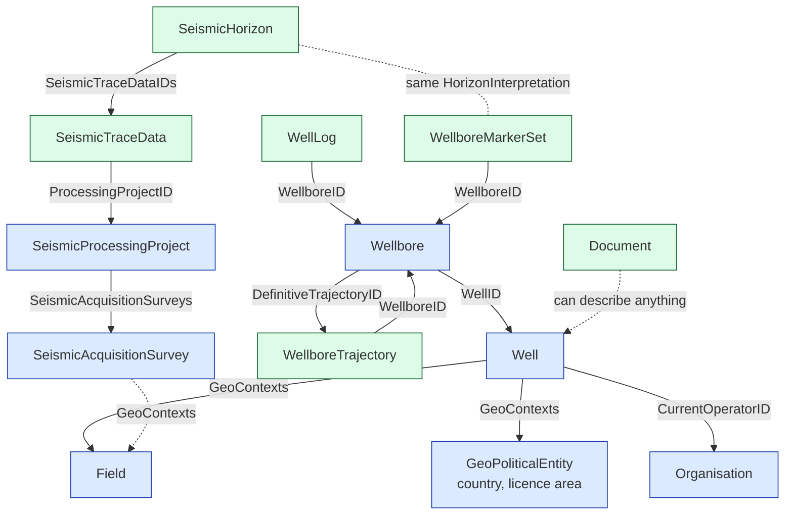
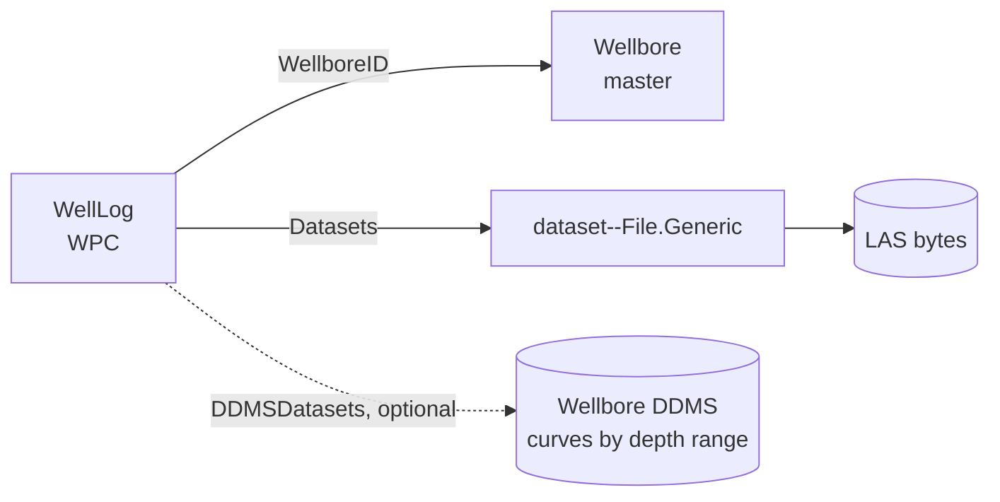

# 04 · Entities and Files

> **Facts as of:** October 2026 (OSDU data definitions,
> community `master` branch)

## TL;DR

- The OSDU model is large: roughly **90 master types, 100 work-product-component
  types, 28 dataset types and 430 reference types**. You need only **about 15** to
  get started.
- The backbone is **Field → Well → Wellbore**. Measurements and interpretations
  (trajectories, logs, formation tops, seismic, documents) are
  **work-product-components (WPCs)** that point at that backbone.
- Every common industry format (LAS, DLIS, SEG-Y, WITSML, RESQML, PDF) maps to a
  known **dataset type** and a known **WPC**. Domain services (DDMS) can also keep
  **optimised copies** for fast access.
- Not every time series belongs in OSDU. **Reported production volumes** do;
  **high-frequency sensor streams** usually live in a time-series store outside
  ADME.

## 1. The entities you meet first



Blue = master data, green = work-product-component. Arrows are ID references
stored in the record at the start of the arrow.

**Seismic connects to wells through location and geology, not as parent and
child.** A survey covers a large area with many wells, and one well can sit
inside several surveys. The links are:
- **Same area:** `GeoContexts[]` (field, licence, basin) and the map outline,
  which lets you search for "seismic covering this well".
- **Same organisations:** project roles such as `Operator` and
  `ContractorOrganisationID`.
- **Same geology:** a `SeismicHorizon` and a wellbore's formation top
  (`Markers[]`) can point to the same `HorizonInterpretation`.
- **One exception:** borehole seismic (VSP), where the receivers sit inside a
  wellbore, links directly to it through `SeismicAcquisitionSurvey.WellboreID`.

| Entity | Group type | In plain words | Key fields (`data.*`) |
|---|---|---|---|
| **Organisation** | master | A company: operator, service company, partner | `OrganisationName`, `OrganisationTypeID`, `ParentOrganisationID` |
| **GeoPoliticalEntity** | master | A country, state or licence area | `GeoPoliticalEntityName`, `GeoPoliticalEntityTypeID` |
| **Field** | master | An accumulation of oil or gas being developed | `FieldName`, `EffectiveDate` |
| **Well** | master | The surface installation and business asset | `FacilityName`, `SpatialLocation` (surface position), `VerticalMeasurements[]` (surface reference points), `CurrentOperatorID`, `GeoContexts[]`, `FacilityStates[]` |
| **Wellbore** | master | One drilled path from a well; a well can have several | `WellID`, `KickOffWellbore` (parent branch), `VerticalMeasurements[]` (drilling reference points, TD), `DefinitiveTrajectoryID`, `TrajectoryTypeID` (vertical, deviated, horizontal), `TargetFormation` |
| **WellboreTrajectory** | WPC | The 3D path of a wellbore, measured at survey stations | `WellboreID`, `TopDepthMeasuredDepth`, `BaseDepthMeasuredDepth`, `AvailableTrajectoryStationProperties[]`, `ProjectedCRSID` |
| **WellLog** | WPC | Measurements along a wellbore (one or more curves) | `WellboreID`, `Curves[]`, `ReferenceCurveID`, `TopMeasuredDepth`, `BottomMeasuredDepth`, `ServiceCompanyID` |
| **WellboreMarkerSet** | WPC | Depths where geological layers start ("formation tops") | `WellboreID`, `Markers[]` (stored inline), `StratigraphicColumnID` |
| **SeismicAcquisitionSurvey** | master | A seismic recording campaign | `AcquisitionTypeID`, `SeismicGeometryTypeID` (2D or 3D), `OperatingEnvironmentID`, `VesselNames` |
| **SeismicProcessingProject** | master | Processing of one or more surveys into images | `SeismicAcquisitionSurveys[]`, `BinGridID` |
| **SeismicTraceData** | WPC | A processed seismic line or volume | `ProcessingProjectID`, `PrincipalAcquisitionProjectID`, `BinGridID`, `SeismicDomainTypeID` (time or depth), `SampleInterval` |
| **SeismicHorizon** | WPC | An interpreted surface picked on seismic data | `SeismicTraceDataIDs[]`, `InterpretationID`, `GeologicalUnitName` |
| **Document** | WPC | A report, PDF, scan or image about anything | `Name`, `DatePublished`, `Keywords`, `ProducedByOrganisationID`, `TaxonomyIDs` |

All of these also carry the shared fields of their group type ([doc 03, §4](03-data-model.md#4-group-types)),
such as `NameAliases[]`, `GeoContexts[]` and `ExtensionProperties`, and
`Datasets[]` on WPCs.

**Beyond this core** there are domains you'll meet later:
- drilling and well construction (`Rig`, `HoleSection`, `CasingDesign`…);
- rock and fluid samples (`RockSample`, `SamplesAnalysis`);
- reservoir modelling (`Reservoir`, many `*Interpretation` and `*Representation`
  types);
- production (`ProductionValues`, `FlowTest`, `DowntimeEvent`).

## 2. Files: formats and where they land

Doc 03 explains the general pattern: a **WPC** describes the content, a
**dataset** record holds the file facts, and the bytes live in storage. Some data
also has an **optimised copy** in a domain service:



The original file always stays. The DDMS copy is an **additional** form that
serves slices quickly, for example two curves between 2,000 and 2,500 m, or one
slice of a seismic cube.

| Format | What it is | Dataset type | Typical WPC | Optimised form / DDMS |
|---|---|---|---|---|
| **LAS** | Text well-log file | `File.Generic` | `WellLog` | Curves in the Wellbore DDMS |
| **DLIS** | Binary well-log file (often many logs inside) | `File.Generic` | `WellLog` (one or more) | Curves in the Wellbore DDMS |
| **Trajectory survey** (CSV or similar) | Survey stations | `File.Generic` | `WellboreTrajectory` | Stations in the Wellbore DDMS |
| **SEG-Y** | Processed seismic traces | `FileCollection.SEGY` | `SeismicTraceData` | `FileCollection.Bluware.OpenVDS` or `FileCollection.Slb.OpenZGY` (Seismic DDMS) |
| **SEG-D** | Raw field seismic recordings | `FileCollection.SEGD` | `SeismicFieldTraceData` | — |
| **WITSML** | Industry XML for drilling data | `File.WITSML` | Trajectory, logs, reports | — |
| **RESQML** | Industry format for reservoir models | `FileCollection.EPC` or `ETPDataspace` | `*Interpretation`, `*Representation` | Reservoir DDMS |
| **PDF / Office** | Reports, studies | `File.Generic` | `Document` | — |
| **CSV** | Tabular exports | `File.Generic` / `File.TabularData` | Depends on content | — |
| **Shapefile / GeoJSON / GeoTIFF** | Maps and outlines | `FileCollection.Esri.Shape` / `File.GeoJSON` / `File.OGC.GeoTIFF` | Depends on content | — |
| **Tape, paper** | Not yet digitised | `PhysicalMedia` | Placeholder WPC (for example Document) | — |

ADME doesn't include the community parsers that turn WITSML, RESQML or PRODML
files into records ([doc 06](06-ddms-and-extensions.md)). You can still store and
describe those files, but extracting records from them is up to you.

## 3. Worked example: a wellbore with its trajectory and a log

Five records, trimmed. The envelope (`kind`, `acl`, `legal`) is omitted. The
WellLog curve details are in [doc 02, §6](02-energy-domain-primer.md#6-measuring-along-the-wellbore).

```jsonc
// 1. master-data--Well
{ "id": "contoso-dp1:master-data--Well:NO-1234",
  "data": { "FacilityName": "NO 1234/5",
            "GeoContexts": [ { "GeoTypeID": "Field",
                               "FieldID": "contoso-dp1:master-data--Field:ALPHA:" } ] } }

// 2. master-data--Wellbore: points to its Well and to its official trajectory
{ "id": "contoso-dp1:master-data--Wellbore:NO-1234-A",
  "data": { "FacilityName": "NO 1234/5-A",
            "WellID": "contoso-dp1:master-data--Well:NO-1234:",
            "DefinitiveTrajectoryID": "contoso-dp1:work-product-component--WellboreTrajectory:5d2e…:" } }

// 3. work-product-component--WellboreTrajectory: describes the survey columns
{ "id": "contoso-dp1:work-product-component--WellboreTrajectory:5d2e…",
  "data": { "WellboreID": "contoso-dp1:master-data--Wellbore:NO-1234-A:",
            "TopDepthMeasuredDepth": 0.0, "BaseDepthMeasuredDepth": 3150.0,
            "AvailableTrajectoryStationProperties": [         // column name → meaning + unit
              { "Name": "MeasuredDepth", "TrajectoryStationPropertyTypeID": "…:reference-data--TrajectoryStationPropertyType:MD:",
                "StationPropertyUnitID": "…:reference-data--UnitOfMeasure:m:" },
              { "Name": "Inclination",   "TrajectoryStationPropertyTypeID": "…:reference-data--TrajectoryStationPropertyType:Inclination:",
                "StationPropertyUnitID": "…:reference-data--UnitOfMeasure:dega:" },
              { "Name": "Azimuth",       "TrajectoryStationPropertyTypeID": "…:reference-data--TrajectoryStationPropertyType:AzimuthTN:",
                "StationPropertyUnitID": "…:reference-data--UnitOfMeasure:dega:" } ],
            "Datasets": [ "contoso-dp1:dataset--File.Generic:a71f…:" ] } }   // → stations file

// 4. work-product-component--WellLog: curves described, values in the LAS file
{ "id": "contoso-dp1:work-product-component--WellLog:7f3c…",
  "data": { "WellboreID": "contoso-dp1:master-data--Wellbore:NO-1234-A:",
            "Curves": [ { "Mnemonic": "GR" }, { "Mnemonic": "RHOB" } ],
            "Datasets": [ "contoso-dp1:dataset--File.Generic:91ab…:" ] } }

// 5. dataset--File.Generic: the LAS file itself
{ "id": "contoso-dp1:dataset--File.Generic:91ab…",
  "data": { "DatasetProperties": { "FileSourceInfo": {
              "FileSource": "<location returned by the File service>",
              "Name": "NO-1234-5-A_main.las", "FileSize": "482113" } } } }
```

**About the trajectory:**
- The **record** maps each **column name in the file** (`Name`) to a standard
  meaning (`TrajectoryStationPropertyTypeID`) and a unit (`StationPropertyUnitID`).
  That's how a program knows that the CSV column "Azimuth" is a true-north
  azimuth in degrees. If `Name` is absent, the column is expected to be named
  after the type.
- The **survey stations themselves**, one row per station, are in the file or in
  the Wellbore DDMS, which has trajectory APIs.
- A wellbore can have several surveys (planned, measured, re-surveyed).
  `DefinitiveTrajectoryID` says which one to use for MD → TVD conversion.
- The Wellbore points to a trajectory that is created **after** it. So in
  practice you load the Wellbore first, then the trajectory, then set
  `DefinitiveTrajectoryID` as an update, which creates a new Wellbore version.

**What you can do with these records:**
- **Find:** look up the log by wellbore, curve or depth range. You can also find
  wells on a map, using their WGS 84 location, and then navigate to their logs. A
  log is only directly map-searchable if its own `SpatialPoint` or `SpatialArea` is
  filled in.
- **Navigate:** Well → Wellbore → Trajectory or WellLog → file.
- **Govern:** control access record by record. For example, the Well can be
  widely visible while the log is restricted to one partner group.

**Load order:** Field → Well → Wellbore, then datasets, then the WPCs that point
to them, and finally back-references such as `DefinitiveTrajectoryID`. Manifest
ingestion checks that referenced records exist.

## 4. Time series and production data

Not everything that changes over time belongs in OSDU records. Where it goes
depends on how often values arrive and what they're used for:

| Data | Example | Where it goes | On ADME |
|---|---|---|---|
| **High-frequency sensor streams** | Wellhead or downhole pressure and temperature every second or minute | OSDU's answer is the **Production DDMS (Historian)**, a time-series domain service | **Not available.** These streams usually stay in a time-series store outside ADME (historian, Fabric Real-Time Intelligence, Azure Data Explorer), keyed by OSDU record IDs. |
| **Reported production volumes** | Daily or monthly oil, gas and water per well, measured or allocated | **`ProductionValues`** WPC, with each period's values inline in `data.ProductionMetricValues[]`. Related: **`FlowTest`** and **`DowntimeEvent`**. | Ordinary records, so the core platform stores them. The schema version depends on your instance. |
| **Event-based subsurface measurements** | A pressure test, a temperature log along the wellbore | `WellPressureTestRawMeasurement`, `WellLog` | Supported. Bulk curve data can go to the Wellbore DDMS. |

**Naming trap:** `work-product-component--TimeSeries` is **not** for sensor data.
It holds the list of time steps for reservoir models.

**The common pattern:**
- ADME is the system of record for **context**: which well, which units, who can
  see it, under what legal terms.
- The time-series store keeps the **readings**.
- Analytics joins the two on OSDU record IDs.

Data outside ADME doesn't inherit ADME's access lists or legal tags, so it needs
its own controls.

## Common misconceptions

- *"One file = one record."* There are at least two records (dataset + WPC). One
  DLIS file can produce several WellLog WPCs.
- *"Logs belong to the well."* Logs, trajectories and markers always belong to a
  **wellbore**.
- *"I must fill every field."* Most fields are optional. Populate what you can
  source honestly; never invent values to satisfy a schema.
- *"The DDMS copy replaces the file."* The original dataset stays. The DDMS
  form is an optimised, additional representation.
- *"All time series go into OSDU."* High-frequency sensor data usually stays in a
  time-series store; OSDU holds the context and the reported volumes.

## Go deeper

- [Schema catalogue: master-data, WPC, dataset, reference-data](https://community.opengroup.org/osdu/data/data-definitions/-/tree/master/E-R) (OSDU community)
- [Well Basics chapter and worked examples](https://community.opengroup.org/osdu/data/data-definitions/-/blob/master/Guides/Chapters/10-WellBasics.md) (OSDU community)
- [Seismic projects and related data](https://community.opengroup.org/osdu/data/data-definitions/-/blob/master/Guides/Chapters/09-SeismicProjectsAndRelatedData.md) (OSDU community)
- [Production domain chapter](https://community.opengroup.org/osdu/data/data-definitions/-/blob/master/Guides/Chapters/15-Production.md) (OSDU community)
- [Worked examples (trajectory, marker set, …)](https://community.opengroup.org/osdu/data/data-definitions/-/tree/master/Examples/WorkedExamples) (OSDU community)
- [OSDU open test data (TNO, Volve)](https://community.opengroup.org/osdu/platform/data-flow/data-loading/open-test-data) (OSDU community)
