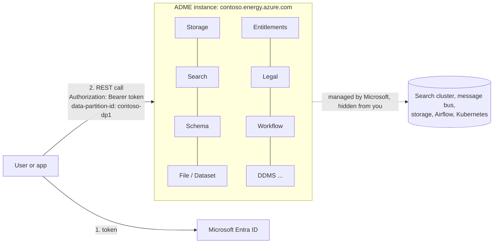
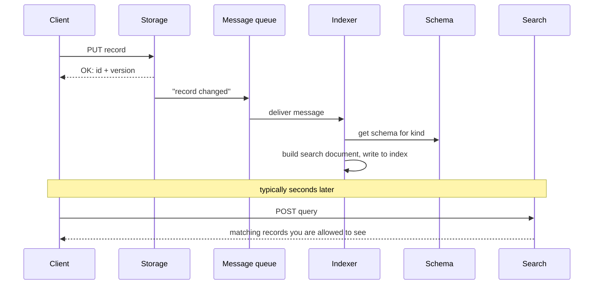
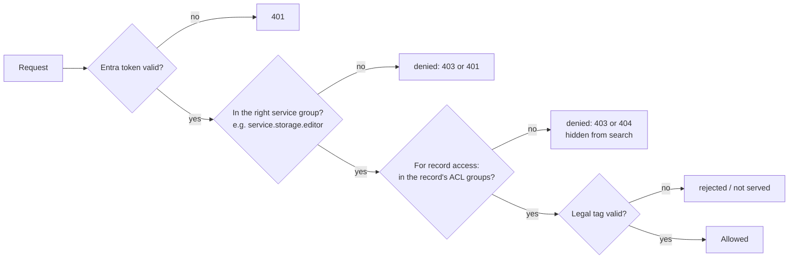

# 05 · Platform Services

> **Facts as of:** October 2026 (ADME on OSDU milestone M26)

## TL;DR

- ADME exposes the OSDU platform as a set of **REST services** behind one endpoint,
  `https://<instance>.energy.azure.com/api/...`. Every call needs an **Entra ID
  token** and a **`data-partition-id`** header.
- Almost every service is a **standard OSDU service** that Microsoft runs for you.
  Around them, ADME adds **Azure-only features**: provisioning, partitions,
  security, monitoring, reference-data sync and export to analytics.
- The core loop is **Schema defines → Storage saves → Indexer indexes → Search
  finds**. Indexing is **asynchronous**, so a saved record becomes searchable a few
  seconds later.
- **Entitlements** decide which APIs and records you may use; they're checked on
  every request. **Legal** tags decide whether data may be stored and served at
  all; they're checked on every record write and read.
- Some OSDU services are **not** in ADME. Details are in
  [doc 06](06-ddms-and-extensions.md).

## 1. How you talk to ADME



- **One instance, many services:** each service has its own path, for example
  `/api/storage/v2/records`, `/api/search/v2/query`, `/api/schema-service/v1/schema`,
  `/api/legal/v1/legaltags` and `/api/entitlements/v2/groups`.
- **Contract:** the API definition (Swagger) for each service on **your**
  instance is the authority. Versions follow the OSDU milestone.
- **Authentication:** Microsoft Entra ID issues a token for the app registration
  used by the instance. Apps and pipelines usually use a **service principal** or a
  **managed identity**, not a person's account.
- **Partition:** every call names its data partition in the `data-partition-id`
  header. A partition is a separate data space with its own groups, legal tags,
  schemas (beyond the shared ones) and reference data.
- **Behind the scenes:** you never see or manage the underlying infrastructure
  (search cluster, message bus, storage, workflow engine). Microsoft operates it.

## 2. The services, and which are OSDU or ADME

**Standard OSDU services that ADME runs for you:**

| Area | Service | What it does |
|---|---|---|
| **Core data** | **Storage** | Create, read, version, delete and purge records. Fetch by ID. |
| | **Schema** | Register and read schemas (kinds) |
| | **Search** | Query indexed records: text, filters, geography. Results are filtered by your access. |
| | **Indexer** + Indexer Queue | Turn stored records into search documents. **Internal**: you don't call them, except to reindex. |
| | **File** | Get upload and download locations for single files, and register file metadata |
| | **Dataset** | The same for any dataset type (files, file collections, external sources) |
| **Governance** | **Entitlements** | Manage groups and memberships: who may call which API and see which records |
| | **Legal** | Manage legal tags and check that they're valid |
| | **Secret** (preview) | Store secrets that applications need |
| **Events** | **Notification** + **Register** | Subscribe to record changes, so your system is notified when data changes |
| **Helpers** | **CRS Catalog**, **CRS Conversion** | Look up coordinate systems; convert coordinates between them |
| | **Unit** | Look up units and how to convert between them |
| **Ingestion** | **Workflow** + Airflow workflows (DAGs) | Run multi-step ingestion jobs defined by OSDU: manifest ingestion, CSV parser, external data sources, SEG-Y conversion (see §3) |
| **Domain** | **DDMS**: Wellbore, Seismic, Reservoir, Rock & Fluid Samples | Domain-optimised storage and APIs ([doc 06](06-ddms-and-extensions.md)) |

**Not exposed in ADME:**
- the OSDU **Partition** service (partitions are managed through Azure instead,
  see below);
- the **Policy** service;
- several DDMS and parsers ([doc 06](06-ddms-and-extensions.md)).

**ADME-only (Azure) capabilities around the OSDU core:**

| Area | Capability |
|---|---|
| **Provisioning** | An Azure resource (portal, ARM, Bicep) with Developer or Standard tier |
| **Partitions** | Created in the Azure portal or API: up to 5 (Developer) or 10 (Standard), named 1–10 characters. They **can't be renamed or deleted**. |
| **Upgrades** | Microsoft upgrades each milestone (for example M25 → M26). Policy is **Automatic** or **Deferred by up to 30 days**, so you can test first. Upgrades can't be skipped. |
| **Security** | Entra ID, Private Link, customer-managed keys, Customer Lockbox, managed identity, CORS, audit logs |
| **Monitoring** | Service, Airflow and search-cluster logs sent to Azure Monitor; platform metrics such as request count and data volume (preview) |
| **Reference data** | FIXED and OPEN values synced automatically and upgraded with each milestone ([doc 03, §4a](03-data-model.md#4a-reference-data-the-lookup-values)) |
| **Analytics export** | **Analytics Consumption Zone (ACZ)**, in preview: continuous export of chosen kinds to **Delta Parquet in your own ADLS Gen2**, which Fabric, Databricks or Snowflake can read. Developer tier, allow-list only. |
| **Deployable add-ons** | **OSDU Admin UI** (manage groups, legal tags, schemas, maps) and **Geospatial Consumption Zone** (map services). Community tools you deploy yourself next to ADME. |

## 3. The life of a record: save → index → search

### Two ways into Storage

Every record ends up in **Storage**, but it can get there by two routes:

```text
1. Direct:    client ──PUT record(s)──▶ Storage                          fast; envelope checks only
2. Workflow:  client ──manifest──▶ Workflow ──▶ Airflow DAG ──▶ Storage   validates first; asynchronous
                          └── you poll the workflow run's status ──┘
```

- **Direct Storage API:** you write records yourself. Storage checks the
  envelope (permissions, ACL groups, legal tags) but **not** `data` against the
  schema, nor whether referenced records exist ([doc 03, §3](03-data-model.md#3-kinds-and-schemas)).
- **Manifest ingestion workflow:** you submit a **manifest**, a JSON package of
  reference data, master data, WPCs and datasets meant to be loaded together. The
  Workflow service starts a run of the **manifest ingestion DAG** (`Osdu_ingest`)
  in Airflow. The run:
  1. validates every record against its schema;
  2. checks that referenced records and reference values exist;
  3. writes the valid records through Storage, and skips and reports the rest.

  You track the run's status through the Workflow service.
- **This is OSDU's own workflow, not an ADME add-on and not something you
  build.** The DAG and the Workflow service are OSDU community code
  (`ingestion-dags`, `ingestion-workflow`), and ADME runs them for you. The CSV
  parser, external-data-source and SEG-Y conversion workflows are OSDU DAGs in
  the same way.
- Which route, or which tools on top of them (ADF, Databricks, partner loaders),
  to use is a design choice. [Doc 07](07-what-goes-in-what-comes-out.md)
  explains what ADME requires whichever route you choose.

### After Storage: indexing and search



1. **Storage** checks your API permission, the record's ACL groups and its legal
   tags, then saves a **new version**.
2. It publishes a **record-changed** event. The **Notification** service can
   also forward it to your subscribers.
3. The **Indexer** reads the record's schema and writes a search document. If the
   schema is missing or a value doesn't fit, the record carries an `index.statusCode`
   (for example 404 or 400) instead of failing silently.
4. **Search** can now find it. Each query filters results by your groups.

**About the index:**
- There's **one search index per kind** (including its version).
- The schema decides which `data` fields are indexed and with which types. For
  example, the schema hint `x-osdu-indexing` decides whether an array is
  flattened or nested.
- You can't configure the search cluster directly. Two levers exist:
  - **index augmentation:** configuration records that add derived fields, for
    example a wellbore's name on its logs;
  - the **reindex API**, for admins.
- The index is a **copy derived from Storage**. Records that failed to index are
  never lost: fix the cause, then reindex.

**Storage vs Search, in one line:**
- Use **Storage** when you know the ID or need a specific version. It's always
  exact and current.
- Use **Search** to discover records. It's eventually consistent, and only indexed
  fields can be queried.

**What Search can do:**
- **Field queries** with wildcards on `kind`, for example
  `osdu:wks:master-data--Wellbore:*`.
- **Spatial filters:** bounding box, distance, polygon, intersection. These use
  the WGS 84 copy of locations.
- **Queries inside arrays** with `nested()`, for example markers deeper than
  3,000 m.
- **Distinct values** with `aggregateBy`.
- **Limits:**
  - at most **1,000** results per call;
  - `offset` + `limit` can't exceed **10,000**;
  - beyond that, page with `query_with_cursor`;
  - ADME throttles fully unbounded queries (`kind` = `*:*:*:*`) with HTTP 429,
    so always name the kinds you need.
- **No joins.** "All logs of well X" needs two queries: first get all wellbores
  of the well, then get all logs of those wellbores
  ([doc 04](04-entities-and-files.md)).

## 4. Governance at runtime

Every request goes through the same gates:



- **Service groups** (`service.<name>.<role>`, for example `service.storage.editor`
  or `service.search.user`) control which **APIs** you can call. They're created
  automatically for each partition.
- **Data groups** in a record's `acl` control which **records** you can see or
  change. `users.data.root` can always see everything.
- **Legal tags** are checked when data is written and when it's read. Expired tags
  make data unavailable ([doc 03, §6](03-data-model.md#6-governance-is-carried-by-every-record)).
- **Partitions** are the hard boundary. Groups and tags in one partition mean
  nothing in another.
- **Status codes vary by service.** A denied record read can return 404 rather
  than 403, and some permission failures return 401. Don't rely on the code
  alone to tell "missing" from "not allowed".

### Who may do what: the three kinds of groups

Day to day you work with three kinds of entitlement groups. Each answers a
different question:

```text
 People and apps (Entra IDs)
        │ member of
        ▼
 TEAM GROUPS  users.team-north …          WHO are you?          (you create them)
        │ member of                  │ member of
        ▼                            ▼
 API BUNDLES  users.datalake.*       DATA GROUPS  data.pl001.viewers …
 WHAT can you do?                    WHICH records can you see or change?
 (predefined; contain service.*      (you create them; written into
  API-permission groups)              each record's acl)
```

| | **API bundle** | **Team group** | **Data group** |
|---|---|---|---|
| Example | `users.datalake.viewers` | `users.team-north` | `data.pl001.viewers` |
| Answers | **What** can you do: which APIs | **Who** are you: a set of people and apps | **Which records** can you see or change |
| Created by | The platform, in every partition; can't be deleted | You | You |
| Contains | Sets of `service.*` groups (fine-grained API permissions) | People, apps, other groups | People, apps, team groups |
| Used in | — | Nested into bundles and data groups | Record `acl`: **owners** (read, update, delete) and **viewers** (read) |
| Changes | Never | Often: joiners, movers, leavers | Rarely: follows contracts and policy |

- **A request needs both:** an API permission (through a bundle) **and** access
  to the record (a data group in its `acl`), plus a valid legal tag. For
  example:
  - a geologist in `users.datalake.viewers` and `data.wells.viewers` can search
    and read well records but can't write;
  - an ingestion pipeline in `users.datalake.editors` can write, and must put
    the right data groups in each record's `acl`.
- **Team groups are the glue:** nest one team group into a bundle **and** into
  data groups, and adding a person to the team gives them both at once.
- **Confidentiality is just another data group:** put
  `data.wells.restricted.viewers` instead of `data.wells.viewers` in a
  confidential well's `acl`, and only members of the restricted group can see it.
- **Not Azure roles:** Azure role assignments on the ADME resource manage the
  resource itself. Access to ADME's APIs and data comes only from these OSDU
  groups, managed through the Entitlements API or the Admin UI add-on. Groups
  exist **per partition**.

### How membership works

- **Members are Entra ID identifiers, not names:**
  - a person by their Entra **object ID (OID)**;
  - an application, service principal or managed identity by its
    **application (client) ID**;
  - another OSDU group, by its email.

  The API field is called `email`, but for people and apps it holds that GUID.
- **Step 1 is always `users@<partition>…`**, the "member of this partition at all"
  group. Without it, every other membership fails.
- **Step 2: an API bundle**, directly or through a team group.
- **Step 3: data groups**, directly or through a team group.
- **Who can manage a group:** its `OWNER` members. The instance's app is owner of
  every group, which is how the first admins get added.
- **Entra ID groups:** the classic, documented model adds individual users and
  applications, with teams modelled as nested OSDU groups. Microsoft is adding
  **Entra ID groups authorization**, which needs a one-time migration, so
  membership can be managed in Entra ID instead. Check its status before relying
  on it ([Microsoft guide](https://github.com/microsoft/adme-samples/blob/main/entra-id-groups-authorization/how-to-enable-entra-id-groups-authorization.md)).

**Predefined groups in every partition.** These are created automatically and
can't be deleted:

| Group | What it is | Use |
|---|---|---|
| `users@<partition>` | "Member of this partition" | **Required** for every person and app |
| `users.datalake.viewers` | Bundle: read APIs (Storage read, Search, Legal, Schema read…) | Data consumers, read-only apps |
| `users.datalake.editors` | Bundle: viewers + write APIs (records, legal tags, schemas, files, workflows) | Data managers, ingestion pipelines |
| `users.datalake.admins` | Bundle: editors + administration of Search, Entitlements, Workflow | Platform admins |
| `users.datalake.ops` | Bundle: admins + full admin of Storage, Legal, Schema | Operations, first admins |
| `users.data.root` | Sees **every** record; automatically in every data group | Break-glass only |
| `data.default.owners` / `viewers` | Default data groups, open to **all** partition users | Avoid for real data |
| `service.*` | Fine-grained API permissions inside the bundles | Normally only through the bundles |
| `data.referencedata.owners` / `viewers` (ADME) | ACLs of the synced OSDU reference values; `…-local` variants if LOCAL values were synced | Make reference data readable by all users |

Features can add more; for example, Seismic DDMS subprojects create their own
`data.sdms.…` groups.

## Common misconceptions

- *"Saved means searchable."* Indexing is asynchronous. Read back by ID from
  Storage if you need it immediately.
- *"Storage validates my data."* Only the manifest ingestion workflow validates
  against the schema and checks references. Direct Storage writes don't.
- *"Search returns all matches."* Only records you're entitled to see, at most
  1,000 per call, and only indexed fields.
- *"ADME is a different API from OSDU."* The data APIs are OSDU's. What's
  Azure-specific is how you provision, secure, monitor and export, plus a few
  ADME-only APIs such as ACZ and Petrel Data Services.
- *"The `data-partition-id` header is optional."* It's required on every call.
- *"The Admin UI is part of ADME."* It's a community tool you deploy yourself.
- *"ADME upgrades only when we're ready."* You can defer a milestone upgrade by
  up to 30 days, not skip it.

## Go deeper

- [OSDU services available on ADME](https://learn.microsoft.com/azure/energy-data-services/osdu-services-on-adme) (Microsoft Learn)
- [Indexing and search workflows](https://learn.microsoft.com/azure/energy-data-services/concepts-index-and-search) (Microsoft Learn)
- [Authentication](https://learn.microsoft.com/azure/energy-data-services/concepts-authentication) and [generate an auth token](https://learn.microsoft.com/azure/energy-data-services/how-to-generate-auth-token) (Microsoft Learn)
- [Manage data partitions](https://learn.microsoft.com/azure/energy-data-services/how-to-add-more-data-partitions) and [upgrade settings](https://learn.microsoft.com/azure/energy-data-services/how-to-manage-upgrade-settings) (Microsoft Learn)
- [Analytics Consumption Zone concepts](https://learn.microsoft.com/azure/energy-data-services/concepts-analytics-consumption-zone) (Microsoft Learn)
- [Manifest-based ingestion concepts](https://learn.microsoft.com/azure/energy-data-services/concepts-manifest-ingestion) (Microsoft Learn) and [OSDU ingestion DAGs](https://community.opengroup.org/osdu/platform/data-flow/ingestion/ingestion-dags) (OSDU community)
- [ADME REST API reference (Swagger)](https://microsoft.github.io/adme-samples/) (Microsoft)
- [OSDU Search API: query syntax, spatial, nested, cursor](https://community.opengroup.org/osdu/platform/system/search-service/-/blob/master/docs/docs/api.md) (OSDU community)
