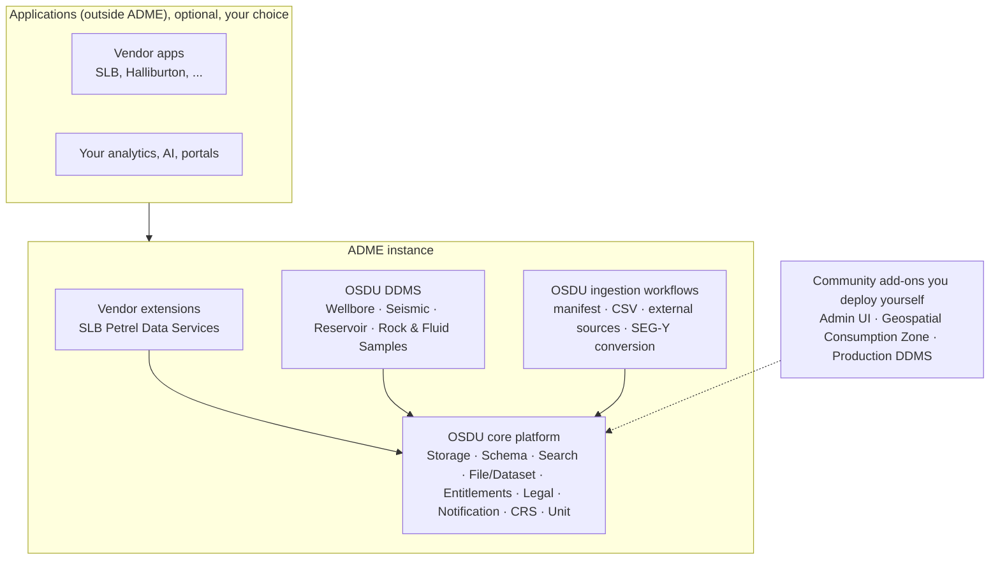
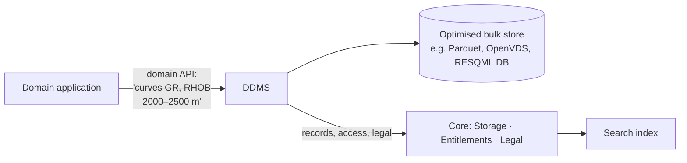

# 06 · DDMS and Extensions: What's Mandatory, What's Optional

> **Facts as of:** October 2026 (ADME on OSDU milestone M26)

## TL;DR

- Think of ADME in **layers**: a **core platform** that's always there, **domain
  services (DDMS)** for heavy domain data, **workflows** for ingestion, and
  **extensions and applications** around it.
- A **DDMS** (Domain Data Management Service) is a specialised service for one
  kind of bulk data. It stores the data in an **optimised format**, offers a
  **domain-specific API**, and still uses the core platform for identity, access,
  legal tags and search.
- ADME runs **four OSDU DDMS**: **Wellbore**, **Seismic**, **Reservoir** and **Rock
  & Fluid Samples**. Each has its own API and storage format.
- Some OSDU components are **not** in ADME, notably the **Production DDMS** (time
  series) and the **WITSML, RESQML and PRODML parsers**. The Well Delivery DDMS was
  retired by OSDU itself.
- **SLB Petrel Data Services** is a **vendor (non-OSDU)** extension that ADME
  also offers.

## 1. The layers: mandatory vs optional

| Layer | Mandatory? | Who defines it | In ADME |
|---|---|---|---|
| **Core platform** | **Yes.** Every OSDU platform has it; it's what OSDU certification targets. | OSDU | Always on |
| **OSDU DDMS** | Part of the OSDU distribution, but each provider chooses which to run | OSDU community | 4 available. Seismic needs each partition registered as a seismic tenant. |
| **OSDU ingestion workflows** | Optional to *use*; you can always write through the APIs directly | OSDU community | Most available ([doc 05, §3](05-platform-services.md#3-the-life-of-a-record-save--index--search)) |
| **Vendor extensions** | Optional | A software vendor | Petrel Data Services |
| **Community add-ons** | Optional | OSDU community | Not included; you deploy them next to ADME |
| **Applications** | Optional | Vendors or you | Outside ADME; they use its APIs ([doc 09](09-use-cases-and-applications.md)) |

OSDU classifies applications in the same spirit:
- **embedded:** community-built and shipped with the platform, for example a DDMS;
- **extension:** a vendor add-on deployed inside the platform;
- **third-party:** a vendor application running outside and calling the APIs.

## 2. What a DDMS is, and why it exists

The core services handle **JSON records and whole files**. That isn't good enough
for some domain data:
- a 3D seismic volume can be **hundreds of GB**, and an application may need just
  one slice of it;
- a well can have **thousands of log curves**, and an application may need two
  curves over 500 m;
- a reservoir model is a grid of **millions of cells** per property and time step.

Downloading whole files every time is far too slow. A DDMS fixes this:

- **Optimised storage:** a format designed for partial, fast reads, for example
  columnar curves or bricked seismic.
- **Domain API:** operations that make sense in the domain, for example "give me
  these curves for this depth range" or "this inline of the cube".
- **Same governance model:** a DDMS uses the platform's entitlement groups and
  legal tags. Its content is described by catalogue records (usually WPCs, with
  `DDMSDatasets[]` pointers), so it can be found through Search. Where access
  control sits varies: the Wellbore DDMS works on records, while the Seismic DDMS
  sets ACLs and a legal tag per **subproject** and dataset.
- **Not a single standard API:** each DDMS has its own API, defined by its OSDU
  community project. OSDU standardises the *pattern* (reuse the core, register
  records), not one DDMS interface.

**Analogy for data engineers:** a DDMS is a specialised storage engine behind
the shared catalogue. It's like an external table in a lakehouse catalogue that
points to an engine optimised for one data type, with permissions still managed
centrally.

## 3. The four DDMS in ADME

| DDMS | Domain | What it serves | Bulk storage | API |
|---|---|---|---|---|
| **Wellbore** | Wells | Wells, wellbores, logs, trajectories, markers; curves by name and depth range | Columnar **Parquet** in blob storage | REST, `/api/os-wellbore-ddms/ddms/v3/...` |
| **Seismic** (Seismic Store) | Seismic | Seismic datasets (SEG-Y, OpenVDS, ZGY), streamed in chunks to applications | Blob storage in a **tenant → subproject → dataset** hierarchy | REST `/seistore-svc/api/v3/...`, plus the `sdutil` command line |
| **Reservoir** | Reservoir models | RESQML objects: interpretations, grids, properties, simulation inputs and outputs | Database grouped into **dataspaces** (for example `project/scenario`) | **ETP** (fast WebSocket protocol) and REST `/api/reservoir-ddms/v2/...` |
| **Rock & Fluid Samples (RAFS)** | Lab samples | Rock and fluid samples, their analyses (core analysis, fluid properties) and reports | Analysis data managed by the DDMS, linked to sample records | REST |

**Notes per DDMS:**
- **Wellbore:**
  - the default home for log and trajectory bulk data;
  - the **Analytics Consumption Zone** can export Wellbore DDMS kinds to Delta
    tables ([doc 05](05-platform-services.md)).
- **Seismic:**
  - each data partition must be **registered as a seismic tenant** before use;
  - conversion workflows turn **SEG-Y → OpenVDS / ZGY**;
  - ADME adds **storage tiers** (hot, cool, cold) and **single-dataset restore**,
    both in preview;
  - the newer **Seismic DDMS v4 APIs are not available**.
- **Reservoir:**
  - generally available since February 2026, in all ADME regions except
    Indonesia Central;
  - mainly used by modelling applications that stream models through ETP.
  - *Reservoir models:* 3D grids of rock and fluid properties used to estimate
    volumes and simulate production. RESQML is their industry exchange standard.
- **RAFS:**
  - generally available since January 2026;
  - create the prerequisite records first (Organisation → Field → Well →
    Wellbore), then samples, analyses and reports.

## 4. Other extensions and ADME-specific additions

- **SLB Petrel Data Services:**
  - a **vendor (SLB) service**, not OSDU, available on ADME;
  - it stores **Petrel projects** (Petrel is SLB's main geoscience application)
    in ADME;
  - it can **"liberate"** data from those projects into the OSDU DDMS, for
    example extract well logs into the Wellbore DDMS so other applications can
    find them;
  - API definitions are published up to M26 (`/api/petreldms/v1/...`), but it's
    not on the "OSDU services" list because it isn't OSDU. **Check enablement
    and Petrel licensing with your account team.**

- **Ingestion workflows** (OSDU DAGs, see [doc 07](07-what-goes-in-what-comes-out.md)):
  - manifest ingestion;
  - **manifest ingestion by reference**, for very large loads (GA July 2026);
  - CSV parser;
  - **External Data Services (EDS)**, GA May 2026. It pulls **metadata** from
    another OSDU platform on a schedule and **leaves the files at the source**.
    It can later "naturalise" them by copying them in.
  - SEG-Y conversion.

## 5. Not in ADME, as of M26

| Component | What it does | Status and alternative |
|---|---|---|
| **Production DDMS** (Historian, Core) | Production time series and production data management | Not available. Microsoft points to a separate deployment for standalone testing. Time series usually live in a separate store ([doc 04, §4](04-entities-and-files.md#4-time-series-and-production-data)). |
| **Well Delivery DDMS** | Well planning and execution data | **Deprecated by OSDU at M26**; deprecated on ADME from March 2026 |
| **Seismic DDMS v4 APIs** | Newer seismic API generation | Not available; use v3 |
| **Energistics parsers** (WITSML, RESQML, PRODML) | Turn industry XML/HDF5 files into OSDU records | Not available. Store the files, and create records with your own tooling or applications. |
| **Policy service** | Fine-grained, rule-based access policies | Not available. Use entitlements and ACLs. |
| **Partition service** | Manage data partitions through OSDU APIs | Not exposed. Use the Azure portal or Azure APIs. |
| **Schema Upgrade tool** | Upgrade records to newer schema versions | Not included; can be deployed separately |
| **Geospatial Consumption Zone** | Map services (GIS layers) over OSDU data | Not included; deploy it next to ADME |

## Common misconceptions

- *"DDMS are Azure-specific."* All four are OSDU community projects. Microsoft
  contributes the Azure implementation and runs them.
- *"Every OSDU platform has the same DDMS."* The core is common; the set of DDMS
  and their API versions differ between providers.
- *"A DDMS bypasses governance."* DDMS data is governed with the same
  entitlement groups and legal tags, although the level varies (per record, or
  per seismic subproject and dataset).
- *"We need a DDMS to store logs or seismic."* You can store them as plain files
  through the core. A DDMS adds fast, partial, domain-aware access, which matters
  for applications at scale.
- *"If OSDU has it, ADME has it."* Check Microsoft's official list of OSDU
  services on ADME for your milestone.

## Go deeper

- [OSDU services available (and unavailable) on ADME](https://learn.microsoft.com/azure/energy-data-services/osdu-services-on-adme) (Microsoft Learn)
- [DDMS concepts](https://learn.microsoft.com/azure/energy-data-services/concepts-ddms) and [DDMS overview](https://learn.microsoft.com/azure/energy-data-services/overview-ddms) (Microsoft Learn)
- Tutorials: [Wellbore DDMS](https://learn.microsoft.com/azure/energy-data-services/tutorial-wellbore-ddms), [Seismic DDMS](https://learn.microsoft.com/azure/energy-data-services/tutorial-seismic-ddms), [Reservoir DDMS](https://learn.microsoft.com/azure/energy-data-services/tutorial-reservoir-ddms-apis), [Rock and Fluid Samples DDMS](https://learn.microsoft.com/azure/energy-data-services/tutorial-rock-and-fluid-samples-ddms) (Microsoft Learn)
- [ADME release notes](https://learn.microsoft.com/azure/energy-data-services/release-notes) (Microsoft Learn)
- [OSDU DDMS projects](https://community.opengroup.org/osdu/platform/domain-data-mgmt-services) (OSDU community)
