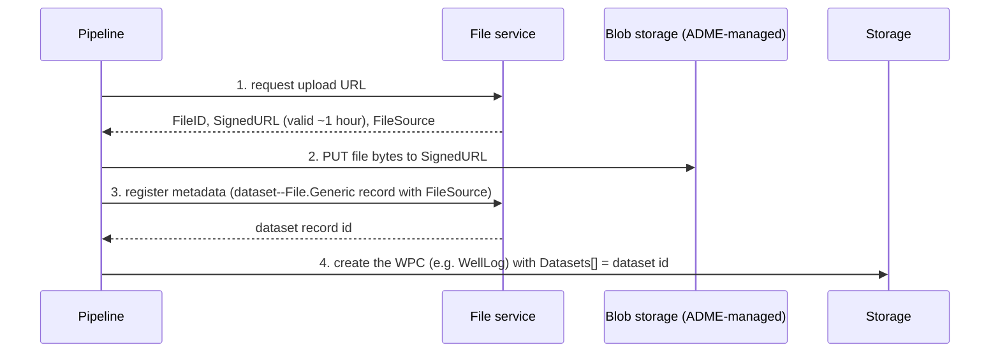

# 07 · What Goes In, What Comes Out

> **Facts as of:** October 2026 (ADME on OSDU milestone M26).
> This doc is about the **contract** ADME enforces, whichever tool loads the
> data (ADF, Databricks, partner loaders…).

## TL;DR

- Before the first record, a partition needs a few things **in place**: an
  identity with the right **service groups**, valid **legal tags**, **data
  (ACL) groups**, the **schemas** you'll use, the **reference values** you'll
  point at, and an **ID strategy**.
- Every record must carry a valid **`kind`, `acl` and `legal`**. Its links should
  point at records and reference values that **already exist**; only manifest
  ingestion enforces this.
- Every file goes in **three steps**: get a signed upload URL → upload the bytes →
  register a **dataset** record. Then a WPC points at that dataset.
- There are several **built-in routes** (direct Storage API, manifest ingestion,
  CSV parser, external data sources, DDMS APIs). They differ mainly in **how much
  the platform validates** for you.
- What comes back: **IDs and versions**, **workflow run status**, **searchable,
  governed records**, **files through signed URLs**, **domain slices from DDMS**
  and **change notifications**. Analytics export is covered in
  [doc 08](08-analytics-and-ai.md).

## 1. Before the first record: the partition checklist

| Prerequisite | Why ADME needs it | Typical owner |
|---|---|---|
| **Data partition** | Every call targets one ([doc 05](05-platform-services.md)) | Platform admin |
| **Identity with service groups** | The pipeline's app or managed identity must be in `users@{partition}…` and in groups that grant API permission for Storage, Schema, Legal, File, Workflow and Search, usually through a `users.*` bundle group ([doc 05, §4](05-platform-services.md#who-may-do-what-the-three-kinds-of-groups)) | Platform admin |
| **Legal tags** | Every record needs at least one **valid** tag. Country of origin must come from the allowed list, and an expiry date is honoured. In ADME the tag name is prefixed with the partition. | Legal / data governance |
| **Data (ACL) groups** | Every record lists owner and viewer groups, which must exist, for example `data.wells.owners` and `data.wells.viewers` | Data governance |
| **Schemas** | OSDU well-known schemas are preloaded. **Custom kinds must be registered** first. | Data architect |
| **Reference values** | FIXED and OPEN values are synced. **LOCAL values and your extensions** (for example your company's well status codes) must be loaded **before** records use them. | Data management |
| **ID strategy** | Decide how to build **stable, repeatable IDs**, for example `…:Wellbore:<source>-<UWI>`. Random IDs on every run create duplicates. | Data architect |
| **Units and CRS** | Know each source's units and coordinate system, and map them to `UnitOfMeasure` and `CoordinateReferenceSystem` reference values | Data management |

Governance decisions (which groups, which legal tags) are **data design**, not
clean-up. Records loaded without them are hard to fix later.

## 2. For every record: the entry contract

| Element | Must be | Checked by |
|---|---|---|
| `kind` | An existing schema, for example `osdu:wks:master-data--Wellbore:1.5.1` | Format by Storage; schema by manifest ingestion and the Indexer |
| `id` | Optional. If given: `{partition}:{group-type}--{Entity}:{key}`, **stable** across re-runs | Storage (format) |
| `acl.owners` / `acl.viewers` | Existing data groups, at least one each | Storage |
| `legal.legaltags` | Existing, **valid**, not expired | Storage, on write **and** on read |
| `legal.otherRelevantDataCountries` | Two-letter country codes | Storage |
| References in `data` (`…ID`) | Point at records and reference values that **exist**, using the right form (`…:key:` = latest version) | **Manifest ingestion only** |
| Values in `data` | Match the schema types | Manifest ingestion; otherwise only seen later as index errors |
| Units and CRS | Declared (`meta[]`, `…UnitID`, CRS fields); spatial data convertible to WGS 84 | Not enforced. Without them, data is ambiguous and missing from map search |
| `ancestry.parents` | For derived data, the source records | Not enforced. It drives lineage and legal inheritance. |

**Load order:** reference values → master data (Field → Well → Wellbore) →
datasets → work-product-components → work product. Children reference parents,
so parents must exist first.

## 3. For every file: three steps

- **Upload:** a single `PUT` handles files under **5 GB**. Larger files use
  `azcopy` with the same signed URL.
- **Download:** ask the File or Dataset service for a **signed download URL**.
  You never get permanent storage credentials.
- **Large or domain data:** seismic and well logs can go through their DDMS
  instead (for example Seismic Store's `sdutil`, or the Wellbore DDMS bulk APIs).
  The DDMS then owns the optimised copy.

## 4. The built-in routes

| Route | What you send | What the platform checks | Best for |
|---|---|---|---|
| **Storage API** (direct) | Batches of records (PUT) | Envelope only (groups, legal tags, permissions) | Pipelines that validate themselves; high volume; updates |
| **Manifest ingestion** (`Osdu_ingest`) | A **manifest**: `ReferenceData[]`, `MasterData[]`, then `Data` (`Datasets[]`, `WorkProductComponents[]`, `WorkProduct`) | **Schema validation, referential integrity**, dataset existence. Bad records are skipped and reported. | Curated packages; the standard OSDU way |
| **Manifest by reference** | A large manifest uploaded as a file first, then referenced | Same as manifest ingestion | Very large manifests (GA July 2026) |
| **CSV parser** | A CSV file plus a **custom schema** registered beforehand | Schema validation and type conversion. It builds row IDs from source + type + an encoded key. | Tabular extracts that you transform to well-known schemas later |
| **External Data Services (EDS)** | Registration of another OSDU platform as a source | Pulls **metadata only** on a schedule; files stay at the source until "naturalised" | Federating with partners or another OSDU instance |
| **DDMS APIs** | Domain objects and bulk data (curves, seismic, RESQML) | The DDMS's own rules, plus core access and legal checks | Bulk domain data |

All the workflow routes are **OSDU-defined Airflow workflows** that ADME runs
([doc 05, §3](05-platform-services.md#3-the-life-of-a-record-save--index--search)).
External tools (ADF, Databricks, Fabric, partner loaders) **call these same
routes**. They add orchestration, transformation and monitoring, not new ways
into ADME.

## 5. What comes out

| You get | How | Notes |
|---|---|---|
| **IDs and versions** | Response to Storage writes | Keep them for lineage and reconciliation |
| **Workflow run status** | Workflow service, polled by run ID | Lists which records were skipped and why |
| **Index status** | Search on `index.statusCode` | 200 = searchable; 400 = type problems; 404 = schema missing |
| **Discovery** | Search: text, filters, geography, nested arrays | Only what the caller may see; eventually consistent |
| **Exact retrieval** | Storage: by ID, any version | Always current |
| **Files** | File or Dataset service: signed download URL | Short-lived, per request |
| **Domain slices** | DDMS APIs: curves by depth, seismic bricks, RESQML objects | Partial reads of big data |
| **Change feed** | Notification service: subscribe to record changes | Drives downstream syncs |
| **Governance on every read** | ACL and legal checks | Including legal inheritance through `ancestry` |
| **Analytics copies** | ACZ (preview) or your own export | See [doc 08](08-analytics-and-ai.md) |

## 6. Where loads usually fail

- **Legal tag** missing, invalid, expired, or with a country not in the allowed
  list.
- **ACL group** doesn't exist in this partition, or has a typo in the email form.
- **Kind** not registered: the record is stored but unsearchable (index 404).
- **Referenced record or reference value** missing: manifest ingestion skips the
  record.
- **IDs regenerated** on each run: duplicates and broken links.
- **Reference form** inconsistent, for example a missing trailing colon:
  references don't match in search.
- **No WGS 84 coordinates**: the record doesn't appear in map queries.
- **Huge single manifest**: split it into batches or use manifest by reference.

## Common misconceptions

- *"ADME will reject bad data."* Only manifest ingestion and the CSV parser
  validate. The Storage API accepts any `data` with a valid envelope.
- *"Uploading the file is enough."* A file is invisible to users until a dataset
  record **and** a WPC describe it.
- *"ADF or Databricks are other ways into ADME."* They're orchestrators. They
  still call the Storage, File or Workflow APIs.
- *"We can sort out governance after loading."* ACLs and legal tags are
  mandatory on every record from the first write.

## Go deeper

- [Manifest-based ingestion concepts](https://learn.microsoft.com/azure/energy-data-services/concepts-manifest-ingestion) and [tutorial](https://learn.microsoft.com/azure/energy-data-services/tutorial-manifest-ingestion) (Microsoft Learn)
- [CSV parser ingestion concepts](https://learn.microsoft.com/azure/energy-data-services/concepts-csv-parser-ingestion) (Microsoft Learn)
- [Upload files with the File service](https://learn.microsoft.com/azure/energy-data-services/how-to-upload-large-files-using-file-service) (Microsoft Learn)
- [Manage legal tags](https://learn.microsoft.com/azure/energy-data-services/how-to-manage-legal-tags), [manage users](https://learn.microsoft.com/azure/energy-data-services/how-to-manage-users), [manage ACLs](https://learn.microsoft.com/azure/energy-data-services/how-to-manage-acls) (Microsoft Learn)
- [Troubleshoot manifest ingestion](https://learn.microsoft.com/azure/energy-data-services/troubleshoot-manifest-ingestion) (Microsoft Learn)
- [External Data Services](https://learn.microsoft.com/azure/energy-data-services/how-to-enable-external-data-services) (Microsoft Learn)
