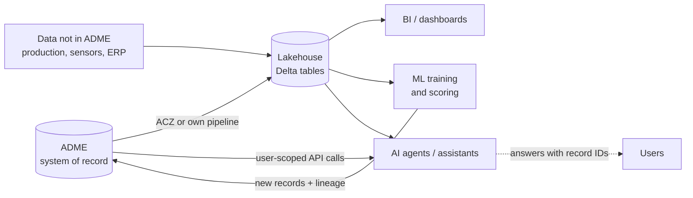

# 08 · Analytics and AI with ADME Data

> **Facts as of:** October 2026. This doc explains the
> options and patterns; step-by-step setup belongs to the later consumption section.

## TL;DR

- ADME is the **governed system of record with search**. It is **not** an
  analytics engine: it has no SQL, no joins, no custom compute, and caps results
  per query.
- For BI, ML and AI you put **curated copies** in a lakehouse (**Fabric**,
  **Databricks**, Snowflake…). That's also where you combine subsurface data with
  data that isn't in ADME, such as production, sensors, maintenance and finance.
- Two ways out: the managed **Analytics Consumption Zone (ACZ)** export to Delta
  tables (preview), or **your own pipeline** on the ADME APIs.
- **Access lists and legal tags aren't enforced in copies.** The lakehouse must
  re-apply access control.
- **Recommended defaults:**
  - **Fabric** for BI and for combining with operational data;
  - ML runs **where the data already lives**, with **Azure ML** added as GPU and
    MLOps compute (it isn't a storage location);
  - **Foundry + Azure AI Search** for generative AI;
  - seismic stays in its DDMS.
- AI works best as a loop: **read from ADME → compute → write results back as new
  records with lineage.** Agents must query ADME **as the user**.

## 1. Where analytics fits



| Need | Use ADME directly | Use a lakehouse copy |
|---|---|---|
| Find a well and open its logs in an application | ✔ | |
| Targeted lookups by ID or search | ✔ | |
| Fleet-wide statistics, joins across kinds | | ✔ |
| Combining with production or operational data | | ✔ |
| ML training on thousands of wells | | ✔ |
| Seismic deep learning | Stream from the Seismic DDMS | (GPU compute, not Delta) |

## 2. Getting data out

| Option | What it does | Status and notes |
|---|---|---|
| **Analytics Consumption Zone (ACZ)** | Managed export of chosen **catalog kinds** and **Wellbore DDMS kinds** (including curve files) to **Delta Parquet in your own ADLS Gen2**:<br/>- an initial snapshot, then **near-real-time** incremental sync;<br/>- soft deletes set `isActive = false`, and purges remove rows;<br/>- rows keep `acl` and `legal` as columns;<br/>- the sync engine runs **in ADME**, the files are in **your** storage, and Fabric, Databricks or Snowflake read them in place. | **Preview:** Developer tier only, allow list. Microsoft has how-to guides for **Fabric**, **Databricks** and **Snowflake**. |
| **Your own pipeline** | Code that calls Search, Storage and DDMS APIs and writes Delta tables. It runs in ADF or Fabric pipelines, Databricks jobs or Functions. The **Notification** service can trigger incremental syncs when records change. | Always available; you own it. No first-party "OSDU connector" exists in ADF or Fabric, so you use generic REST calls. |
| **Partner tools** | Data management and visualisation products that support ADME (Interica, Katalyst, Cegal, INT…) | Commercial products |
| **Direct reads for bulk** | Seismic: **OpenVDS** libraries read volumes stored in the Seismic DDMS (`sd://…` paths). Logs: Wellbore DDMS APIs. | Typical for ML on seismic, where a Delta copy makes little sense |

## 3. Choosing the analytics platform

ADME's side is the same for all of them (ACZ Delta files or your export), so
choose by the **customer's existing standard and skills**.

| Platform | How it connects to ACZ data | Strengths for this domain |
|---|---|---|
| **Microsoft Fabric** | A **OneLake shortcut** to the ACZ folder: no copy, query in place | **Power BI** (Direct Lake), Spark notebooks, **Real-Time Intelligence** for time series, Fabric IQ ontology (preview) for business context |
| **Azure Databricks** | **Unity Catalog** storage credential + external location + external tables | Heavy data engineering and ML (MLflow); fine-grained governance in Unity Catalog |
| **Snowflake** | **Iceberg table** over the Delta files (Delta Direct + catalog integration), refreshed automatically | When it's the corporate standard |
| **Azure Machine Learning** | Reads from the lake or directly from DDMS APIs | Model training and deployment, GPU clusters for seismic |
| **Power BI** alone | On top of Fabric or Databricks. A community OSDU Power BI connector was published (2023) for small direct queries; check its current status. | Dashboards for data managers and asset teams |

## 4. Governance when data leaves ADME

ADME enforces ACLs and legal tags only **inside ADME**. In a copy, it's up to you:

- **Decide what may leave:** a **publication rule**, for example "only kinds X, Y;
  never records with group `restricted`; never expired legal tags".
- **Re-apply access:** use Unity Catalog row filters, Fabric or OneLake security,
  or separate workspaces. ACZ keeps the `acl` and `legal` columns, so you **can**
  filter on them, but nothing does it automatically.
- **Residency:** the destination storage must be in an allowed geography. With
  ACZ, choosing it is **your** responsibility.
- **Deletes:** ACZ propagates them. Your own pipeline must handle them too.

## 5. Recommendations: what to use for which workload

The key idea is to **separate where data lives from where compute runs**:
- keep **one lake** as the home for analytical copies;
- attach compute engines to it;
- leave domain bulk data (seismic, models) in its DDMS.

| Workload | Where the data lives | Where compute runs | Recommendation |
|---|---|---|---|
| **BI and reporting**: portfolio dashboards, data completeness, data-quality KPIs | ACZ Delta files in your ADLS (read through a OneLake shortcut) or your own export in OneLake, plus curated Lakehouse tables | Fabric SQL endpoint, **Power BI Direct Lake** | **Fabric** is the default for Microsoft-centric customers. With a Databricks estate, Databricks SQL + Power BI works equally well. |
| **Combining with operational data**: production, sensors, maintenance | OneLake; streaming data in an Eventhouse | Fabric Spark, **Real-Time Intelligence** (KQL) | **Fabric.** It brings batch, streaming and BI into one place. Azure Data Explorer is the standalone alternative for time series. |
| **ML on tabular and curve data**: logs, catalogue features, reported production | The same lake: OneLake, or ADLS Gen2 under Unity Catalog | **Fabric Data Science** (notebooks, MLflow) for moderate scale; **Databricks** if it's the customer's ML platform; **Azure ML** for GPU training, managed endpoints and full MLOps | Start in the platform where the data already is. **Add Azure ML as compute** when you need GPUs, real-time endpoints or stricter MLOps. |
| **Seismic deep learning**: fault and horizon detection | **Stays in the Seismic DDMS** (OpenVDS/ZGY); no Delta copy | **Azure ML GPU clusters** (or Databricks GPU), reading through OpenVDS | Stream from the DDMS; write interpretations back to ADME |
| **Generative AI over documents and records** | Document files in ADME; a search index in **Azure AI Search** | **Microsoft Foundry** (models, Agent Service), with ADME APIs as tools | **Foundry + Azure AI Search.** Add Fabric data agents for questions over curated tables. |

**Azure ML is compute and MLOps, not storage.** It doesn't define where data
lives. It connects to existing storage through **datastores**, for example ADLS
Gen2 or **OneLake** (a supported datastore type). So the recommended
setup is:
- **one lake** (OneLake with Fabric, or ADLS + Unity Catalog with Databricks)
  as the data home;
- **Azure ML** reads from that lake when you need its capabilities, and registers
  models and lineage in its own workspace.

Copying data into a separate "ML lake" just creates another ungoverned copy.

**A pragmatic default stack** for a customer without a strong existing platform:

```text
ADME ──ACZ──▶ ADLS (Delta) ──shortcut──▶ Fabric (Lakehouse, Power BI, Real-Time Intelligence, notebooks)
                                             └──▶ Azure ML (GPU / endpoints, only when needed)
ADME documents + APIs ──────────────────────▶ Azure AI Search + Microsoft Foundry (agents)
Seismic DDMS ──OpenVDS──────────────────────▶ Azure ML GPU (seismic AI)
```

**Until ACZ is available for your tier**, replace the ACZ step with your own
export pipeline. ACZ is currently a Developer-tier preview, so production
instances can't use it yet. For example, Fabric notebooks or pipelines can call
the ADME APIs and write Delta tables directly into OneLake.

**Rules for AI on ADME data** (they apply whatever the platform):
- **Agents act as the user:** call ADME with the **user's token** (on behalf of
  the user), never a powerful service identity. Then the agent only sees what the
  user may see.
- **Search indexes carry ACLs:** if you index ADME documents into Azure AI
  Search, store each document's **ACL groups** and **filter by the user's groups**
  on every query. OSDU groups aren't Entra ID groups, so look up the user's OSDU
  groups through the Entitlements API.
- **Answers cite OSDU record IDs**, so users can verify the source.
- **Document text is untrusted input:** guard against prompt injection.
- There's **no official ADME MCP (tool) server**. Community OSDU MCP servers
  exist; assess them before use.

## 6. Closing the loop: writing results back to ADME

Anything you compute outside ADME can become **governed data** again: a cleaned
log, a predicted curve, an interpretation, or metadata extracted from documents.
Writing it back completes the loop in §1. Otherwise results stay in the
lakehouse, where nobody using ADME or domain applications will find them.
Follow these rules:

- **New records, not edits:** store results as **new** records (for example a
  predicted curve as a new WellLog). Never overwrite measured data.
- **Lineage:** set `ancestry.parents` to the input records. That gives
  traceability, and **legal status is inherited**, so if an input's legal tag
  expires, the derived result does too.
- **Mark it as machine-generated:** use `Source`, `TechnicalAssurances` or
  `ExtensionProperties` (model name and version), so users can tell
  interpretation from measurement.
- **Access control:** give derived records ACLs **at least as strict** as their
  inputs.

## Common misconceptions

- *"ACZ means ADME data is secured in Fabric or Databricks."* ACZ copies the ACL
  and legal **values**; it doesn't enforce them.
- *"We should run analytics through the Search API."* Search is for discovery. Bulk
  analytics through it hits result limits and rate limits.
- *"An AI agent with a service principal is simpler."* It is simpler, and it
  leaks data. Agents must act with the user's own permissions.
- *"Seismic ML needs everything converted to tables."* Seismic stays in bricked
  formats (OpenVDS/ZGY) and is streamed into GPU compute.
- *"We need a separate data lake for Azure ML."* Azure ML attaches to the lake
  you already have (OneLake or ADLS) through datastores.
- *"AI results are just for display."* Written back with lineage, they become
  reusable, searchable data.

## Go deeper

- [Analytics Consumption Zone concepts](https://learn.microsoft.com/azure/energy-data-services/concepts-analytics-consumption-zone) (Microsoft Learn)
- Connect ACZ to [Fabric](https://learn.microsoft.com/azure/energy-data-services/how-to-connect-analytics-consumption-zone-to-fabric), [Databricks](https://learn.microsoft.com/azure/energy-data-services/how-to-connect-analytics-consumption-zone-to-databricks), [Snowflake](https://learn.microsoft.com/azure/energy-data-services/how-to-connect-analytics-consumption-zone-to-snowflake) (Microsoft Learn)
- [OneLake shortcuts](https://learn.microsoft.com/fabric/onelake/onelake-shortcuts) (Microsoft Learn)
- [Azure Machine Learning datastores](https://learn.microsoft.com/azure/machine-learning/how-to-datastore) (Microsoft Learn)
- [Microsoft Foundry Agent Service](https://learn.microsoft.com/azure/foundry/agents/overview) (Microsoft Learn)
- [Security filters for trimming results in Azure AI Search](https://learn.microsoft.com/azure/search/search-security-trimming-for-azure-search) (Microsoft Learn)
- [OpenVDS](https://community.opengroup.org/osdu/platform/domain-data-mgmt-services/seismic/open-vds) (OSDU community)
