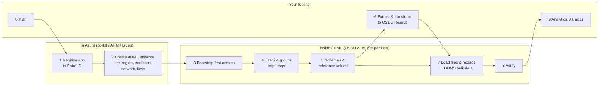

# 10 · From Zero to Data: The End-to-End Path

> **Facts as of:** October 2026. A high-level checklist: **what** to do and
> **where**, in order. It's an overview, not a detailed how-to.

## TL;DR

- Work happens in **three places**:
  - **Azure**: the app registration and the instance;
  - **inside ADME**, through the OSDU APIs and per partition: groups, legal tags,
    schemas, data;
  - **your own tooling**: extract, transform and load pipelines; analytics.
- **Azure access ≠ ADME access.** Azure roles let people manage the *resource*.
  Access to ADME's *APIs and data* comes only from **OSDU entitlement groups**
  inside each partition.
- The order matters:
  1. plan;
  2. Azure setup;
  3. access and governance;
  4. model;
  5. prepare data;
  6. load;
  7. verify;
  8. use;
  9. operate.

  Governance (groups, legal tags) must exist **before** the first record.

## The path at a glance

## The steps

| # | Step | Where | What to do | Output |
|---|---|---|---|---|
| **0** | **Plan** | Your side | Decide on: - tier and region; - **partitions** (names can't be changed or deleted later); - network exposure; - encryption keys; - **group and ACL design**; - **legal tags**; - **ID strategy**; - which data and which schemas ([07 §1](07-what-goes-in-what-comes-out.md#1-before-the-first-record-the-partition-checklist)). | Design decisions |
| **1** | **Register an app** | Azure: Entra ID | Create an **app registration** and a client secret (or certificate). Its **app (client) ID** is bound to the instance, and that app becomes **owner of every OSDU group**. Add a redirect URI if users will sign in through it. | App ID, secret |
| **2** | **Create the ADME instance** | Azure: Marketplace, portal, ARM/Bicep | Choose the subscription, resource group, region and **tier**. Enter the **app ID** and **partition names** (up to 5 at creation; more later). Then set: - **networking** (public or Private Link); - **encryption** (Microsoft-managed or customer-managed keys); - optionally **External Data Services**; - advanced settings: CORS, **upgrade policy**, LOCAL reference values. | Instance URL `https://<name>.energy.azure.com`, partitions `<name>-<partition>` |
| **2b** | Azure extras (optional) | Azure | Private endpoints, diagnostic settings for Azure Monitor, audit logs, Customer Lockbox, more partitions. Give colleagues **Azure roles** only if they manage the resource. | Secured, monitored resource |
| **3** | **Bootstrap first admins** | Inside ADME: Entitlements API | Using a token for the **instance app**, add the first admins to `users@<partition>…` and `users.datalake.ops@<partition>…`. Repeat for each partition. | People who can manage ADME access |
| **4** | **Users, groups, legal tags** | Inside ADME: Entitlements and Legal APIs, or the Admin UI add-on | - Add each person (Entra **object ID**) or pipeline (**client ID**) to `users@…`, then to a bundle such as `users.datalake.viewers` or `…editors`. - Create the **data groups** for record ACLs (owners, viewers, restricted…) and add members or team groups. - Create the **legal tags**. | Who can do what ([05 §4: how membership works](05-platform-services.md#how-membership-works)) |
| **5** | **Schemas and reference values** | Inside ADME: Schema and Storage APIs | - Use the preloaded **well-known schemas** where possible. Register **custom kinds** only if needed. - FIXED and OPEN reference values are already synced. Load your **LOCAL values and extensions** before the data that uses them. | Ready data model ([03](03-data-model.md)) |
| **6** | **Extract and transform** | Your tooling (ADF, Databricks, Fabric, partner loaders, scripts) | Profile the source, then map fields to schemas: - **stable IDs**; - units and CRS (WGS 84 for search); - reference-value IDs; - `acl` and `legal` on every record. Then split files into **dataset + WPC**. Validate here if you'll write through the Storage API. | OSDU-shaped records and files |
| **7** | **Load** | Inside ADME: File, Workflow, Storage, DDMS APIs | - Upload files: **signed URL → PUT bytes → dataset record**. - Ingest records with **manifest ingestion** (it validates) or the **Storage API**, in order: reference → master → datasets → WPCs. - Load **bulk domain data** into the DDMS:   - Wellbore DDMS for curves;   - **Seismic**: register the partition as a tenant, create subprojects, upload with `sdutil`, convert SEG-Y → OpenVDS/ZGY;   - Reservoir DDMS through ETP. | Data in ADME ([07](07-what-goes-in-what-comes-out.md), [06](06-ddms-and-extensions.md)) |
| **8** | **Verify** | Inside ADME | - Check workflow run status. - Check `index.statusCode` (reindex failures). - Compare **counts with the source**. - **Spot-check access** with a viewer and a non-member identity. | Trusted, searchable data |
| **9** | **Use** | Apps and your tooling | - Domain applications and Search for discovery. - **Export** to Fabric, Databricks or other platforms (ACZ preview or your own pipeline) and **re-apply access control** there. - AI with user-scoped access; write results back with lineage. | Value ([08](08-analytics-and-ai.md), [09](09-use-cases-and-applications.md)) |
| **10** | **Operate** | Azure + inside ADME | - Milestone upgrades (Automatic, or Deferred up to 30 days to test first). - Monitoring. - **Legal-tag expiry**. - Group membership changes. - New partitions and schema versions. | A running platform |

## Azure vs inside ADME: who manages what

| In **Azure** (Azure roles, portal, ARM) | **Inside ADME** (OSDU APIs, per partition) |
|---|---|
| App registration and secrets (Entra ID) | Users and apps as members of OSDU groups |
| The ADME resource: tier, region, partitions | Service groups (API permissions) and data groups (record ACLs) |
| Networking, Private Link, CORS | Legal tags |
| Customer-managed keys, Lockbox | Schemas and reference values |
| Monitoring, diagnostics, audit logs | Records, files, DDMS data |
| Upgrade policy | Workflow runs, index status |
| **Azure RBAC**: who may manage the resource | **Entitlements**: who may call APIs and see data |

## Common mistakes

- *Giving someone an Azure role and expecting them to see data.* They also need
  OSDU group memberships in the partition.
- *Losing control of the instance app.* Its token is the only way to bootstrap
  admins in a new partition. Keep its secret managed and rotated.
- *Naming partitions casually.* Names are permanent, and partitions can't be
  deleted.
- *Loading data before groups and legal tags exist.* Every record needs them on
  the first write.
- *Skipping verification.* "Workflow succeeded" doesn't mean everything is
  indexed, correct and visible to the right people.

## Go deeper

- [Create an ADME instance (quickstart)](https://learn.microsoft.com/azure/energy-data-services/quickstart-create-microsoft-energy-data-services-instance) (Microsoft Learn)
- [Generate auth tokens](https://learn.microsoft.com/azure/energy-data-services/how-to-generate-auth-token) and [manage users](https://learn.microsoft.com/azure/energy-data-services/how-to-manage-users) (Microsoft Learn)
- [Manage legal tags](https://learn.microsoft.com/azure/energy-data-services/how-to-manage-legal-tags) and [manage ACLs](https://learn.microsoft.com/azure/energy-data-services/how-to-manage-acls) (Microsoft Learn)
- [Manifest ingestion tutorial](https://learn.microsoft.com/azure/energy-data-services/tutorial-manifest-ingestion) and [CSV parser tutorial](https://learn.microsoft.com/azure/energy-data-services/tutorial-csv-ingestion) (Microsoft Learn)
- [Seismic DDMS tutorial](https://learn.microsoft.com/azure/energy-data-services/tutorial-seismic-ddms) and [Wellbore DDMS tutorial](https://learn.microsoft.com/azure/energy-data-services/tutorial-wellbore-ddms) (Microsoft Learn)
- [Set up Private Link](https://learn.microsoft.com/azure/energy-data-services/how-to-set-up-private-links), [customer-managed keys](https://learn.microsoft.com/azure/energy-data-services/how-to-manage-data-security-and-encryption) and [monitoring](https://learn.microsoft.com/azure/energy-data-services/how-to-monitor-data-manager-energy) (Microsoft Learn)
